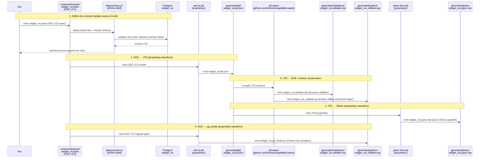
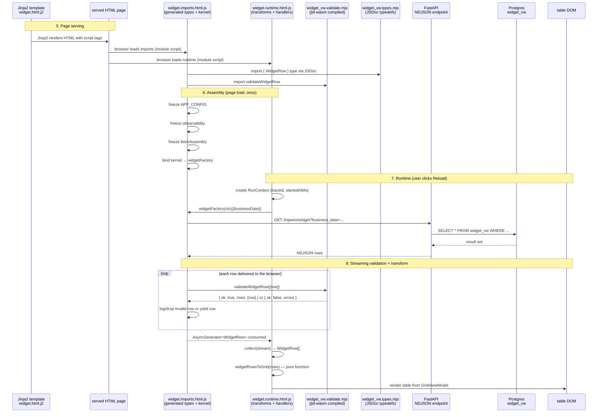

Repository plan and research notes

# Functional Fetchers: Widget View Tutorial

How to add a new screen backed by a Postgres view, following the
honest kernel pattern. Two phases: build-time generation, then
browser-time functional fetching.

## Build-Time Pipeline



## The Invariant

After `make generate`, these seven things describe the same row shape:

```text
installed Postgres view  widget_vw
   == ODC v3.0 YAML      contracts/tripwire/widget_vw.yaml
   == JTD schema         generated/jtd/widget_vw.jtd.json
   == MJS validator      generated/validators/widget_vw.validate.mjs
   == Python pg_serde    generated/python/widget_vw.pg_serde.py
   == Python helper      generated/python/widget_vw_validator.py
   == JSDoc typedef      generated/jsdoc/widget_vw.types.mjs
```

If any one drifts, `datacontract test` or `tsc --noEmit` catches it.

The **pg_serde** module is the generated Python row serializer/deserializer.
The outbound path (`row_to_jsonable`) converts typed `psycopg3` `dict_row`
values (datetime, Decimal, etc.) into the canonical JSON wire representation
that the browser MJS validator expects. Without it, `json.dumps(...,
default=str)` silently erases contract types into strings, and the browser
validator correctly rejects them.

The inbound path (`jsonable_to_row`) is a no-op pass-through:

```python
# Tripwire is a read-only analytics surface; no inbound write path exists.
# The deserializer is present so pg_serde is a true serde, not a one-way
# serializer. If Tripwire ever accepts data, this path becomes real.
def jsonable_to_row(obj: dict[str, object]) -> dict[str, object]:
    return obj
```

## Canonical transport rule

Tripwire is a data/analytics frontend, not a business DTO layer.

For view-backed endpoints, the canonical transport is:

```text
Predicate -> NDJSON Row stream
```

That means:

- no `{ rows: [...] }`
- no `{ data: [...] }`
- no `{ results: [...] }`
- no page-shaped summary wrapper for relational transports

A summary endpoint must returns a single jsonl record. 

Do not add hot-path transport ceremony such as:

- `Object.freeze(...)`
- `rows.slice()`
- defensive cloning
- immutable snapshot wrappers

unless a measured production issue proves necessity.

## Browser-Time Pipeline



## FastAPI / psycopg3 side

Keep the backend thin.

- Use modern `psycopg3`
- Prefer `dict_row`
- Serialize rows through the **generated pg_serde** module, not `json.dumps(..., default=str)`
- Stream JSONL / NDJSON directly
- Do not reshape view rows into page DTOs on the server

Conceptually:

```text
psycopg3 dict_row -> generated pg_serde -> JSONL row stream -> browser MJS validator -> pure transform
```

The generated `pg_serde` module converts typed Python values (datetime →
RFC 3339 string, Decimal → JSON number, etc.) into the canonical wire
representation that the browser MJS validator expects. This is not a DTO
layer; it is a contract-aligned serialization boundary. The ODC logical types
drive what each field becomes on the wire:

| ODC logicalType | psycopg3 Python type | pg_serde wire output | JTD type   |
|-----------------|---------------------|----------------------|------------|
| `timestamp`     | `datetime`          | RFC 3339 string      | `timestamp`|
| `number`        | `Decimal` / `float` | JSON number          | `float64`  |
| `integer`       | `int`               | JSON integer         | `int32`    |
| `boolean`       | `bool`              | JSON boolean         | `boolean`  |
| `string`        | `str`               | JSON string          | `string`   |

Without `pg_serde`, `json.dumps(..., default=str)` silently turns timestamps
and decimals into untyped strings, and the browser validator correctly rejects
them. The generated serializer closes this gap.

For Tripwire screens, browser-side MJS validation is the primary runtime trust
boundary because the data engineer can inspect dropped rows and validator errors
in Chrome DevTools / console during screen work. Server-side Python validation
may still exist as an offline/helper artifact, but it is not required in the hot
path for a thin streaming adapter.

## Vanilla JS + JSDoc + tsc --noEmit

There is no TypeScript compiler in the browser path. There is no bundler.
The `.mjs` and `.html.js` files are vanilla JavaScript that runs directly
in modern Chrome and Edge.

JSDoc annotations reference the generated typedefs:

```javascript
// widget.imports.html.js
import { validateWidgetRow } from '../generated/validators/widget_vw.validate.mjs';

/** @typedef {import('../generated/jsdoc/widget_vw.types.mjs').WidgetRow} WidgetRow */

/**
 * @param {AppConfig} config
 * @param {Observability} obs
 * @param {FetchAssembly} fetchAsm
 * @param {RunContext} ctx
 * @param {{ businessDate: string }} input
 * @returns {AsyncGenerator<WidgetRow>}
 */
async function* widgetKernel(config, obs, fetchAsm, ctx, input) {
  const url = `${config.apiBase}/tripwire/widget?business_date=${input.businessDate}`;
  for await (const row of fetchAsm.fetchNdjson(url, ctx)) {
    const result = validateWidgetRow([row]);
    if (result.ok) yield result.rows[0];
  }
}
```

Static proof runs as a separate build step, never at runtime:

```bash
mise exec -- npx -y -p typescript@latest tsc -p tripwire/test/js/tsconfig.json
```

`tsc` reads `.js` and `.mjs` files via `allowJs: true, checkJs: true`, resolves
the JSDoc `@typedef` imports against the generated types, and reports mismatches.
`--noEmit` means no output artifacts — it is a pure proof tool.

This gives you the same type safety as TypeScript without any transpilation,
bundling, or build-to-run dependency. The browser runs exactly the file you
wrote.

## Jinja2 HTML Template

FastAPI serves the page via a Jinja2 template that wires in the vanilla JS:

```html
{# templates/widget.html.j2 #}


<script type="module" src="/static/screens/widget.imports.html.js"></script>
<script type="module" src="/static/screens/widget.runtime.html.js"></script>

```

No webpack. No node_modules at runtime. The J2 template is a thin shell that
loads module scripts. The scripts import generated validators and types directly
via browser-native ES module resolution.

## Unit Testing the Kernel

The kernel is a pure function (all dependencies injected). Test it by
supplying fakes.

The transform is even simpler — no fakes needed, just rows in, grid out.

## Typed Streaming with JSDoc + tsc --noEmit

The fetch path should expose an `AsyncGenerator<WidgetRow>` so the browser can:

- validate incrementally
- drop/log bad rows locally
- progressively aggregate
- progressively render

A helper may still collect the stream into a typed array when the UI needs a
full snapshot.

## Full Pipeline Summary

```text
BUILD TIME                         BROWSER TIME
──────────                         ────────────
widget_vw.yaml (ODC v3.0)         widget.html.j2 serves page
  │                                  │
  ├─→ datacontract-cli proves DB     ├─→ widget.imports.html.js
  │                                  │     imports generated validator
  ├─→ odc-to-jtd (proprietary)      │     imports generated JSDoc types
  │     → widget_vw.jtd.json        │     defines widgetKernel
  │                                  │     assembles widgetFactory
  ├─→ jtd-wasm                       │
  │     → widget_vw.validate.mjs    ├─→ widget.runtime.html.js
  │     → widget_vw_validator.py    │     pure transforms over rows
  │                                  │     progressively updates DOM
  ├─→ pg_serde-from-odc              │
  │     → widget_vw.pg_serde.py     └─→ DOM: validated Row stream → grid
  │     (Python row serializer)
  └─→ jsdoc-from-jtd (proprietary)
        → widget_vw.types.mjs

RUNTIME TRANSPORT:
  view-backed endpoint -> generated pg_serde -> NDJSON row stream

PRIMARY RUNTIME TRUST BOUNDARY:
  browser MJS validator
```

## Trust Boundary

```text
unknown row JSON
  -> generated browser validator
  -> WidgetRow values
  -> pure transform
  -> DOM
```

The validator the browser runs was compiled from the same JTD that was
generated from the same ODC contract that was proven against the Postgres
view. One source of truth, mechanically propagated.

---

Canonical design doc: `tripwire/HONEST_KERNEL_FUNCTIONAL_FETCHERS.md`
---

## Follow-up: Generalise ODC sources — contract first, source adapter second

The generated contract artifacts must not hardcode an HTTP fetcher as the primary abstraction.

The real abstraction is:

```text
ODC contract
  -> generated row schema artifacts
  -> source-specific adapter that honours the contract
  -> validator boundary
  -> pure kernel
```

The physical source is intentionally immaterial. A contract may be honoured by:

- a DBA-installed Postgres view
- a DuckDB table/view
- an IndexedDB object store
- an Avro stream/file
- an S3 JSONL/NDJSON export
- an in-memory JavaScript array
- a Python iterator
- a mashup tool that simulates prepared-statement predicates
- anything else `datacontracts-cli` can validate, sync, or generate against

The generated contract artifacts must remain source-neutral:

- ODC YAML is the source of truth
- ODC → JTD
- JTD → MJS validator
- JTD → Python validator / serde
- JTD → JSDoc typedef
- optional ODC → backend-specific DDL / Avro / dbt / SQL / etc.

The generated `fetcher.mjs` should therefore be renamed or reframed as a **contract client** or **row source runner**, not an HTTP fetcher.

It should depend on an injected adapter interface, for example:

```js
/**
 * @template TPredicate
 * @template TRow
 * @typedef {object} ContractRowSource
 * @property {(predicate: TPredicate, ctx?: unknown) => AsyncIterable<unknown> | Promise<Iterable<unknown>>} readRows
 */
```

The generated code may provide:

```js
/**
 * @param {ContractRowSource<MblAuditPredicate, unknown>} source
 * @param {MblAuditPredicate} predicate
 * @param {Observability} observability
 * @returns {AsyncGenerator<MblAuditSheetDiffVwRow>}
 */
export async function* readMblAuditSheetDiffVwRows(source, predicate, observability = {}) {
  for await (const row of await source.readRows(predicate)) {
    const result = MblAuditSheetDiffVwValidator.validateRows([row]);
    if (!result.ok) {
      observability.error?.("mbl_audit_sheet_diff_vw.row.invalid", { errors: result.errors });
      continue;
    }
    yield result.rows[0];
  }
}
```

Then separate adapters provide the physical implementation:

```js
export const httpNdjsonSource = {
  async *readRows(predicate) {
    // build URL, fetch NDJSON, yield objects
  }
};

export const indexedDbSource = {
  async *readRows(predicate) {
    // open IndexedDB, apply predicate, yield objects
  }
};

export const memorySource = {
  async *readRows(predicate) {
    // filter globalThis.MBL_AUDIT_DATA, yield objects
  }
};
```

For Python, the equivalent is:

```py
class ContractRowSource(Protocol):
    def read_rows(self, predicate: Mapping[str, object]) -> Iterable[Mapping[str, object]]:
        ...
```

The important rule:

> Generated contract code validates and types rows.
> Source adapters acquire rows.
> Kernels transform validated rows.
> No layer should assume the physical substrate unless it is explicitly an adapter.

For MBL audit specifically, `MBL_AUDIT_DATA` should be treated as one possible source adapter over the `mbl_audit_sheet_diff_vw` contract, not as a special-case page DTO. IndexedDB is just a local execution engine that happens to honour the same ODC contract.

This gives us turtles all the way down:

```text
ODC contract
  -> generated JSON/JTD schema
    -> generated validators / serde / typedefs
      -> source-neutral contract reader
        -> physical adapter: postgres | indexeddb | avro | memory | s3 | duckdb | py
          -> validated row stream
            -> honest kernel pure transforms
              -> runtime renderer
```

### New Task 0 — Introduce source-neutral ContractRowSource abstraction

- [ ] Rename conceptual generated fetcher API from “fetch rows over HTTP” to “read rows from a contract source”.
- [ ] Define `ContractRowSource<TPredicate, TRow>` in generated JS/JSDoc terms.
- [ ] Keep validation in generated contract code.
- [ ] Move HTTP URL/NDJSON logic into an adapter.
- [ ] Move IndexedDB logic into an adapter.
- [ ] Ensure MBL audit uses the same generated contract reader as any future Postgres/Avro/DuckDB-backed screen.
- [ ] Add a test proving the same contract reader accepts rows from memory adapter, IndexedDB adapter, and HTTP/NDJSON adapter if already available.
- [ ] Add documentation saying physical storage is not part of the ODC contract; it is an implementation of the contract.

### Revised principle

Do **not** generate “the fetcher”.

Generate **the contract reader**.

Then plug in whatever source can produce rows that claim to honour the contract. The validator is the trust boundary.


---

## Historical footnote

Content present in earlier revisions of this document but absent from the
newest version, preserved verbatim from the capture (pairwise reduction
newest → oldest). Each chunk is labelled with the revision it last appeared
in. Nothing here is current guidance — it is lost-idea recovery for the later
extraction passes.

### Canonical transport alternative — `Predicate -> Row[]` (last in 97b69a5)

For view-backed endpoints, the canonical transport is:

```text
Predicate -> Row[]
```

or, when the screen benefits from progressive delivery:

```text
Predicate -> NDJSON Row stream
```

### Aggregates and synthesized endpoints (last in 97b69a5)

Aggregates and synthesized endpoints are different. A true summary endpoint may
return an object such as:

```json
{
  "high_water_mark": "...",
  "status_counts": {"completed": 12},
  "recent_errors": []
}
```

because that object is not a view row transport.

### Forbidden patterns (last in 97b69a5)

### Forbidden patterns

The following patterns are forbidden in Tripwire and should be deleted during touch/refactor work.

#### Forbidden transport envelopes

Do not return:

```json
{ "rows": [...] }
{ "data": [...] }
{ "runs": [...] }
{ "ops": [...] }
{ "sensors": [...] }
```

View-backed endpoints return only `Row[]` or an NDJSON row stream.

#### Forbidden dual-path runtime logic

Delete code maintaining:

- old envelope transport
- compatibility transport
- transformed intermediate transport
- parallel transport shapes

There must be one transport path only:

```text
wire row -> validate -> render
```

#### Forbidden immutable transport ceremony

Do not add hot-path transport ceremony such as:

- `Object.freeze(...)`
- `rows.slice()`
- defensive cloning
- immutable snapshot wrappers

unless a measured production issue proves necessity.

#### Forbidden compatibility preservation

When replacing the architecture:

- replace it
- delete the old path
- remove old assumptions
- remove dead adapters

Do not preserve transitional compatibility layers.

### Build-Time Toolchain (last in 42da4f6)

### Build-Time Toolchain

| Step | Tool | Status |
|---|---|---|
| ODC v3.0 contract authoring | You write YAML | Manual |
| Contract ↔ Postgres proof | [datacontract-cli](https://github.com/datacontract/datacontract-cli) | Off-the-shelf, not vendored |
| ODC → JTD | `odc-to-jtd` | Proprietary — see internal tooling docs |
| JTD → MJS validator | [jtd-wasm](https://github.com/livemorecapital/jtd-wasm) | LiveMore open-source |
| JTD → Python validator | [jtd-wasm](https://github.com/livemorecapital/jtd-wasm) | LiveMore open-source |
| JTD → JSDoc typedef | `jsdoc-from-jtd` | Proprietary — see internal tooling docs |

### Unit Testing the Kernel — code examples (last in 42da4f6)

```javascript
// test/js/widget_kernel.test.mjs
import { describe, it } from 'node:test';
import assert from 'node:assert/strict';

describe('widgetKernel', () => {
  it('yields validated frozen rows', async () => {
    const fakeConfig = Object.freeze({ apiBase: '' });
    const fakeObs = Object.freeze({ span: () => ({ end() {} }) });
    const fakeFetch = Object.freeze({
      fetchJson: async () => [
        { widget_id: 1, widget_name: 'Sprocket', price: 9.99 },
      ],
    });
    const ctx = Object.freeze({ traceId: 'test', startedAtMs: 0 });

    const results = [];
    for await (const row of widgetKernel(fakeConfig, fakeObs, fakeFetch, ctx, { businessDate: '2026-01-01' })) {
      results.push(row);
    }

    assert.equal(results.length, 1);
    assert.equal(results[0].widget_name, 'Sprocket');
    assert.throws(() => { results[0].widget_name = 'Mutated'; }); // frozen
  });
});
```

The transform is even simpler — no fakes needed, just rows in, grid out:

```javascript
describe('widgetRowsToGrid', () => {
  it('maps rows to column+row grid', () => {
    const rows = [Object.freeze({ widget_name: 'Sprocket', price: 9.99 })];
    const grid = widgetRowsToGrid(rows);
    assert.deepEqual(grid.columns, ['widget_name', 'price']);
    assert.deepEqual(grid.rows[0], ['Sprocket', 9.99]);
  });
});
```

### Typed Streaming with JSDoc + tsc --noEmit — stream wrapper, collect, mount, type chain (last in 42da4f6)

The generated fetcher returns a validated `ReadonlyArray`. To get an
`AsyncGenerator` that yields typed frozen rows one at a time, wrap it:

```javascript
// components/widget_tile.mjs

/** @typedef {import('../generated/jsdoc/widget_vw.types.mjs').WidgetRow} WidgetRow */
/** @typedef {{fetchJson: (url: string) => Promise<unknown>}} FetchAssembly */
/** @typedef {{info?: (msg: string, attrs?: Record<string, unknown>) => void, error?: (msg: string, attrs?: Record<string, unknown>) => void}} Observability */

/**
 * @param {string} endpoint
 * @param {Readonly<Record<string, string>>} predicate
 * @param {FetchAssembly} fetchAssembly
 * @param {Observability} observability
 * @returns {AsyncGenerator<WidgetRow>}
 */
export async function* fetchWidgetRowsStream(endpoint, predicate, fetchAssembly, observability) {
  const rows = await fetchWidgetVwRows(endpoint, predicate, fetchAssembly, observability);
  for (const row of rows) yield Object.freeze(row);
}
```

The generated fetcher (`fetchWidgetVwRows`) already validates each row
via the generated `.validator.mjs` (compiled from `.jtd.json`). The
stream wrapper adds freeze-per-row and exposes an `AsyncGenerator<WidgetRow>`
return type that `tsc` can trace.

Collect the stream into a frozen typed array:

```javascript
/** @param {AsyncIterable<WidgetRow>} stream @returns {Promise<ReadonlyArray<WidgetRow>>} */
async function collectRows(stream) {
  const rows = [];
  for await (const row of stream) rows.push(row);
  return Object.freeze(rows);
}
```

The mount function wires everything with a RunContext:

```javascript
import { createRunContext, observed } from './lib/run_context.js';

export async function mountWidgetTile({ element, href }) {
  const runContext = createRunContext('widget_tile');
  const rows = await collectRows(fetchWidgetRowsStream(
    '/api/views/widget_vw',
    widgetPredicateFromUrl(href),
    Object.freeze({ fetchJson }),
    observed(runContext, 'widget_tile'),
  ));
  const model = widgetRowsToTileModel(rows);  // pure transform
  element.textContent = String(model.total);
}
```

#### The type chain tsc proves

```text
generated/jsdoc/widget_vw.types.mjs   defines  WidgetRow
                     ↓
@typedef import in widget_tile.mjs     references it
                     ↓
fetchWidgetRowsStream                  returns  AsyncGenerator<WidgetRow>
                     ↓
collectRows                            accepts  AsyncIterable<WidgetRow>
                     ↓
                                       returns  Promise<ReadonlyArray<WidgetRow>>
                     ↓
widgetRowsToTileModel                  accepts  ReadonlyArray<WidgetRow>
                     ↓
                                       returns  frozen TileModel
```

Run the proof:

```bash
tsc --allowJs --checkJs --noEmit --strict \
  --moduleResolution node \
  components/widget_tile.mjs
```

This checks JSDoc types across the full chain without emitting any
output. The browser runs the exact `.mjs` file you wrote — no
transpilation, no bundler, no build-to-run dependency. If the
generated typedef changes shape (because the ODC contract changed),
`tsc` catches the mismatch at build time.

### PROOF block in Full Pipeline Summary (last in 42da4f6)

```text
PROOF (offline, not runtime):
  tsc --noEmit checks JSDoc against generated types
```
