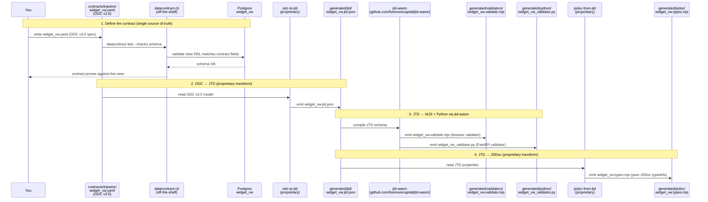
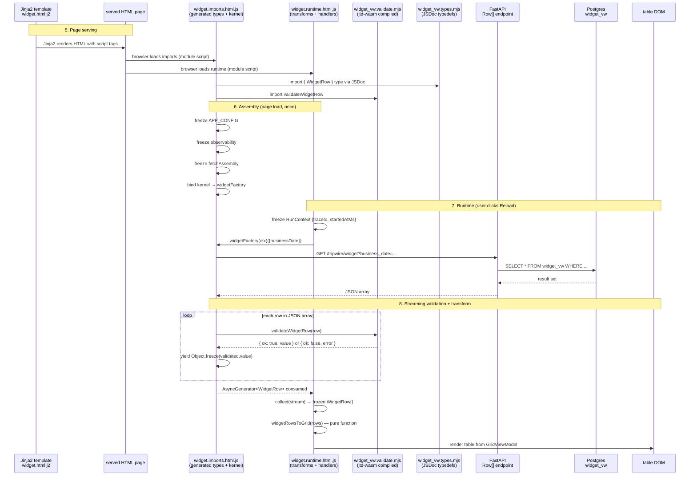

# Functional Fetchers: Widget View Tutorial

How to add a new screen backed by a Postgres view, following the
honest kernel pattern. Two phases: build-time generation, then
browser-time functional fetching.

## Build-Time Pipeline



## The Invariant

After `make generate`, these six things describe the same row shape:

```text
installed Postgres view  widget_vw
   == ODC v3.0 YAML      contracts/tripwire/widget_vw.yaml
   == JTD schema          generated/jtd/widget_vw.jtd.json
   == MJS validator       generated/validators/widget_vw.validate.mjs
   == Python validator    generated/python/widget_vw_validator.py
   == JSDoc typedef       generated/jsdoc/widget_vw.types.mjs
```

If any one drifts, `datacontract test` or `tsc --noEmit` catches it.

## Build-Time Toolchain

| Step | Tool | Status |
|---|---|---|
| ODC v3.0 contract authoring | You write YAML | Manual |
| Contract ↔ Postgres proof | [datacontract-cli](https://github.com/datacontract/datacontract-cli) | Off-the-shelf, not vendored |
| ODC → JTD | `odc-to-jtd` | Proprietary — see internal tooling docs |
| JTD → MJS validator | [jtd-wasm](https://github.com/livemorecapital/jtd-wasm) | LiveMore open-source |
| JTD → Python validator | [jtd-wasm](https://github.com/livemorecapital/jtd-wasm) | LiveMore open-source |
| JTD → JSDoc typedef | `jsdoc-from-jtd` | Proprietary — see internal tooling docs |

## Browser-Time Pipeline



## Vanilla JS + JSDoc + tsc --noEmit

There is no TypeScript compiler in the browser path. There is no bundler.
The `.mjs` and `.html.js` files are vanilla JavaScript that runs directly
in modern Chrome and Edge.

JSDoc annotations reference the generated typedefs:

```javascript
// widget.imports.html.js
import { validateWidgetRow } from '../generated/validators/widget_vw.validate.mjs';

/** @typedef {import('../generated/jsdoc/widget_vw.types.mjs').WidgetRow} WidgetRow */

/**
 * @param {AppConfig} config
 * @param {Observability} obs
 * @param {FetchAssembly} fetchAsm
 * @param {RunContext} ctx
 * @param {{ businessDate: string }} input
 * @returns {AsyncGenerator<WidgetRow>}
 */
async function* widgetKernel(config, obs, fetchAsm, ctx, input) {
  const url = `${config.apiBase}/tripwire/widget?business_date=${input.businessDate}`;
  const rows = await fetchAsm.fetchJson(url, ctx);
  for (const row of rows) {
    const result = validateWidgetRow(row);
    if (result.ok) yield Object.freeze(result.value);
  }
}
```

Static proof runs as a separate build step, never at runtime:

```bash
mise exec -- npx -y -p typescript@latest tsc -p tripwire/test/js/tsconfig.json
```

`tsc` reads `.js` and `.mjs` files via `allowJs: true, checkJs: true`, resolves
the JSDoc `@typedef` imports against the generated types, and reports mismatches.
`--noEmit` means no output artifacts — it is a pure proof tool.

This gives you the same type safety as TypeScript without any transpilation,
bundling, or build-to-run dependency. The browser runs exactly the file you
wrote.

## Jinja2 HTML Template

FastAPI serves the page via a Jinja2 template that wires in the vanilla JS:

```html
{# templates/widget.html.j2 #}


<script type="module" src="/static/screens/widget.imports.html.js"></script>
<script type="module" src="/static/screens/widget.runtime.html.js"></script>

```

No webpack. No node_modules at runtime. The J2 template is a thin shell that
loads module scripts. The scripts import generated validators and types directly
via browser-native ES module resolution.

## Unit Testing the Kernel

The kernel is a pure function (all dependencies injected). Test it by
supplying fakes:

```javascript
// test/js/widget_kernel.test.mjs
import { describe, it } from 'node:test';
import assert from 'node:assert/strict';

describe('widgetKernel', () => {
  it('yields validated frozen rows', async () => {
    const fakeConfig = Object.freeze({ apiBase: '' });
    const fakeObs = Object.freeze({ span: () => ({ end() {} }) });
    const fakeFetch = Object.freeze({
      fetchJson: async () => [
        { widget_id: 1, widget_name: 'Sprocket', price: 9.99 },
      ],
    });
    const ctx = Object.freeze({ traceId: 'test', startedAtMs: 0 });

    const results = [];
    for await (const row of widgetKernel(fakeConfig, fakeObs, fakeFetch, ctx, { businessDate: '2026-01-01' })) {
      results.push(row);
    }

    assert.equal(results.length, 1);
    assert.equal(results[0].widget_name, 'Sprocket');
    assert.throws(() => { results[0].widget_name = 'Mutated'; }); // frozen
  });
});
```

The transform is even simpler — no fakes needed, just rows in, grid out:

```javascript
describe('widgetRowsToGrid', () => {
  it('maps rows to column+row grid', () => {
    const rows = [Object.freeze({ widget_name: 'Sprocket', price: 9.99 })];
    const grid = widgetRowsToGrid(rows);
    assert.deepEqual(grid.columns, ['widget_name', 'price']);
    assert.deepEqual(grid.rows[0], ['Sprocket', 9.99]);
  });
});
```

## Full Pipeline Summary

```text
BUILD TIME                         BROWSER TIME
──────────                         ────────────
widget_vw.yaml (ODC v3.0)         widget.html.j2 serves page
  │                                  │
  ├─→ datacontract-cli proves DB     ├─→ widget.imports.html.js
  │                                  │     imports generated validator
  ├─→ odc-to-jtd (proprietary)      │     imports generated JSDoc types
  │     → widget_vw.jtd.json        │     defines widgetKernel
  │                                  │     assembles widgetFactory
  ├─→ jtd-wasm                       │
  │     → widget_vw.validate.mjs    ├─→ widget.runtime.html.js
  │     → widget_vw_validator.py    │     widgetRowsToGrid (pure)
  │                                  │     onReloadClick handler
  └─→ jsdoc-from-jtd (proprietary)  │
        → widget_vw.types.mjs       └─→ DOM: validated Row[] → table

PROOF (offline, not runtime):
  tsc --noEmit checks JSDoc against generated types
```

## Trust Boundary

```text
unknown JSON
  → jtd-wasm compiled validator (from ODC v3.0 → JTD → MJS)
  → frozen WidgetRow[]
  → pure transform
  → DOM
```

The validator the browser runs was compiled from the same JTD that was
generated from the same ODC contract that was proven against the Postgres
view. One source of truth, mechanically propagated.

---

Canonical design doc: `tripwire/HONEST_KERNEL_FUNCTIONAL_FETCHERS.md`
