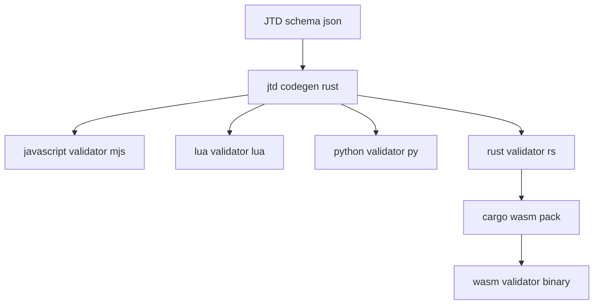
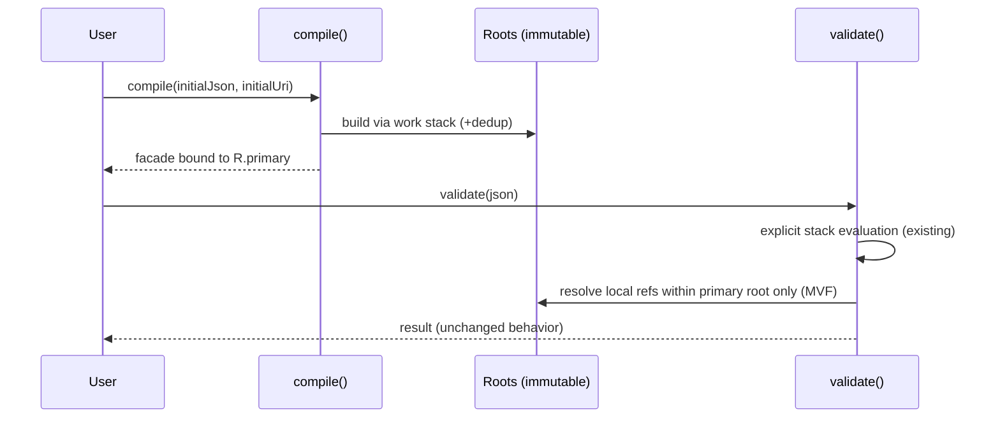
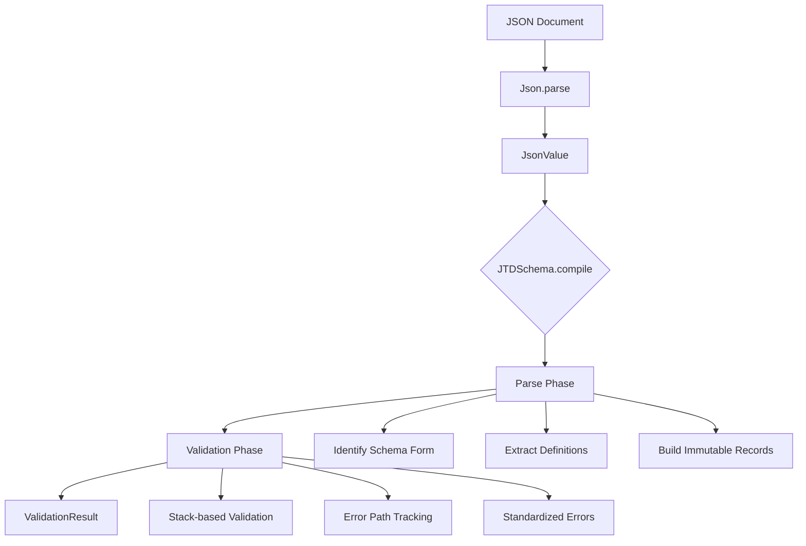
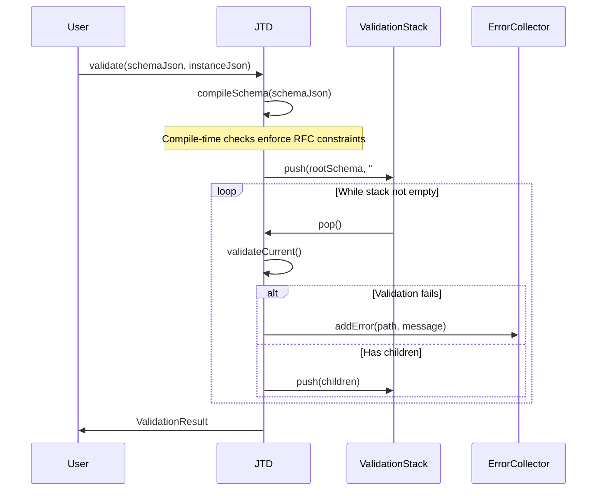
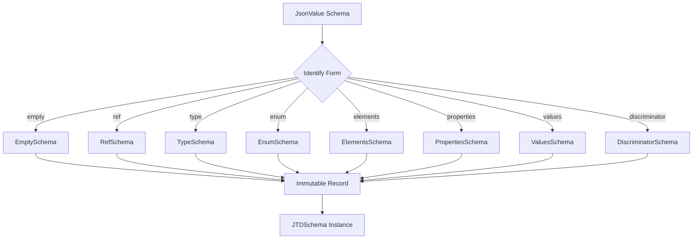

# Supplementals — verbatim standalone extracts from adjacent sources

Pre-triaged adjacent material for the later margin-note passes. Every chunk is
a whole-chunk verbatim copy with provenance. Primary sources live alongside in
this directory; boilerplate is indexed as excluded.

Whole-file extracts: every source below is wholly relevant to the elaboration
domain (typed validators, JTD codegen, no-framework architecture, exhaustive
switches, sealed types, build/test policy, design rules), so each extract is the
complete file verbatim with its own headings demoted one level (# becomes ##,
## becomes ###) so this file's structure stays navigable. Code blocks are
untouched.

---

## JTD RFC repo AGENTS — D_jtd_repo/AGENTS.md

Origin: prompt-cult/json-type-definition-RFC-8927 — <https://raw.githubusercontent.com/prompt-cult/json-type-definition-RFC-8927/master/AGENTS.md>

## AGENTS.md

### Purpose & Scope
Operational guidance for human and AI agents working in `jtd-wasm`. This document supplements the user-facing `README.md` and `JTD_CODEGEN_SPEC.md` with developer-centric workflows and policies.

### Operating Principles
- **Zero Tolerance for Warnings**: `xmake run check` (fmt + clippy) must pass before any commit.
- **Mandatory Verification**: Run `xmake run test_all` before verifying a task complete.
- **Cross-Platform Compatibility**: Ensure `xmake run test_all` passes on macOS and Linux.
- **Windows Policy**: See "Windows Testing Strategy" below.

### Testing Strategy

#### 1. Compatibility Suite
We validate against the official [json-typedef-spec](https://github.com/jsontypedef/json-typedef-spec) test suite.
- **Source**: `.tmp/json-typedef-spec` (fetched via `xmake run fetch_suite`)
- **Verification**: SHA256 checksums enforce suite integrity.

#### 2. Supported Targets & Environments
- **Rust (Native)**: Tested on all platforms (macOS, Linux, Windows).
- **WebAssembly (WASI)**: Tested on all platforms via `wasmtime`.
- **JavaScript (ESM)**: Tested on macOS/Linux via `quickjs-rs`.
- **Lua (5.1/LuaJIT)**: Tested on all platforms via `mlua` + `dkjson`.
- **Python (3.11+)**: Tested on macOS/Linux via `python3` subprocess.

#### 3. Windows Testing Strategy
We strictly enforce **Rust → Rust** and **Rust → WASM** correctness on Windows. However, we **skip JavaScript validation tests on Windows** (`test_js` target).

**Reasoning:**
- **Not a workaround**: This is an intentional policy, not a temporary hack.
- **Core Value**: Our primary deliverable for Windows users is the Rust-based code generator. The generated JavaScript logic is identical across all platforms (it is deterministic string emission).
- **Tooling Limitations**: The `quickjs-rs` crate (our test harness for JS) does not currently compile on MSVC Windows. We decline to maintain a complex C/C++ build toolchain just to run the JS test harness on Windows when the generator logic is already verified on Linux/macOS.
- **Confidence**: Since `jtd-codegen` produces identical output regardless of the host OS, verifying the JS output on Linux/macOS provides sufficient confidence for Windows users deploying that same JS code.
- **Full-Stack Rust**: Windows users targeting the browser should prefer our **WASM** path (`Rust -> Rust -> WASM`), which is fully tested and supported on Windows.

### Development Workflows

#### Running Tests
```bash
# Full suite (fmt, clippy, fetch spec, run all tests)
xmake run test_all

# Specific targets
xmake run test_rust
xmake run test_js   # Skips on Windows
xmake run test_lua
xmake run test_py
xmake run test_wasm
```

#### Git Hooks
Install the pre-commit hook to prevent accidental regressions:
```bash
xmake run install_hooks
```

#### Release Process
1. Bump version in `jtd-codegen/Cargo.toml`.
2. Commit and tag: `git tag release/x.y.z`.
3. Push tag: `git push origin release/x.y.z`.
4. GitHub Actions will build and attach binaries for macOS, Linux, and Windows.


---

## JTD RFC repo JTD_CODEGEN_SPEC — D_jtd_repo/JTD_CODEGEN_SPEC.md

Origin: prompt-cult/json-type-definition-RFC-8927 — <https://raw.githubusercontent.com/prompt-cult/json-type-definition-RFC-8927/master/JTD_CODEGEN_SPEC.md>

## JTD Code Generation Specification

A language-independent specification for compiling RFC 8927 JSON Type Definition
schemas into target-language source code that validates JSON documents. The
generated code contains exactly the checks the schema requires -- no
interpreter, no AST, no runtime stack, no dead code.

### 1. Terminology

| Term | Meaning |
|---|---|
| **schema** | A JSON object conforming to RFC 8927. |
| **instance** | The JSON value being validated at runtime. |
| **form** | One of the 8 mutually-exclusive schema shapes defined in RFC 8927 plus the nullable modifier. |
| **AST node** | An immutable, tagged value representing one compiled schema form. Used during generation, discarded after. |
| **error** | A pair of JSON Pointers: `(instancePath, schemaPath)`. |
| **definitions** | A flat string-keyed map of named AST nodes, resolved at compile time. Each becomes a generated function. |

### 2. Overview

A JTD code generator operates in two phases:

1. **Parse**: Read the JTD schema JSON and compile it into an intermediate
   AST of immutable nodes (Section 3).
2. **Emit**: Walk the AST and emit target-language source code. Each AST
   node maps to a specific code pattern. The AST is discarded after
   emission (Section 5).

The generated code is a standalone validation function. When executed against
a JSON instance, it produces the same `(instancePath, schemaPath)` error
pairs that RFC 8927 Section 3.3 specifies.

### 3. Intermediate AST

The AST is used only during generation. It is not present in the output.

#### 3.1 Node Types

```
Node =
  | Empty                                                -- {}
  | Ref        { name: String }                          -- {"ref": "..."}
  | Type       { type: TypeKeyword }                     -- {"type": "..."}
  | Enum       { values: List<String> }                  -- {"enum": [...]}
  | Elements   { schema: Node }                          -- {"elements": ...}
  | Properties { required:   Map<String, Node>,          -- {"properties": ...}
                 optional:   Map<String, Node>,           -- {"optionalProperties": ...}
                 additional: Boolean }                     -- {"additionalProperties": ...}
  | Values     { schema: Node }                          -- {"values": ...}
  | Discrim    { tag: String, mapping: Map<String,Node>} -- {"discriminator":...,"mapping":...}
  | Nullable   { inner: Node }                           -- any form + "nullable": true
```

`TypeKeyword` is one of the 12 strings defined in RFC 8927 Section 2.2.3:

```
TypeKeyword = boolean | string | timestamp
            | int8 | uint8 | int16 | uint16 | int32 | uint32
            | float32 | float64
```

#### 3.2 Compilation Algorithm

```
compile(json, isRoot=true, definitions) -> Node:

  REQUIRE json is a JSON object

  IF isRoot:
    IF json has key "definitions":
      REQUIRE json["definitions"] is a JSON object
      -- Pass 1: register all keys as placeholders for forward refs
      FOR EACH key in json["definitions"]:
        definitions[key] = PLACEHOLDER
      -- Pass 2: compile each definition
      FOR EACH key in json["definitions"]:
        definitions[key] = compile(json["definitions"][key], isRoot=false, definitions)
  ELSE:
    REQUIRE json does NOT have key "definitions"

  -- Detect form
  forms = []
  IF json has "ref":           forms += "ref"
  IF json has "type":          forms += "type"
  IF json has "enum":          forms += "enum"
  IF json has "elements":      forms += "elements"
  IF json has "values":        forms += "values"
  IF json has "discriminator": forms += "discriminator"
  IF json has "properties" OR json has "optionalProperties":
                               forms += "properties"

  REQUIRE |forms| <= 1

  -- Compile form
  node = MATCH forms:
    []               -> Empty
    ["ref"]          -> compileRef(json, definitions)
    ["type"]         -> compileType(json)
    ["enum"]         -> compileEnum(json)
    ["elements"]     -> compileElements(json, definitions)
    ["properties"]   -> compileProperties(json, definitions)
    ["values"]       -> compileValues(json, definitions)
    ["discriminator"]-> compileDiscriminator(json, definitions)

  -- Nullable modifier wraps any form
  IF json has "nullable" AND json["nullable"] == true:
    node = Nullable { inner: node }

  RETURN node
```

#### 3.3 Form-Specific Compilation

**Ref**:
```
compileRef(json, definitions):
  name = json["ref"]          -- must be a string
  REQUIRE name IN definitions  -- forward refs are valid (placeholder exists)
  RETURN Ref { name }
```

**Type**:
```
compileType(json):
  t = json["type"]            -- must be a string
  REQUIRE t IN TypeKeyword
  RETURN Type { type: t }
```

**Enum**:
```
compileEnum(json):
  values = json["enum"]       -- must be a non-empty array of strings
  REQUIRE no duplicates in values
  RETURN Enum { values }
```

**Elements**:
```
compileElements(json, definitions):
  inner = compile(json["elements"], isRoot=false, definitions)
  RETURN Elements { schema: inner }
```

**Properties**:
```
compileProperties(json, definitions):
  req = {}
  opt = {}
  IF json has "properties":
    FOR EACH (key, schema) in json["properties"]:
      req[key] = compile(schema, isRoot=false, definitions)
  IF json has "optionalProperties":
    FOR EACH (key, schema) in json["optionalProperties"]:
      opt[key] = compile(schema, isRoot=false, definitions)
  REQUIRE keys(req) INTERSECT keys(opt) == {}
  additional = json.get("additionalProperties", false)
  RETURN Properties { required: req, optional: opt, additional }
```

**Values**:
```
compileValues(json, definitions):
  inner = compile(json["values"], isRoot=false, definitions)
  RETURN Values { schema: inner }
```

**Discriminator**:
```
compileDiscriminator(json, definitions):
  tag = json["discriminator"]     -- must be a string
  REQUIRE json has "mapping"
  mapping = {}
  FOR EACH (key, schema) in json["mapping"]:
    node = compile(schema, isRoot=false, definitions)
    REQUIRE node is Properties      -- not Nullable, not any other form
    REQUIRE tag NOT IN node.required
    REQUIRE tag NOT IN node.optional
    mapping[key] = node
  RETURN Discrim { tag, mapping }
```

#### 3.4 Compile-Time Invariants

After compilation, the following are guaranteed:
- Every `Ref.name` resolves to an entry in `definitions`.
- Every `Discrim.mapping` value is a `Properties` node (not nullable).
- No `Properties` node has overlapping required/optional keys.
- The AST is immutable. No node is modified after construction.

### 4. Type Checking Reference

Exact semantics for each `TypeKeyword`. The code generator emits exactly
this check, inlined, for each type keyword it encounters.

#### 4.1 boolean

```
value is a JSON boolean (true or false)
```

Target-language expression examples:
- JavaScript: `typeof v === "boolean"`
- Java: `v instanceof JsonBoolean`
- Python: `isinstance(v, bool)`

#### 4.2 string

```
value is a JSON string
```

Target-language expression examples:
- JavaScript: `typeof v === "string"`
- Java: `v instanceof JsonString`
- Python: `isinstance(v, str)`

#### 4.3 timestamp

```
value is a JSON string
AND value matches the RFC 3339 date-time production
    (regex: ^\d{4}-\d{2}-\d{2}T\d{2}:\d{2}:(\d{2}|60)(\.\d+)?(Z|[+-]\d{2}:\d{2})$)
AND the date-time is parseable (accounting for leap seconds by
    normalizing :60 to :59 before parsing)
```

Target-language expression examples:
- JavaScript: `typeof v === "string" && !Number.isNaN(Date.parse(v))` (simplified;
  a full implementation needs the regex for leap-second support)
- Java: regex match + `OffsetDateTime.parse(normalized)`

#### 4.4 float32, float64

```
value is a JSON number (any finite number; no range check)
```

RFC 8927 does not distinguish float32 from float64 at the validation level.
Both accept any JSON number.

Target-language expression examples:
- JavaScript: `typeof v === "number" && Number.isFinite(v)`
- Java: `v instanceof JsonNumber`

#### 4.5 Integer types

All integer types share the same two-step check:

```
value is a JSON number
AND value has zero fractional part (floor(value) == value)
AND value is within the type's range (inclusive)
```

| Type | Min | Max |
|---|---|---|
| int8 | -128 | 127 |
| uint8 | 0 | 255 |
| int16 | -32768 | 32767 |
| uint16 | 0 | 65535 |
| int32 | -2147483648 | 2147483647 |
| uint32 | 0 | 4294967295 |

Note: `3.0` is a valid int8. `3.5` is not. This is value-based, not
syntax-based.

Target-language expression examples:
- JavaScript (uint8): `typeof v === "number" && Number.isInteger(v) && v >= 0 && v <= 255`
- Java (uint8): `v instanceof JsonNumber n && n.toDouble() == Math.floor(n.toDouble()) && n.toLong() >= 0 && n.toLong() <= 255`

### 5. Emission Rules

The code generator walks the AST and emits target-language source code.
Each AST node maps to a specific code pattern. The central rule:

**Emit only what the schema requires. If the schema does not mention a
form, the generated code does not contain any logic for that form.**

#### 5.1 Generated Code Structure

The generator emits:

1. **One function per definition** -- named `validate_<defName>`, taking
   `(instance, errors, instancePath)` as parameters. Only emitted if the
   schema has definitions.

2. **One exported `validate(instance)` function** -- the entry point. Creates
   the error list, calls the root validation logic, returns the error list.

3. **No helpers, no libraries, no imports.** Every check is inlined. If the
   schema uses only `"type": "string"`, the generated code contains one
   `typeof` check and nothing else.

#### 5.2 Node-to-Code Mapping

##### Empty

Emit nothing. No check. No code.

If an Empty node is a required property value, the generated code checks
that the key exists but does not validate the value:

```javascript
// Schema: {"properties": {"data": {}}}
if (!("data" in obj)) e.push({instancePath: p, schemaPath: sp + "/properties/data"});
// No else branch -- empty schema accepts any value
```

##### Nullable

Emit a null guard before the inner check:

```javascript
// Schema: {"type": "string", "nullable": true}
if (v !== null) {
  if (typeof v !== "string") e.push({instancePath: p, schemaPath: sp + "/type"});
}
```

If the inner node is Empty, the nullable wraps nothing -- emit only the
null guard (which passes everything, so emit nothing at all).

##### Type

Emit the type-specific check inlined. No helper function.

```javascript
// "type": "string"
if (typeof v !== "string") e.push({instancePath: p, schemaPath: sp + "/type"});

// "type": "uint8"
if (typeof v !== "number" || !Number.isInteger(v) || v < 0 || v > 255)
  e.push({instancePath: p, schemaPath: sp + "/type"});

// "type": "boolean"
if (typeof v !== "boolean") e.push({instancePath: p, schemaPath: sp + "/type"});

// "type": "float64"
if (typeof v !== "number" || !Number.isFinite(v))
  e.push({instancePath: p, schemaPath: sp + "/type"});
```

##### Enum

Emit a set-membership check. For small enums, inline the array. For large
enums, a code generator MAY hoist the array to module scope as a constant.

```javascript
// "enum": ["a", "b", "c"]
if (typeof v !== "string" || !["a","b","c"].includes(v))
  e.push({instancePath: p, schemaPath: sp + "/enum"});
```

Note: the string type guard is required because RFC 8927 specifies that
non-string values fail enum validation.

##### Elements

Emit an array type guard, then a loop. The loop body is the generated
check for the element schema.

```javascript
// "elements": {"type": "string"}
if (!Array.isArray(v)) {
  e.push({instancePath: p, schemaPath: sp + "/elements"});
} else {
  for (let i = 0; i < v.length; i++) {
    if (typeof v[i] !== "string")
      e.push({instancePath: p + "/" + i, schemaPath: sp + "/elements/type"});
  }
}
```

If the element schema is a complex type (Properties, Discrim), emit a
function call in the loop body instead of inlining.

For nested arrays (arrays of arrays), a code generator MAY inline nested
loops up to a configurable depth (e.g. 3 levels) for performance, falling
back to function calls beyond that depth.

##### Properties

Emit an object type guard, then:
1. One presence check per required key.
2. Inlined value checks for each required and optional property.
3. A key-rejection loop if `additional == false`.

```javascript
// Schema: {"properties":{"name":{"type":"string"}}, "optionalProperties":{"age":{"type":"uint8"}}}
if (v === null || typeof v !== "object" || Array.isArray(v)) {
  e.push({instancePath: p, schemaPath: sp + "/properties"});
} else {
  // Required properties
  if (!("name" in v)) e.push({instancePath: p, schemaPath: sp + "/properties/name"});
  else if (typeof v["name"] !== "string")
    e.push({instancePath: p + "/name", schemaPath: sp + "/properties/name/type"});

  // Optional properties
  if ("age" in v) {
    const a = v["age"];
    if (typeof a !== "number" || !Number.isInteger(a) || a < 0 || a > 255)
      e.push({instancePath: p + "/age", schemaPath: sp + "/optionalProperties/age/type"});
  }

  // Additional properties (only emitted when additional == false)
  for (const k in v) {
    if (k !== "name" && k !== "age")
      e.push({instancePath: p + "/" + k, schemaPath: sp});
  }
}
```

If `additional` is `true`, the for-in loop is **not emitted at all**.

If a property value's schema is a complex type (Properties, Elements, etc.),
emit a function call instead of inlining. If it is a leaf (Type, Enum,
Empty), inline it.

##### Values

Emit an object type guard, then a for-in loop. The loop body is the
generated check for the value schema.

```javascript
// "values": {"type": "string"}
if (v === null || typeof v !== "object" || Array.isArray(v)) {
  e.push({instancePath: p, schemaPath: sp + "/values"});
} else {
  for (const k in v) {
    if (typeof v[k] !== "string")
      e.push({instancePath: p + "/" + k, schemaPath: sp + "/values/type"});
  }
}
```

##### Discriminator

Emit a 5-step sequential check, then a switch/if-else dispatching to the
variant validator.

```javascript
// "discriminator": "type", "mapping": {"a": {...}, "b": {...}}
if (v === null || typeof v !== "object" || Array.isArray(v)) {
  e.push({instancePath: p, schemaPath: sp + "/discriminator"});
} else if (!("type" in v)) {
  e.push({instancePath: p, schemaPath: sp + "/discriminator"});
} else if (typeof v["type"] !== "string") {
  e.push({instancePath: p + "/type", schemaPath: sp + "/discriminator"});
} else if (v["type"] === "a") {
  validate_variant_a(v, e, p, sp + "/mapping/a");
} else if (v["type"] === "b") {
  validate_variant_b(v, e, p, sp + "/mapping/b");
} else {
  e.push({instancePath: p + "/type", schemaPath: sp + "/mapping"});
}
```

Each variant validator is a generated Properties check. The discriminator
tag field is excluded from additional-properties checking and from
property validation in the variant (it was already validated by the
discriminator check).

##### Ref

Emit a function call to the generated definition validator:

```javascript
// "ref": "address"
validate_address(v, e, p, sp);
```

Each definition becomes a generated function. The function body is the
emitted code for the definition's AST node.

#### 5.3 Inlining Policy

A code generator SHOULD inline checks for leaf nodes (Type, Enum, Empty)
directly into their parent's generated code.

A code generator SHOULD emit separate functions for:
- Each definition (called via Ref).
- Each Properties or Discrim node that appears as the child of Elements,
  Values, or other container nodes.
- Each discriminator variant.

A code generator MUST NOT emit helper functions, type-checking utilities,
or library imports that are not required by the specific schema being
compiled.

#### 5.4 Recursive Schemas

Recursive refs (a definition that ultimately references itself) are legal
in RFC 8927. In generated code, this becomes recursive function calls:

```javascript
// Schema: {"definitions":{"node":{"properties":{"next":{"ref":"node","nullable":true}}}},
//          "ref":"node"}
function validate_node(v, e, p, sp) {
  if (v === null || typeof v !== "object" || Array.isArray(v)) {
    e.push({instancePath: p, schemaPath: sp});
    return;
  }
  if (!("next" in v)) {
    e.push({instancePath: p, schemaPath: sp + "/properties/next"});
  } else if (v["next"] !== null) {
    validate_node(v["next"], e, p + "/next", sp + "/properties/next");
  }
}

export function validate(instance) {
  const e = [];
  validate_node(instance, e, "", "");
  return e;
}
```

The target-language call stack provides the implicit work stack. For most
real-world schemas, recursion depth is bounded by the document's structure.

#### 5.5 Discriminator Tag Exemption

When emitting a variant Properties check inside a discriminator, the
code generator MUST:
- Exclude the tag field from additional-properties rejection.
- Not emit a value check for the tag field (it was already validated
  as a string by the discriminator check).

This means the generated known-key set in the for-in loop includes the
tag field name, and no property check is emitted for it.

### 6. Error Format

Errors follow RFC 8927 Section 3.3, which defines error indicators as
pairs of JSON Pointers:

```
Error = {
  instancePath: String,   -- JSON Pointer (RFC 6901) into the instance
  schemaPath:   String    -- JSON Pointer (RFC 6901) into the schema
}
```

The `instancePath` points to the value that failed. The `schemaPath` points
to the schema keyword that caused the failure.

#### 6.1 Schema Path Construction

The schema path is built at generation time and baked into the generated
code as string literals. Each emission rule appends to the schema path:

| Form | Appended path component(s) |
|---|---|
| Type | `/type` |
| Enum | `/enum` |
| Elements (type guard) | `/elements` |
| Elements (child) | `/elements` |
| Properties (type guard) | `/properties` (or `/optionalProperties` if no required properties) |
| Properties (missing key) | `/properties/<key>` |
| Properties (additional) | (nothing -- error at current path) |
| Properties (child req) | `/properties/<key>` |
| Properties (child opt) | `/optionalProperties/<key>` |
| Values (type guard) | `/values` |
| Values (child) | `/values` |
| Discrim (not object) | `/discriminator` |
| Discrim (tag missing) | `/discriminator` |
| Discrim (tag not string) | `/discriminator` |
| Discrim (tag not in map) | `/mapping` |
| Discrim (variant) | `/mapping/<tagValue>` |

Schema paths are string literals in the generated code. They do not change
at runtime.

#### 6.2 Instance Path Construction

Instance paths are built at runtime via string concatenation:

| Descent into | Appended to instancePath |
|---|---|
| Array element at index `i` | `"/" + i` |
| Object property with key `k` | `"/" + k` |
| Discriminator tag value | `"/" + tagFieldName` |
| Discriminator variant | (nothing -- same object) |
| Ref target | (nothing -- transparent) |

### 7. Conformance

Generated code conforms to this spec if:

1. For any valid RFC 8927 schema and any JSON instance, the generated
   `validate(instance)` function returns the same set of
   `(instancePath, schemaPath)` error pairs that RFC 8927 Section 3.3
   specifies.

2. The generated code passes the official JTD validation test suite
   (`validation.json` from `json-typedef-spec`) when used as the
   validation engine.

3. The code generator rejects invalid schemas at generation time per the
   constraints in Section 3.4.

4. The generated code contains no dead code: no helper functions, loops,
   branches, or checks that the schema does not require.

5. Validation does not short-circuit. All errors are collected in a
   single pass.

### 8. Worked Example

Schema:
```json
{
  "properties": {
    "name": { "type": "string" },
    "age":  { "type": "uint8" },
    "tags": { "elements": { "type": "string" } }
  },
  "optionalProperties": {
    "email": { "type": "string" }
  }
}
```

#### Compiled AST (intermediate, discarded after emission)

```
Properties {
  required: {
    "name" -> Type { type: "string" },
    "age"  -> Type { type: "uint8" },
    "tags" -> Elements { schema: Type { type: "string" } }
  },
  optional: {
    "email" -> Type { type: "string" }
  },
  additional: false
}
```

#### Generated Code (JavaScript ES2020)

```javascript
export function validate(instance) {
  const e = [];
  if (instance === null || typeof instance !== "object" || Array.isArray(instance)) {
    e.push({instancePath: "", schemaPath: "/properties"});
    return e;
  }

  if (!("name" in instance)) e.push({instancePath: "", schemaPath: "/properties/name"});
  else if (typeof instance["name"] !== "string")
    e.push({instancePath: "/name", schemaPath: "/properties/name/type"});

  if (!("age" in instance)) e.push({instancePath: "", schemaPath: "/properties/age"});
  else {
    const v = instance["age"];
    if (typeof v !== "number" || !Number.isInteger(v) || v < 0 || v > 255)
      e.push({instancePath: "/age", schemaPath: "/properties/age/type"});
  }

  if (!("tags" in instance)) e.push({instancePath: "", schemaPath: "/properties/tags"});
  else if (!Array.isArray(instance["tags"]))
    e.push({instancePath: "/tags", schemaPath: "/properties/tags/elements"});
  else {
    const arr = instance["tags"];
    for (let i = 0; i < arr.length; i++) {
      if (typeof arr[i] !== "string")
        e.push({instancePath: "/tags/" + i, schemaPath: "/properties/tags/elements/type"});
    }
  }

  if ("email" in instance && typeof instance["email"] !== "string")
    e.push({instancePath: "/email", schemaPath: "/optionalProperties/email/type"});

  for (const k in instance) {
    if (k !== "name" && k !== "age" && k !== "tags" && k !== "email")
      e.push({instancePath: "/" + k, schemaPath: ""});
  }

  return e;
}
```

No helper functions. No dead code. Every line corresponds to a specific
constraint in the schema.

#### Validation of example instance

Instance:
```json
{ "name": "Alice", "age": 300, "tags": ["a", 42], "extra": true }
```

Errors produced:
```json
[
  { "instancePath": "/age",    "schemaPath": "/properties/age/type" },
  { "instancePath": "/tags/1", "schemaPath": "/properties/tags/elements/type" },
  { "instancePath": "/extra",  "schemaPath": "" }
]
```

- `age`: 300 is a number with zero fractional part, but 300 > 255 (uint8 max).
- `tags/1`: 42 is not a string.
- `extra`: not in required or optional properties, and `additionalProperties`
  defaults to `false`.


---

## JTD RFC repo README — D_jtd_repo/README.md

Origin: prompt-cult/json-type-definition-RFC-8927 — <https://raw.githubusercontent.com/prompt-cult/json-type-definition-RFC-8927/master/README.md>

## jtd-wasm

[](https://github.com/simbo1905/jtd-wasm/actions/workflows/ci.yml)
[](https://www.codefactor.io/repository/github/simbo1905/jtd-wasm)
[](https://github.com/simbo1905/jtd-wasm/releases)
[](LICENSE)

**Ahead-of-time code generator for [RFC 8927 JSON Type Definition](https://www.rfc-editor.org/rfc/rfc8927).**

Compiles JTD schemas into optimized validation functions for Rust, JavaScript, Python, and Lua. No interpreter, no AST at runtime, zero overhead.

### 🚀 Interactive Demo

**[Try the Live Playground](https://simbo1905.github.io/jtd-wasm/)**

Test schemas against the generated validators (JS and WASM) directly in your browser.



### ✨ Features

- **Zero Runtime Overhead**: Generates efficient code that performs validation directly. No schema parsing or interpretation at runtime.
- **Multi-Target**:
  - **JavaScript**: Generates standalone ESM `.mjs` files. No dependencies.
  - **Lua**: Generates portable Lua 5.1 / LuaJIT code.
  - **Python**: Generates Python 3.13+ modules using only the standard library.
  - **Rust**: Generates struct-free, dependency-light code (only `serde_json`).
  - **WebAssembly**: Combine Rust output with `wasm-pack` for native-speed browser validation.
- **Standard Compliant**: Verified against the [official JSON Type Definition compliance suite](https://github.com/jsontypedef/json-typedef-spec) (316 tests).
- **Safe & Secure**: Generated code uses finite recursion depth and explicit checks.

### 📦 Installation

#### Pre-built Binaries
Download the latest release for macOS, Linux, or Windows from [GitHub Releases](https://github.com/simbo1905/jtd-wasm/releases).

#### From Source
```bash
cargo install --git https://github.com/simbo1905/jtd-wasm jtd-codegen
```

### 🛠️ Usage

#### CLI
Generate a validator from a schema file:

```bash
# Generate JavaScript
jtd-codegen --target js schema.json > validator.js

# Generate Lua
jtd-codegen --target lua schema.json > validator.lua

# Generate Python
jtd-codegen --target python schema.json > validator.py

# Generate Rust
jtd-codegen --target rust schema.json > validator.rs
```

#### Supported Workflows

| Scenario | Workflow | Use Case |
|----------|----------|----------|
| **Rust → Rust** | Schema → `.rs` | Rust backend services needing high-performance validation. |
| **Rust → WASM** | Schema → `.rs` → `.wasm` | Browser apps needing native speed & type safety. |
| **Rust → JavaScript** | Schema → `.mjs` | Node.js/Browser apps where a standalone, readable JS module is preferred. |
| **Rust → Lua** | Schema → `.lua` | Embedded systems (Nginx, Redis, Games) using Lua 5.1 or LuaJIT. |
| **Rust → Python** | Schema → `.py` | Python services and scripts needing JTD validation with zero dependencies. |

#### Code Examples

**JavaScript (ES Modules)**
```javascript
import { validate } from './validator.js';

const data = JSON.parse('{"name": "Alice", "age": 30}');
const errors = validate(data);

if (errors.length > 0) {
  console.error('Validation failed:', errors);
}
```

**Rust**
```rust
use serde_json::Value;
// Include the generated code
include!("validator.rs");

fn main() {
    let data: Value = serde_json::from_str(r#"{"name": "Alice"}"#).unwrap();
    let errors = validate(&data);
    
    if !errors.is_empty() {
        println!("Validation failed: {:?}", errors);
    }
}
```

**Lua (5.1 / LuaJIT)**
```lua
local validate = require("validator").validate

-- Assuming you have a JSON decoder (e.g., dkjson, cjson)
local data = { name = "Alice", age = 30 }
local errors = validate(data)

if #errors > 0 then
  for _, err in ipairs(errors) do
    print("Error at " .. err[1] .. ": " .. err[2])
  end
end
```

**Python (3.13+)**
```python
import json
from validator import validate

data = json.loads('{"name": "Alice", "age": 30}')
errors = validate(data)

if errors:
    for err in errors:
        print(f"Error at {err['instancePath']}: {err['schemaPath']}")
```

### 🧪 Development & Testing

This project uses `xmake` to orchestrate tests and cross-language verification.

```bash
# Run full verification (Format + Clippy + Rust/JS/WASM Tests)
xmake run test_all

# Run code quality checks only
xmake run check

# Install git pre-commit hook
xmake run install_hooks
```

### 📄 Specification

The code generator implements [JTD_CODEGEN_SPEC.md](./JTD_CODEGEN_SPEC.md). This repository includes a corrected copy of the upstream spec, validated against the official test suite.

### ⚖️ License

MIT License - see [LICENSE](LICENSE) for details.


---

## JTD RFC repo examples README — D_jtd_repo/examples/README.md

Origin: prompt-cult/json-type-definition-RFC-8927 — <https://raw.githubusercontent.com/prompt-cult/json-type-definition-RFC-8927/master/examples/README.md>

## Demo System

The demo system provides an interactive browser-based playground to test JTD validators compiled by `jtd-codegen`.

### Structure

```
examples/
├── index.html              # Main demo UI (Preact + HTM + Tailwind)
├── nginx.conf.template     # Nginx config template with {{placeholders}}
├── nginx.conf             # Generated nginx config (gitignored)
└── NN_example_name/       # Numbered example directories
    ├── schema.json        # JTD schema definition
    └── validator.js       # Generated validator (gitignored)
```

### Workflow

#### 1. Build the Binary

```bash
xmake run demo_build
```

Compiles `jtd-codegen` in release mode to `target/release/jtd-codegen`.

#### 2. Initialize Demo

```bash
xmake run demo_init
```

Generates `examples/nginx.conf` from `nginx.conf.template`:
- Replaces `{{PROJECT_DIR}}` with absolute path
- Replaces `{{NGINX_MIME_TYPES}}` with detected mime.types location

#### 3. Compile Validators

```bash
xmake run demo_compile
```

For each `examples/NN_*/schema.json`:
- Runs `jtd-codegen --target js schema.json`
- Writes output to `validator.js`

#### 4. Start Server

```bash
xmake run demo_start
```

Launches nginx on http://localhost:8080/ serving the demo UI.

#### All-in-One

```bash
xmake run demo
```

Runs all four steps sequentially.

### Adding Examples

1. Create numbered directory: `examples/03_my_example/`
2. Add JTD schema: `examples/03_my_example/schema.json`
3. Update `index.html` examples array with test cases
4. Run `xmake run demo_compile`

The demo UI dynamically loads validators via ES modules:

```javascript
const validatorModule = await import('./01_simple_user/validator.js');
const errors = validatorModule.validate(jsonData);
```

### Requirements

- nginx (brew install nginx)
- Rust toolchain
- Modern browser with ES module support


---

## no-framework-pickler README — F_java/no-framework-pickler/README.md

Origin: simbo1905/no-framework-pickler — <https://raw.githubusercontent.com/simbo1905/no-framework-pickler/main/README.md>

## No Framework Pickler

No Framework Pickler is a tiny serialization library that generates elegant, fast, type-safe serializers for Java
records and sealed interface hierarchies of records — perfect for building elegant message protocols using modern Data
Oriented Programming techniques:

```java
/// Given a sealed interface and its permitted record types using Java's new Data Oriented Programming paradigm:
public sealed interface TreeNode permits TreeNode.InternalNode, TreeNode.LeafNode, TreeNode.TreeEnum {
  record LeafNode(int value) implements TreeNode {
  }

  record InternalNode(String name, TreeNode left, TreeNode right) implements TreeNode {
  }

  enum TreeEnum implements TreeNode {EMPTY}

  static TreeNode empty() {
    return TreeEnum.EMPTY;
  }

  /// Sealed interfaces allow for exhaustively pattern matched within switch expressions
  static boolean areTreesEqual(TreeNode l, TreeNode r) {
    return switch (l) {
      case TreeEnum.EMPTY -> r == TreeEnum.EMPTY;
      case LeafNode(var v1) -> r instanceof LeafNode(var v2) && v1 == v2;
      case InternalNode(String n1, TreeNode i1, TreeNode i2) ->
          r instanceof InternalNode(String n2, TreeNode j1, TreeNode j2) &&
              n1.equals(n2) &&
              areTreesEqual(i1, j1) &&
              areTreesEqual(i2, j2);
    };
  }
}

// ByteBuffer for high performance serialization 
ByteBuffer buffer = ByteBuffer.allocate(1024);

// Given a tree of nodes:
final var rootNode = new TreeNode.InternalNode("Root",
    new TreeNode.InternalNode("Branch1",
        new TreeNode.LeafNode(42),
        new TreeNode.LeafNode(99)),
    new TreeNode.InternalNode("Branch2",
        new TreeNode.LeafNode(123),
        TreeNode.empty()));

// And a type safe pickler for the sealed interface:
Pickler<TreeNode> treeNodePickler = Pickler.forClass(TreeNode.class);

// When we serialize a tree of nodes to a ByteBuffer and load it back out again:
treeNodePickler.serialize(buffer, rootNode);
buffer.flip();

TreeNode deserializedRoot = treeNodePickler.deserialize(buffer);

// Then it has elegantly and safely reconstructed the entire tree structure
if(TreeNode.areTreesEqual(rootNode, deserializedRoot) ){
    System.out.println("The trees are equal!");
}
```

**No Framework Pickler is Java** where in a single line of code creates a typesafe pickler for a sealed interface
hierarchy of records. There are no annotations. There are no build-time steps. There are no generated data structures
you
need to map to your regular code. There is no special configuration files. It is just Java Records and Sealed
Interfaces.

**No Framework Pickler is fast** as it avoids deep reflection on the hot path by using the JDK's `unreflect` on the
resolved the public constructors and public component accessors of the Java records. This work is one once when the
type-safe pickler is constructed. The
cached [Direct Method Handles](https://docs.oracle.com/en/java/javase/17/docs/api/java.base/java/lang/invoke/MethodHandleInfo.html#directmh)
are then used to do the actual work. On some workloads it can be 2x faster than standard Java serialization while
creating a binary payload that is 0.5x the size.

**No Framework Pickler is safer** than many alternative approaches including JDK Serialization itself. The pickler
resolves the legal code paths that regular Java code would take when creating the pickler; not when it is reading binary
data. Bad data on the wire will never result in mal-constructed data structures with undefined behaviour.

**No Framework Pickler ❤️ Data Oriented Programming** you get out-of-the-box exhaustive switch statements because no 
codebase should be left behind. Go forth and detructure your the compact binary messages like it is 2025. 

You get all the convenience of the built-in JDK serialization with none of the downsides by simply using Java records as 
your data types. Java enum types are also supported. There is also support for "value" types with a plugin mechanism with 
a demo that maps `java.util.UUID`. The Java language is moving towards allowing you to define custom value types that the 
JVM optimises so if-and-when those appear we can plug those into this library. 

### Project Goals

No Framework Pickler is designed around these core principles:

- **Zero Dependencies**: No external libraries, frameworks, or build-time dependencies
- **Zero Annotations**: Uses Java's type system directly without requiring any annotations
- **Modern Java First**: Built for Java 21+ leveraging records, sealed interfaces, and pattern matching
- **Data-Oriented Programming**: Separates immutable data structures (records) from behavior (static methods)
- **Type Safety**: Compile-time guarantees with no reflection on hot paths
- **Performance**: Fast serialization through direct method handles with compact binary format
- **Simplicity**: Single-line API (`Pickler.forClass()`) with no configuration files or code generation
- **Security by Design**: Only legal Java construction paths, no arbitrary object creation from untrusted data
- **Safety over Speed**: No `Unsafe` hacks and only shallow reflection on the record component public methods 
and public constructors.
- **Safety over Space**: Guard rails where there can be, and a clear “here be dragons” when you opt-in to 
things that can swap data between components  if you record components of the same type in your source code.

### Usage

No Framework Pickler enforces that the root type passed to `Pickler.forClass()` must be either:

- A `record` type
- A `sealed interface` that permits mixtures of `record` or `enum` types
- A `sealed interface` that permits mixtures of `record` or `enum` types or nested `sealed interfaces` of `record` or
  `enum` types to any level

#### Basic Record Serialization

```java
/// Define a record using the enum. It **must** be public
public record Month(Season season, String name) {
}

/// Define a simple enum with no fields, so no custom constructor. It **must** be public
public enum Season {SPRING, SUMMER, FALL, WINTER}

// Create an instance
var december = new Month(Season.WINTER, "December");

// Get a pickler for the record type containing the enum
Pickler<Month> pickler = Pickler.forClass(Month.class);

// Calculate size and allocate buffer
int size = pickler.maxSizeOf(december);
ByteBuffer buffer = ByteBuffer.allocate(size);

// Serialize to a ByteBuffer
pickler.serialize(buffer, december);
buffer.flip();

// Deserialize from the ByteBuffer
Month deserializedMonth = pickler.deserialize(buffer);

// Verify the deserialized enum value
if(!deserializedMonth.equals(december)){
  throw newAssertionError("should not be reached");
}
```

### Security

This library is secure by default by:

1. When you create a Pickler instance the `unreflect` method is used to
   make [Direct Method Handles](https://docs.oracle.com/en/java/javase/17/docs/api/java.base/java/lang/invoke/MethodHandleInfo.html#directmh)
   for the constructor(s) and component accessors
2. Using the JDK's `ByteBuffer` class to read and write binary data ensures that the bytes are validate by the JDK.
3. Strings are explicitly using UTF8 bytes that are validated by the ByteArray `readUtf8` method.
4. The pickler resolves what are the legal permitted class names of all records within a sealed interface hierarchy at
   when you create the pickler; not when you are deserializing.
5. There is logic for backwards and forwards compatibility of `records`. This is disabled by default so you must
   explicitly enable it.

### Schema Evolution

No Framework Pickler provides **opt-in** backwards compatibility that is more restrictive than JDK serialization because
we don't write component names to the wire. This keeps the wire format compact but requires careful schema evolution.

#### Compatibility Modes

For details on compatibility modes, see [BACKWARDS_COMPATIBILITY.md](BACKWARDS_COMPATIBILITY.md).

### Create the Pickler with a Custom Handler

Use the `SerdeHandler.forClass(...)` factory method to fluently define the handler directly within the list passed to
the `Pickler`.

```java
// The record instance to be serialized.
final var originalRecord = new EventRecord(UUID.randomUUID(), 404);

// Create the pickler, providing a list of custom handlers.
final var pickler = Pickler.forClass(
    EventRecord.class,
    List.of(
        // Define the handler for UUID fluently inside the list.
        SerdeHandler.forClass(
            UUID.class,
            // Sizer: A UUID is always two longs.
            (obj) -> 2 * Long.BYTES,
            // Writer: Write the most and least significant bits.
            (buffer, obj) -> {
              UUID uuid = (UUID) obj;
              buffer.putLong(uuid.getMostSignificantBits());
              buffer.putLong(uuid.getLeastSignificantBits());
            },
            // Reader: Read the two longs and reconstruct the UUID.
            (buffer) -> {
              long most = buffer.getLong();
              long least = buffer.getLong();
              return new UUID(most, least);
            }
        )
    )
);

// Perform the serialization and deserialization round-trip.
final ByteBuffer buffer = ByteBuffer.allocate(pickler.maxSizeOf(originalRecord));
pickler.serialize(buffer, originalRecord);
buffer.flip();

final var deserializedRecord = pickler.deserialize(buffer);

// Verify the result.
assertEquals(originalRecord, deserializedRecord);
```

By providing the `SerdeHandler`, the framework's type discovery and serialization logic will automatically use your
custom implementation for `UUID` components within any record structure.

### Logging

You can enable logging using the java.util.logging framework. There are bridges available for the main logging
frameworks
such as for SLF4J and Log4j2. The pickler tests uses the `java.util.logging.ConsoleHandler` to log messages at `INFO`,
`FINE`, `FINER` and `FINEST` level. You can enable this by setting the system property
`java.util.logging.ConsoleHandler.level`. You can run the unit tests with the levels to see the output:

```shell
mvn test -Dtest=RefactorTests,MachinaryTests -Djava.util.logging.ConsoleHandler.level=FINER
```

### License

SPDX-FileCopyrightText: 2025 Simon Massey  
SPDX-License-Identifier: Apache-2.0

### Augmented Intelligence (AI) Welcomed

AI as **Augmented Intelligence** is most welcome here. Contributions that enhance *human + agent collaboration* are encouraged. If you want to suggest new agent‑workflows, prompt patterns, or improvements in tooling / validation / introspection, please submit amendments to **AGENTS.md** via standalone PRs. Your ideas make the difference.

When submitting Issues or PRs, please use a "deep research" tool to sanity check your proposal. Then **before** submission un your submission through a strong model with a prompt such as:

> "Please review the AGENTS.md and README.md along with this draft PR/Issue and check that it does not have any gaps and why it might be insufficient, incomplete, lacking a concrete example, duplicating prior issues or PRs, or not be aligned with the project goals or non‑goals."

Please attach the output of that model’s review to your Issue or PR.

### Acknowledgements

This library uses ZigZag-encoded LEB128-64b9B "varint" functionality written by Gil Tene of Azul Systems. The original
identical code can be found
at [github.com/HdrHistogram/HdrHistogram](https://github.com/HdrHistogram/HdrHistogram/blob/ad76bb512b510a37f6a55fdea32f8f3dd3355771/src/main/java/org/HdrHistogram/ZigZagEncoding.java).
ZigZagEncoding was released to the public domain
under [CC0 1.0 Universal](http://creativecommons.org/publicdomain/zero/1.0/).


---

## no-framework-pickler ARCHITECTURE — F_java/no-framework-pickler/ARCHITECTURE.md

Origin: simbo1905/no-framework-pickler — <https://raw.githubusercontent.com/simbo1905/no-framework-pickler/main/ARCHITECTURE.md>

## No Framework Pickler Architecture

### Project Overview

**No Framework Pickler** is a lightweight, zero-dependency Java 21+ serialization library that generates type-safe,
compact and fast, serializers for records containing value-like types as well as container-like types. This includes
value-like types such as `UUID`, `String`, `enum` was well as container-like such as optionals, arrays, lists, and maps
of value-like types.

All reflective operations are done during Meta-stage (Construction Time) in `Pickler.forClass(Class<?>)` on the public
API of records. The library avoids deep reflection on the Object-stage (Runtime) "hot path"  for performance. It should
also not do map lookups or other switch statements that can be made final variable to use at the Object-stage.

This construction resolves public method handles and "unreflects" them to get direct method handles. It then creates
functions that are delegation chains that are used at runtime without further reflection. This is done by constructing
type specific serializers using:

- **Abstract Syntax Tree construction** for the parameterized types of `record` components
- **Multi-stage programming** with a meta-stage during `Pickler.forClass(Class<?>)` construction that performs **static
  semantic analysis** to build an **Abstract Syntax Tree (AST)** representation of the type structure
- **Static semantic analysis** preserving type safety guarantees

The implementation uses a **parallel sequence of structural tags and concrete types** to represent the type structure.

### Recursive Type Analysis Algorithm

The analysis performs **recursive descent parsing** of Java's `Type` hierarchy:

1. **Container Recognition**: Identifies parameterized types (List\<T\>, Map\<K,V\>, Optional\<T\>) and arrays (T[])
2. **Recursive Decomposition**: Recursively analyzes type arguments to arbitrary depth
3. **AST Construction**: Builds parallel sequences of structural tags and concrete types
4. **Termination**: Reaches leaf nodes at primitive/user-defined types

### Abstract Syntax Tree (AST) Construction and Formal Grammar

The **static semantic analysis** implements **recursive descent parsing** of Java's Type hierarchy to construct *
*Abstract Syntax Trees** (AST) that represent the nested container structure of parameterized types. This AST
construction enables **compile-time specialization** through **multi-stage programming**.

The AST distinguishes between value and container types at the implementation level:

- **ValueNode**: Represents logical values rather than containers (array, list, map, optional, ...)
  - **PrimitiveValueNode**: Represents Java primitive types (`int.class`, `boolean.class`, etc.)
  - **RefValueNode**: Represents reference types including boxed primitives (`Integer.class`, `Boolean.class`),
    `String`, `UUID`, enums, records, and interfaces
- **Containers**: Represents arrays, list, optionals, and maps
  - **ArrayNode**: Represents arrays (e.g., `int[]`, `Integer[]`)
  - **ListNode**: Represents lists (e.g., `List<String>`)
  - **OptionalNode**: Represents optionals (e.g., `Optional<Double>`)
  - **MapNode**: Represents maps (e.g., `Map<String, Integer>`)

At runtime, we also make a distinction between built-in and user types. With user types we support both records, enums
and nested sealed interfaces of those types

### Readable AST Grammar with Parenthesized Notation

### EBNF Grammar

```ebnf
TypeStructure ::= TypeExpression

TypeExpression ::= ValueType | ContainerExpression

ContainerExpression ::= ArrayExpression 
                     | ListExpression 
                     | OptionalExpression 
                     | MapExpression

ArrayExpression ::= 'ARRAY(' TypeExpression ')'

ListExpression ::= 'LIST(' TypeExpression ')'

OptionalExpression ::= 'OPTIONAL(' TypeExpression ')'

MapExpression ::= 'MAP(' TypeExpression ',' TypeExpression ')'

ValueType ::= PrimitiveType | ReferenceType

PrimitiveType ::= 'BOOLEAN' | 'BYTE' | 'SHORT' | 'CHARACTER' 
                | 'INTEGER' | 'LONG' | 'FLOAT' | 'DOUBLE'

ReferenceType ::= BoxedPrimitive | BuiltInValueBased | UserType | CustomValueBased

BoxedPrimitive ::= 'BOOLEAN' | 'BYTE' | 'SHORT' | 'CHARACTER' 
                 | 'INTEGER' | 'LONG' | 'FLOAT' | 'DOUBLE'

BuiltInValueBased ::= 'STRING' | 'LOCAL_DATE' | 'LOCAL_DATE_TIME'

UserType ::= 'ENUM' | 'RECORD' | 'INTERFACE'

CustomValueBased ::= <user-defined value-based types with custom handlers>

Note: PrimitiveType and BoxedPrimitive share names but represent different runtime types (int vs Integer)
```

Note that we capture the actual concrete type into the AST. This means that at runtime we can understand that whether
the INTEGER is a primitive or a reference type. This is important for null-safety and default value handling. When we
run `toTreeString` we output the class getSimpleName() as we will see in the following examples.

### Examples with Tree Structure

#### Simple Examples

- `boolean` → `boolean` (primitive)
- `Boolean` → `Boolean` (reference)
- `int[]` → `ARRAY(int)` (primitive array)
- `Integer[]` → `ARRAY(Integer)` (reference array)
- `List<String>` → `LIST(String)`
- `Optional<Double>` → `OPTIONAL(Double)` (reference type)
- `Map<String, Integer>` → `MAP(String, Integer)` (Java maps use reference types and auto-boxing)

#### Nested Examples

- `List<Double>[]` → `ARRAY(LIST(Double))`
- `Optional<String[]>` → `OPTIONAL(ARRAY(String))`
- `Map<String, List<Integer>>` → `MAP(String, LIST(Integer))`
- `List<Optional<Boolean>>` → `LIST(OPTIONAL(Boolean))`
- `List<double[]>` → `LIST(ARRAY(double))`

#### Complex Nested Example

`List<Map<String, Optional<Integer[]>[]>>`

Breaking it down:

- Outer container: `List<...>`
- Inside List: `Map<String, Optional<Integer[]>[]>`
- Map key: `String`
- Map value: `Optional<Integer[]>[]`
- Inside array: `Optional<Integer[]>`
- Inside Optional: `Integer[]`

**Tree representation:**

```text
LIST(
  MAP(
    String,
    ARRAY(
      OPTIONAL(
        ARRAY(Integer)
      )
    )
  )
)
```

### Test Case Generation

With this grammar, you can systematically generate test cases:

#### Depth 1 (Primitives only for those that have them)

- `TypeExpr.PrimitiveValueType.BOOLEAN`
- `TypeExpr.PrimitiveValueType.BYTE`
- `TypeExpr.PrimitiveValueType.SHORT`
- `TypeExpr.PrimitiveValueType.CHARACTER`
- `TypeExpr.PrimitiveValueType.INTEGER`
- `TypeExpr.PrimitiveValueType.LONG`
- `TypeExpr.PrimitiveValueType.FLOAT`
- `TypeExpr.PrimitiveValueType.DOUBLE`
- .. repeat for boxed referenced types ..
- `TypeExpr.RefValueType.STRING`
- `TypeExpr.RefValueType.UUID`

#### Depth 2 (Single container)

- `ARRAY(P)` for each value type P
- `LIST(P)` for each value type P
- `OPTIONAL(P)` for each value type P
- `MAP(P1, P2)` for each pair of value types P1, P2

#### Depth 3 (Nested containers)

- `ARRAY(LIST(P))` → `List<P>[]`
- `LIST(ARRAY(P))` → `List<P[]>`
- `OPTIONAL(MAP(P1, P2))` → `Optional<Map<P1, P2>>`
- `MAP(P, LIST(P))` → `Map<P, List<P>>`
- etc.

### Benefits of This Notation

1. **Clear nesting**: Parentheses show exactly what contains what
2. **Explicit arity**: MAP always has exactly 2 arguments
3. **Easy to parse**: Both humans and machines can easily understand the structure
4. **Direct mapping**: Each expression maps directly to Java generic syntax
5. **Test generation**: Can systematically enumerate all possible type combinations up to a given depth
6. **Primitive vs Reference**: Distinguishes between primitive and reference types, allowing for null-safety
   optimizations.

In the future the JDK with future Valhalla features may generalize forcing a variable to be a value type then the
compiler will not allow you to do certain things with it such as use it as an object monitor. This is proposed as a new
`value` type and also the ability for user types to pass deconstruction pattern. This will mean that a user type may, or
map not, be used as a value type. Then to speed up and inline records onto the stack the users of Java will be able to "
opt into" value types semantics for the user types that by default will have reference types semantics. No Framework
Pickler is humbly attempting to understand how this dualism will work and to be arranged a way that in the future may be
able to take advantage of the future Java features.

#### AST Construction Algorithm

The **recursive descent parser** implements the following algorithm:

1. **Container Recognition**: Identifies parameterized types (List\<T\>, Map\<K,V\>, Optional\<T\>) and arrays (T[])
2. **Recursive Decomposition**: Recursively analyzes type arguments to arbitrary depth using **typing context**
   preservation
3. **AST Construction**: Builds parallel sequences of structural tags and concrete types maintaining **type environment
   ** (Γ)
4. **Termination**: Reaches leaf nodes at value types (primitive, boxed, user enum, user record, value-like UUID,
   String)

### Step-by-Step Parse Tree Construction

#### Example Analysis: `List<Map<String, Optional<int[]>[]>>`

```text
Input: List<Map<String, Optional<int[]>[]>>

Step 1: Recognize outer container
- Type: List<T> where T = Map<String, Optional<int[]>[]>
- Action: Extract LIST container, recurse on T
- AST so far: LIST(...)

Step 2: Parse T = Map<String, Optional<Integer[]>[]>
- Type: Map<K,V> where K = String, V = Optional<int[]>[]
- Action: Extract MAP container, recurse on K and V
- AST so far: LIST(MAP(..., ...))

Step 3a: Parse K = String
- Type: String (primitive)
- Action: Terminal node, add STRING
- AST so far: LIST(MAP(String, ...))

Step 3b: Parse V = Optional<int[]>[]
- Type: Array of Optional<int[]>
- Action: Extract ARRAY container, recurse on element type
- AST so far: LIST(MAP(String, ARRAY(...)))

Step 4: Parse element = Optional<int[]>
- Type: Optional<T> where T = int[]
- Action: Extract OPTIONAL container, recurse on T
- AST so far: LIST(MAP(String, ARRAY(OPTIONAL(...))))

Step 5: Parse T = int[]
- Type: Array of primative int
- Action: Extract ARRAY container, recurse on element type
- AST so far: LIST(MAP(String, ARRAY(OPTIONAL(ARRAY(...)))))

Step 6: Parse element = int
- Type: int (primitive)
- Action: Terminal node, add int
- AST so far: LIST(MAP(STRING, ARRAY(OPTIONAL(ARRAY(int)))))

Final AST: LIST(MAP(String, ARRAY(OPTIONAL(ARRAY(int)))))
```

#### Detailed Trace with Type Environment

```text
parseType("List<Map<String, Optional<int[]>[]>>")
├─ recognize: List<...>
├─ extract type parameter: Map<String, Optional<int[]>[]>
└─ return: LIST(parseType("Map<String, Optional<int[]>[]>"))
   │
   └─ parseType("Map<String, Optional<int[]>[]>")
      ├─ recognize: Map<...,...>
      ├─ extract key type: String
      ├─ extract value type: Optional<int[]>[]
      └─ return: MAP(parseType("String"), parseType("Optional<int[]>[]"))
         │
         ├─ parseType("String")
         │  └─ return: STRING (primitive)
         │
         └─ parseType("Optional<int[]>[]")
            ├─ recognize: ...[] (array)
            ├─ extract element type: Optional<int[]>
            └─ return: ARRAY(parseType("Optional<int[]>"))
               │
               └─ parseType("Optional<int[]>")
                  ├─ recognize: Optional<...>
                  ├─ extract type parameter: int[]
                  └─ return: OPTIONAL(parseType("int[]"))
                     │
                     └─ parseType("int[]")
                        ├─ recognize: ...[] (array)
                        ├─ extract element type: int
                        └─ return: ARRAY(parseType("int"))
                           │
                           └─ parseType("int")
                              └─ return: INTEGER (int)
```

#### Type Environment (Γ) at Each Step

```text
Γ₀: { current: "List<Map<String, Optional<int[]>[]>>" }
Γ₁: { current: "Map<String, Optional<in[]>[]>", parent: List }
Γ₂: { current: "String", parent: Map.key }
Γ₃: { current: "Optional<int[]>[]", parent: Map.value }
Γ₄: { current: "Optional<int[]>", parent: Array }
Γ₅: { current: "int[]", parent: Optional }
Γ₆: { current: "int", parent: Array }
```

#### Tree Visualization

Here is it with labels:

```mermaid
graph TD
    A["LIST<...>"] --> B["MAP<K,V>"]
    B -->|key| C["String"]
    B -->|value| D["ARRAY[...]"]
    D -->|element| E["OPTIONAL<...>"]
    E -->|wrapped| F["ARRAY[...]"]
    F -->|element| G["int"]
    classDef container fill: #4a5568, stroke: #2d3748, stroke-width: 2px, color: #e2e8f0
    classDef primitive fill: #718096, stroke: #4a5568, stroke-width: 2px, color: #e2e8f0
class A, B, D, E, F container
class C, G primitive
```

#### Buffer Allocation and maxSizeOf Strategy

**The maxSizeOf method is an optional hot path**. While serialize/deserialize are always on the hot path, maxSizeOf
usage depends on the application's buffer allocation strategy:

1. **Fixed Buffer Pools**: Applications with predictable message sizes can pre-allocate fixed-size buffers and reuse
   them. These applications never call maxSizeOf.

2. **Dynamic Allocation**: Applications with variable message sizes (following power-law distributions where most
   messages are <1KB but occasional "monster" messages exist) benefit from maxSizeOf to avoid:
    - Pre-allocating monster buffers for all messages (wastes memory, increases GC pressure)
    - Buffer overflow exceptions from undersized allocations

3. **Performance Consideration**: When the optional maxSizeOf is used in order to keep it fast makes a pessimistic
   estimate of the maximum size. This avoids some runtime techniques such as ZipZag encoding of `Long[]` may have a
   dramatic impact on the size used.

### Linear Dependencies Optimization

NFP automatically detects when type hierarchies have no circular dependencies and applies **linear dependency optimization** for significant performance improvements:

#### Optimization Strategy

1. **Dependency Analysis**: Builds complete dependency graph of all record types
2. **Cycle Detection**: Uses DFS to check if the graph is a DAG (Directed Acyclic Graph)  
3. **Automatic Path Selection**:
   - **No cycles**: Uses optimized immutable maps with direct resolution (2x faster lookups)
   - **Has cycles**: Falls back to lazy resolution approach

#### Performance Benefits

- **Linear hierarchies**: 2x faster map lookups
- **Circular hierarchies**: Standard performance (no degradation)
- **Automatic**: No API changes required - optimization applied transparently

#### Examples

**Optimized Path** (e-commerce domain):

```java
record Address(String street, String city, String zip) {}
record Customer(String name, String email, Address address) {}  
record Order(Customer customer, List<OrderItem> items, String date) {}
// Dependencies: Address ← Customer ← Order (linear, optimized)
```

**Standard Path** (self-referential):

```java  
record TreeNode(String value, TreeNode left, TreeNode right) {}
// Dependencies: TreeNode ← TreeNode (circular, standard resolution)
```

Users see optimization decisions via INFO-level logging:

- `"Linear dependency optimization applied for MyType"`
- `"Circular dependencies detected for MyType - using standard resolution"`

End.


---

## no-framework-pickler BACKWARDS_COMPATIBILITY — F_java/no-framework-pickler/BACKWARDS_COMPATIBILITY.md

Origin: simbo1905/no-framework-pickler — <https://raw.githubusercontent.com/simbo1905/no-framework-pickler/main/BACKWARDS_COMPATIBILITY.md>

## Backwards Compatibility in Framework Pickler

### Project Overview

When `DISABLED` which is our default model to make the feature opt-in:

- We compute a hash of the type signature at pickler creation time:
  - `records` uses the first 8-byes of a SHA256 of the record class full name, component types and names
  - `enums` uses the first 8-byes of a SHA256 of the enum class full name and enum constant names
- The precomputed hash written out as a `long` value
- The written `long` is read back at deserialization time and compared against the local precomputed version.
- The runtime check is `long != long` which is a fast primitive operation.
- This will throw an exception if there is not a match.

This means you are safe by default and the cost of writing and reading the `long` is far less than the cost of writing
out all the field names or enum constant names to the wire.

When `ENABLED` mode is enabled:

- You must supply and additional `Map<Class<?>,Long>` that supplies the alternative type signatures written by the older
  codebase.
- You look up what are the older original type signatures using the method `pickler.typeSignature(MyRecord.class)`.
- You must then construct the new pickler passing in a map of the alternative type signatures passing the map to the
  pickler factory method e.g.
  `var p = Pickler.forClass(Animals.class, Map.of( Penguin.class, long1, Alicorn.class, long2 ));`.
- **Only Append** new component fields to the end of `record` definitions (this avoids all the issues detailed below)
- **Only Append** new enum constants to the end of `enum` definitions (this avoids all the issues detailed below)
- **Never change record component types** as this will cause deserialization errors (just like JDK serialization)
- **Component renaming works** for records (unlike JDK serialization which writes out names)
- **Enum constant renaming works** for records (unlike JDK serialization which writes out names)
- **Never reorder existing fields** as this may cause silent data corruption (unlike JDK serialization which writes out
  names)

When enabled the `ENABLED` mode is inspired by the JDK serialization behavior that it will use the default values for
record components yet as we do not write out the field names this can only work for **appending** new fields to the end
of the record definition.

When compared to JDK Serialization there are the following differences:

- `java.io.ObjectInputStream`:
  - Fails fast if you have renamed `enum` constants or `record` components.
  - Has no problem with reordering `enum` constants or `record`.
- No Framework Pickler:
  - Fails fast if you have reordered `record` components that have different raw or generic types.
  - Has no problem with renaming `enum` constants or `record` components as long as you do not reorder them.
- No Framework Pickler fails fast only if the reordered values have different raw or generic types.
- No Framework Pickler does not detect reordered values that have the same raw or generic types.

### Compatibility Mode

The compatibility mode is handled in `CompatibilityMode.java`. The compatibility mode can be set via system property
`no.framework.Pickler.Compatibility`. The default is `DISABLED`.

- **DISABLED**: The safe mode which is the default mode. Strictly no backwards compatibility. Fails fast on any schema
  mismatch.
- **ENABLED**: Opt-in mode. Emulates JDK serialization functionality with a risky corner case.
- If you do opt-in **never** reorder existing fields or enum constants in your source file to avoid the risky corner
  case of "swapping" components or enum constants when deserializing.

End.


---

## no-framework-pickler CODING_STYLE_LLM — F_java/no-framework-pickler/CODING_STYLE_LLM.md

Origin: simbo1905/no-framework-pickler — <https://raw.githubusercontent.com/simbo1905/no-framework-pickler/main/CODING_STYLE_LLM.md>

## Java DOP Coding Standards ####################

This file is a Gen AI summary of CODING_STYLE.md to use less tokens of context window. Read the original file for full details.

IMPORTANT: We do TDD so all code must include targeted unit tests.
IMPORTANT: Never disable tests written for logic that we are yet to write we do Red-Green-Refactor coding.

### Core Principles ##

* Use Records for all data structures. Use sealed interfaces for protocols.
* Prefer static methods with Records as parameters
* Default to package-private scope
* Package-by-feature, not package-by-layer
* Create fewer, cohesive, wide packages (functionality modules or records as protocols)
* Use public only when cross-package access is required
* Use JEP 467 Markdown documentation examples: `/// good markdown` not legacy `/** bad html */`
* Apply Data-Oriented Programming principles and avoid OOP
* Use Stream operations instead of traditional loops. Never use `for(;;)` with mutable loop variables use
  `Arrays.setAll`
* Prefer exhaustive destructuring switch expressions over if-else statements
* Use destructuring switch expressions that operate on Records and sealed interfaces
* Use anonymous variables in record destructuring and switch expressions
* Use `final var` for local variables, parameters, and destructured fields
* Apply JEP 371 "Local Classes and Interfaces" for cohesive files with narrow APIs

### Data-Oriented Programming ##

* Separate data (immutable Records) from behavior (never utility classes always static methods)
* Use immutable generic data structures (maps, lists, sets) and take defense copies in constructors
* Write pure functions that don't modify state
* Leverage Java 21+ features:
  * Records for immutable data
  * Pattern matching for structural decomposition
  * Sealed classes for exhaustive switches
  * Virtual threads for concurrent processing

### Package Structure ##

* Use default (package-private) access as the standard. Do not use 'private' or 'public' by default.
* Limit public to genuine cross-package APIs
* Prefer package-private static methods. Do not use 'private' or 'public' by default.
* Limit private to security-related code
* Avoid anti-patterns: boilerplate OOP, excessive layering, dependency injection overuse

### Constants and Magic Numbers ##

* **NEVER use magic numbers** - always use enum constants
* **NEVER write large if-else-if statements over known types** - will not be exhaustive and creates bugs when new types are added. Use exhaustive switch statements over bounded sets such as enum values or sealed interface permits
* **Wire protocol markers**: Use `Constants.TYPE.wireMarker()` not hardcoded negative numbers like `-2`
* **Type markers**: Use `Constants.TYPE.marker()` not hardcoded positive numbers like `2`
* **Type lookups**: Use `Constants.fromMarker(byte)` for reverse lookups
* **Examples**:
  * ❌ `ZigZagEncoding.putInt(buffer, -2)`
  * ✅ `ZigZagEncoding.putInt(buffer, Constants.BOOLEAN.wireMarker())`

### Functional Style ##

* Combine Records + static methods for functional programming
* Emphasize immutability and explicit state transformations
* Reduce package count to improve testability
* Implement Algebraic Data Types pattern with Function Modules
* Modern Stream Programming
* Use Stream API instead of traditional loops
* Write declarative rather than imperative code
* Chain operations without intermediate variables
* Support immutability throughout processing
* Example: `IntStream.range(0, 100).filter(i -> i % 2 == 0).sum()` instead of counting loops
* Always use final variables in functional style.
* Prefer `final var` with self documenting names over `int i` or `String s` but its not possible to do that on a `final` variable that is not yet initialized so its a weak preference not a strong one.
* Avoid just adding new functionality to the top of a method to make an early return. It is fine to have a simple guard statement. Yet general you should pattern match over the input to do different things with the same method. Adding special case logic is a code smell that should be avoided.

### Documentation using JEP 467 Markdown documentation ##

IMPORTANT: You must not write JavaDoc comments that start with `/**` and end with `*/`
IMPORTANT: You must "JEP 467: Markdown Documentation Comments" that start all lines with `///`

Here is an example of the correct format for documentation comments:

```java
/// Returns a hash code value for the object. This method is
/// supported for the benefit of hash tables such as those provided by
/// [java.util.HashMap].
///
/// The general contract of `hashCode` is:
///
///   - Whenever it is invoked on the same object more than once during
///     an execution of a Java application, the `hashCode` method
///   - If two objects are equal according to the
///     [equals][#equals(Object)] method, then calling the
///   - It is _not_ required that if two objects are unequal
///     according to the [equals][#equals(Object)] method, then
///
/// @return a hash code value for this object.
/// @see     java.lang.Object#equals(java.lang.Object)
```

### Logging ##

* Use Java's built-in logging: `java.util.logging.Logger`
* Log levels: Use appropriate levels (FINE, FINER, INFO, WARNING, SEVERE)
  * **FINE**: Production-level debugging, default for most debug output
  * **FINER**: Verbose debugging, detailed internal flow, class resolution details
  * **INFO**: Important runtime information
* LOGGER is a static field: `static final Logger LOGGER = Logger.getLogger(ClassName.class.getName());`
* Use lambda logging for performance: `LOGGER.fine(() -> "message " + variable);`
* **Testing with Verbose Logs**: Use system property override in test commands:

  ```bash
  mvn test -Dtest=MachineryTests#testMethod -Djava.util.logging.ConsoleHandler.level=FINER
  ```

### Maven Utilities and Scripts ##

**For project utilities that need dependencies**: Use Maven exec instead of complex classpath management:

```bash
# Run utility classes with all project dependencies
mvn exec:java -Dexec.mainClass="org.sample.UtilityClass" -q

# Use token-saving script to reduce Maven output
./mvn-test-no-boilerplate.sh exec:java -Dexec.mainClass="org.sample.UtilityClass"
```

**Critical Lessons from Benchmarking**:

* **Measure ACTUAL test data**: Import real benchmark records, don't create fake copies that fall out of date
* **Use Maven exec for utilities**: Avoid complex classpath setup when project dependencies are needed
* **Records must be public**: NFP requires public records for reflection access


### Modern Java Singleton Pattern: Sealed Interfaces ##

**Anti-Pattern**: Traditional singleton classes with private constructors and static instances are legacy should be avoided.

**Modern Pattern**: Use sealed interfaces, with nested  with static methods that only has a nested record that is the configuration object to use with
the default methods

#### Implementation ##

```java
/// Modern Java companion object pattern avoiding singleton anti-patterns
public sealed interface LoggingControl permits LoggingControl.Config {

  /// Configuration record for immutable state
  record Config(Level defaultLevel) implements LoggingControl {}
  
  /// Static methods provide functionality without instantiation
  static void setupCleanLogging(Config config) {
    // Implementation here - no instances required
  }
  
  /// Convenience methods with sensible defaults
  static void setupCleanLogging() {
    setupCleanLogging(new Config(Level.WARNING));
  }
}
```

#### Benefits ##

1. **No instantiation possible**: Interface cannot be constructed directly
2. **Functional style**: Static methods provide clean API without state
3. **Type safety**: Sealed interface with permits controls allowed implementations  
4. **Configuration via records**: Immutable configuration objects instead of mutable state
5. **Modern Java idioms**: Uses features introduced in Java 17+ (sealed types, records)

#### Usage ##

```java
// Clean functional calls - no instances, no singletons
LoggingControl.setupCleanLogging(); // Uses default config
LoggingControl.setupCleanLogging(new LoggingControl.Config(Level.FINER)); // Custom config
```

This pattern replaces traditional singleton anti-patterns with modern, functional Java that is easier to test, reason about, and maintain.

#### Assertions and Input Validation ##

1. On the public API entry points use `Objects.assertNonNull()` to ensure that the inputs are legal.

  * e.g. the input of  `Pickler.forClass(Class<T> type)` is immediate checked for null.

2. After that on internal method that should be passed only valid data use `assert` to ensure that the data is valid.

  * e.g. use `assert x==y: "unexpected x="+x+" y="+y;` as `mvn` base should be run with `-ea` to enable assertions.

3. Often there is an `orElseThrow()` which can be used so the only reason to use `assert` is to add more logging to the error message.

4. Consider using the validations of `Object` and `Arrays` ane the like to ensure that the data is valid.

  * e.g. `Objects.requireNonNull(type, "type must not be null")` or `Arrays.checkIndex(index, array.length)`.

### Case Study 1: 

⏺ Good. The refactoring is complete and uses proper Optional handling instead of special case checks.

> see! the flag structure of
82      // Check built-in types last
83      for (Tag tag : values()) {
84        if (tag == INTERFACE) continue; // INTERFACE is handled above for sealed interfaces
85        for (Class<?> supported : tag.supportedClasses) {
86          if (supported.equals(clazz) || supported.isAssignableFrom(clazz)) {
87            return tag;
88          }
89        }
90      }
>The indentation literally implies that that the `if` is a peer of `for` when in fact the `for` is broken without the `if`. 
>With the functional stream approach
83      return Arrays.stream(values())
84          .filter(tag -> Optional.ofNullable(tag.supportedClasses)
85              .stream()
86              .flatMap(Arrays::stream)
87              .anyMatch(supported -> supported.equals(clazz) || supported.isAssignableFrom(clazz)))
88          .findFirst()
89          .orElseThrow(() -> new IllegalArgumentException("Unsupported class: " + clazz.getName()));
> it is literally impossible to not understand that the nullability or not is a specific thing. we all know that the filter/flagMap/anyMatch/findFirst is lazy and deferred it is only `orElseThrow` that is a terminal that is the point of execution. which is why CODING_STYLE_LLM.md is telling you to use functional streams.

⏺ Got it. The functional stream approach makes the nullability handling explicit and impossible to misread. The imperative code with the if (tag == INTERFACE) continue;
  creates a hidden dependency - the inner for loop will NPE without that guard, but the indentation makes them look like independent statements.

  In the stream version, Optional.ofNullable(tag.supportedClasses) makes it crystal clear that we're dealing with potentially null values, and the data flow is explicit:
  filter tags → handle nullable arrays → flatten → match → find first → throw if not found. The lazy evaluation means we only process as much as needed until we find a
  match.

  This is exactly why modern Java prefers streams - they force you to handle edge cases explicitly in the data flow rather than hiding them in control flow that can be
  easily misread or refactored incorrectly.


### JEP References

[JEP 467](https://openjdk.org/jeps/467): Markdown Documentation in JavaDoc
[JEP 371](https://openjdk.org/jeps/371): Local Classes and Interfaces
[JEP 395](https://openjdk.org/jeps/395): Records
[JEP 409](https://openjdk.org/jeps/409): Sealed Classes
[JEP 440](https://openjdk.org/jeps/440): Record Patterns
[JEP 427](https://openjdk.org/jeps/427): Pattern Matching for Switch


---

## no-framework-pickler AGENTS — F_java/no-framework-pickler/AGENTS.md

Origin: simbo1905/no-framework-pickler — <https://raw.githubusercontent.com/simbo1905/no-framework-pickler/main/AGENTS.md>

## AI Coding Agents for No Framework Pickler

This document provides comprehensive guidelines for AI coding agents working on the No Framework Pickler project. It complements the existing coding standards and focuses on agent-specific best practices.

### Project Context

No Framework Pickler is a Java 21+ serialization library that generates type-safe, fast serializers for records and sealed interface hierarchies using Data-Oriented Programming (DOP) principles. The project emphasizes:

- Zero dependencies and zero annotations
- Multi-stage programming with compile-time AST construction
- Performance through direct method handles
- Type safety through static semantic analysis
- Modern Java features (records, sealed interfaces, pattern matching)

### Core Agent Principles

#### 1. Test-Driven Development (TDD)

**CRITICAL**: Always follow Red-Green-Refactor methodology:

- **Red**: Write failing tests first for new functionality
- **Green**: Implement minimal code to make tests pass
- **Refactor**: Improve code while keeping tests green
- **NEVER** disable or comment out tests for unwritten logic

```java
/// Example: Write test first, then implement
@Test
void shouldSerializeCustomValueType() {
    // Arrange - create test data
    final var original = new CustomRecord(customValue);
    final var pickler = Pickler.forClass(CustomRecord.class, customHandlers);
    
    // Act - serialize and deserialize
    final var buffer = ByteBuffer.allocate(pickler.maxSizeOf(original));
    pickler.serialize(buffer, original);
    buffer.flip();
    final var deserialized = pickler.deserialize(buffer);
    
    // Assert - verify correctness
    assertEquals(original, deserialized);
}
```

#### 2. Data-Oriented Programming Focus

**Separate data from behavior**:

- Use `record` types for immutable data structures
- Use `sealed interface` for protocols and type hierarchies
- Prefer static methods over instance methods
- Never create utility classes - use static methods in appropriate contexts

```java
/// Good: Data + behavior separation
public record SerializationResult(ByteBuffer buffer, int bytesWritten) {}

public static SerializationResult serialize(Pickler<?> pickler, Object data) {
    // Static method provides behavior
}

/// Bad: Traditional OOP approach
public class SerializationHelper {
    private ByteBuffer buffer; // Mutable state
    public void serialize(Object data) { ... } // Instance method
}
```

#### 3. Modern Java Features Usage

**Leverage Java 21+ capabilities**:

```java
/// Use pattern matching and exhaustive switches
static TypeExpr analyze(Type type) {
    return switch (type) {
        case ParameterizedType(var rawType, var args) -> 
            analyzeParameterized(rawType, args);
        case GenericArrayType(var componentType) -> 
            new ArrayNode(analyze(componentType));
        case Class<?> clazz when clazz.isArray() -> 
            new ArrayNode(analyze(clazz.getComponentType()));
        case Class<?> clazz -> analyzeClass(clazz);
        default -> throw new IllegalArgumentException("Unsupported type: " + type);
    };
}
```

### Coding Standards for Agents

#### 1. Documentation Standards

**Use JEP 467 Markdown documentation comments** - never legacy JavaDoc:

```java
/// Analyzes the type structure of a Java Type to build an AST representation.
/// 
/// This method performs recursive descent parsing of Java's Type hierarchy to construct
/// Abstract Syntax Trees (AST) that represent nested container structures.
/// 
/// **Supported containers:**
/// - Arrays: `int[]`, `String[]`
/// - Lists: `List<T>`
/// - Optionals: `Optional<T>`  
/// - Maps: `Map<K,V>`
/// 
/// @param type the Java Type to analyze
/// @return TypeExpr AST node representing the type structure
/// @throws IllegalArgumentException if type is unsupported
static TypeExpr analyze(Type type) {
    // Implementation
}
```

#### 2. Package Structure and Visibility

**Default to package-private scope**:

```java
/// Package-private by default - no explicit modifier
record TypeAnalysisResult(TypeExpr expr, Map<Class<?>, Long> signatures) {}

/// Static methods are package-private by default
static TypeAnalysisResult analyzeType(Type type) {
    // Implementation
}

/// Only use public for cross-package APIs
public static Pickler<T> forClass(Class<T> type) {
    Objects.requireNonNull(type, "type must not be null");
    // Implementation
}
```

#### 3. Constants and Magic Numbers

**Never use magic numbers** - always use enum constants:

```java
/// Good: Use enum constants for wire protocol markers
enum Constants {
    BOOLEAN(-2),
    BYTE(-3),
    INTEGER(-4);
    
    private final int wireMarker;
    
    Constants(int wireMarker) {
        this.wireMarker = wireMarker;
    }
    
    int wireMarker() { return wireMarker; }
}

/// Usage
ZigZagEncoding.putInt(buffer, Constants.BOOLEAN.wireMarker());

/// Bad: Magic numbers
ZigZagEncoding.putInt(buffer, -2); // What does -2 mean?
```

#### 4. Functional Programming Style

**Use Stream API and avoid imperative loops**:

```java
/// Good: Functional style with streams
static List<TypeExpr> analyzeComponents(RecordComponent[] components) {
    return Arrays.stream(components)
        .map(RecordComponent::getGenericType)
        .map(TypeAnalyzer::analyze)
        .collect(toList());
}

/// Bad: Imperative loops
static List<TypeExpr> analyzeComponents(RecordComponent[] components) {
    final var results = new ArrayList<TypeExpr>();
    for (RecordComponent component : components) {
        results.add(analyze(component.getGenericType()));
    }
    return results;
}
```

#### 5. Error Handling and Validation

**Use appropriate validation strategies**:

```java
/// Public API: Use Objects.requireNonNull
public static Pickler<T> forClass(Class<T> type) {
    Objects.requireNonNull(type, "type must not be null");
    return createPickler(type);
}

/// Internal methods: Use assert for invariants
static TypeExpr analyzeInternal(Type type) {
    assert type != null : "type should not be null at this point";
    assert !(type instanceof WildcardType) : "wildcards not supported: " + type;
    // Implementation
}
```

### Agent-Specific Guidelines

#### 1. Context Understanding

Before making changes:

1. **Read related documentation** (ARCHITECTURE.md, BACKWARDS_COMPATIBILITY.md)
2. **Understand the AST construction** - this is core to the library
3. **Review existing tests** to understand expected behavior
4. **Consider performance implications** - avoid reflection on hot paths

#### 2. File Organization

**Follow the package-by-feature structure**:

- `Pickler.java` - Main public API
- `TypeExpr.java` - AST node definitions
- `Serdes.java` - Serialization/deserialization logic
- `Constants.java` - Wire protocol constants
- `CompatibilityMode.java` - Backwards compatibility handling

#### 3. Testing Strategy

**Write comprehensive tests**:

```java
/// Test the happy path
@Test 
void shouldSerializeSimpleRecord() {
    // Test implementation
}

/// Test edge cases
@Test
void shouldHandleEmptyOptional() {
    // Test implementation  
}

/// Test error conditions
@Test
void shouldThrowOnUnsupportedType() {
    assertThrows(IllegalArgumentException.class, 
        () -> Pickler.forClass(UnsupportedClass.class));
}
```

#### 4. Performance Considerations

**Remember the two-stage design**:

- **Meta-stage (Construction)**: Expensive reflection, AST building - acceptable cost
- **Object-stage (Runtime)**: Hot path - avoid reflection, map lookups, dynamic dispatch

```java
/// Good: Expensive work done at construction time
static Pickler<T> createPickler(Class<T> type) {
    // Expensive reflection and analysis here is OK
    final var methodHandles = analyzeAndCreateHandles(type);
    
    // Return optimized runtime implementation
    return new OptimizedPickler<>(methodHandles);
}

/// The returned pickler should avoid expensive operations
class OptimizedPickler<T> implements Pickler<T> {
    private final MethodHandle constructor;
    private final MethodHandle[] accessors;
    
    @Override
    public void serialize(ByteBuffer buffer, T obj) {
        // Fast path - no reflection, no map lookups
    }
}
```

#### 5. Logging Guidelines

**Use java.util.logging with appropriate levels**:

```java
static final Logger LOGGER = Logger.getLogger(ClassName.class.getName());

/// Use lambda logging for performance
LOGGER.fine(() -> "Analyzing type: " + type.getTypeName());

/// Use different levels appropriately
LOGGER.info("Pickler created for type: " + type.getSimpleName());
LOGGER.fine(() -> "AST construction complete: " + astNode.toTreeString());
LOGGER.finer(() -> "Method handle resolved: " + methodHandle);
```

#### 6. Singleton Pattern (Modern Java)

**Use sealed interfaces instead of traditional singletons**:

```java
/// Modern companion object pattern
public sealed interface TypeAnalyzer permits TypeAnalyzer.Config {
    
    record Config(boolean strictMode, Set<Class<?>> customTypes) implements TypeAnalyzer {}
    
    static TypeExpr analyze(Type type) {
        return analyze(type, new Config(true, Set.of()));
    }
    
    static TypeExpr analyze(Type type, Config config) {
        // Implementation using config
    }
}
```

### Common Anti-Patterns to Avoid

#### 1. Traditional OOP Anti-Patterns

```java
/// Bad: Utility class with static methods
public class SerializationUtils {
    private SerializationUtils() {} // Pointless private constructor
    
    public static void serialize(...) { ... }
}

/// Bad: Mutable data classes
public class MutableRecord {
    private String value;
    public void setValue(String value) { this.value = value; }
}
```

#### 2. Imperative Style Anti-Patterns

```java
/// Bad: Complex if-else chains
if (type instanceof List) {
    // Handle list
} else if (type instanceof Map) {
    // Handle map  
} else if (type instanceof Optional) {
    // Handle optional
} // ... many more conditions

/// Good: Exhaustive pattern matching
return switch (type) {
    case List<?> list -> analyzeList(list);
    case Map<?, ?> map -> analyzeMap(map);
    case Optional<?> opt -> analyzeOptional(opt);
    // Compiler ensures exhaustiveness
};
```

#### 3. Performance Anti-Patterns

```java
/// Bad: Reflection on hot path
public void serialize(ByteBuffer buffer, Object obj) {
    Method[] methods = obj.getClass().getMethods(); // Expensive!
    // Use reflection to serialize
}

/// Good: Pre-computed method handles
public void serialize(ByteBuffer buffer, T obj) {
    // Use pre-computed direct method handles
    accessor1.invoke(obj); // Fast direct call
}
```

### Agent Success Criteria

A successful AI coding agent working on this project will:

1. **Maintain type safety** - Never compromise the static guarantees
2. **Follow TDD religiously** - Red-Green-Refactor always
3. **Use modern Java idioms** - Records, sealed interfaces, pattern matching
4. **Preserve performance characteristics** - Keep hot paths fast
5. **Write comprehensive documentation** - Using JEP 467 Markdown format
6. **Follow DOP principles** - Separate data from behavior
7. **Use functional style** - Streams, immutability, pure functions
8. **Never use magic numbers** - Always use symbolic constants

### Additional Resources

- [CODING_STYLE_LLM.md](CODING_STYLE_LLM.md) - Detailed coding standards
- [ARCHITECTURE.md](ARCHITECTURE.md) - Technical architecture overview  
- [BACKWARDS_COMPATIBILITY.md](BACKWARDS_COMPATIBILITY.md) - Schema evolution rules
- [README.md](README.md) - Project overview and usage examples

Remember: This is a performance-senstive serialization library that should feel like "just Java" to its users while providing safety and speed through careful engineering.


---

## java.util.json.Java21 README — F_java/java.util.json.Java21/README.md

Origin: simbo1905/java.util.json.Java21 — <https://raw.githubusercontent.com/simbo1905/java.util.json.Java21/main/README.md>

## java.util.json – Backport from the OpenJDK sandbox

This is a backport of the `java.util.json` API from the OpenJDK jdk‑sandbox “json” branch for use on Java 21 and above. 

References:
- OpenJDK sandbox “json” branch: https://github.com/openjdk/jdk-sandbox/tree/json
- Design paper: [Towards a JSON API for the JDK.pdf](Towards%20a%20JSON%20API%20for%20the%20JDK.pdf)

This project is not an official release; APIs and behaviour may change as upstream evolves. 
You can find this code on [Maven Central](https://central.sonatype.com/artifact/io.github.simbo1905.json/java.util.json). 

### Published Artifacts

Every tagged release publishes all reactor modules to Maven Central under `io.github.simbo1905.json` (version = release date, e.g. `2026.08.30`):

| Artifact | Purpose | Runtime |
|---|---|---|
| [`java.util.json`](https://central.sonatype.com/artifact/io.github.simbo1905.json/java.util.json) | Core JSON API (incubator backport) | JDK 21+ |
| [`java.util.json.jsonpath`](https://central.sonatype.com/artifact/io.github.simbo1905.json/java.util.json.jsonpath) | JsonPath query engine over `JsonValue` | JDK 21+ |
| [`java.util.json.jtd`](https://central.sonatype.com/artifact/io.github.simbo1905.json/java.util.json.jtd) | JSON Type Definition validator (RFC 8927) | JDK 21+ |
| [`java.util.json.jtd.codegen`](https://central.sonatype.com/artifact/io.github.simbo1905.json/java.util.json.jtd.codegen) | Codegen validators (~9x faster than the interpreter) | JDK 25+ |
| [`jtd2jar`](https://central.sonatype.com/artifact/io.github.simbo1905.json/jtd2jar) | Compiles a JTD schema into a standalone validator JAR | JDK 21+ |
| [`json-compatibility-suite`](https://central.sonatype.com/artifact/io.github.simbo1905.json/json-compatibility-suite) | JSON Test Suite compatibility validation | JDK 21+ |
| [`json-java21-api-tracker`](https://central.sonatype.com/artifact/io.github.simbo1905.json/json-java21-api-tracker) | Upstream API drift tracking | JDK 21+ |

The `jtd2jar` distroless container image is additionally published to GHCR: `ghcr.io/simbo1905/java.util.json.java21/jtd2jar:<version>`.

This repo is organized into the following modules:

| Module | What it is | JDK |
| --- | --- | --- |
| `json-java21` | Core `java.util.json` backport (parser, immutable types, `Json` API) | 21+ |
| `json-java21-jtd` | JTD (RFC 8927) stack-machine interpreter — ideal for infrequent config parsing and one-time validation | 21+ |
| `json-java21-jtd-codegen` | Bytecode code generator for JTD schemas — ahead-of-time compiled validators for repeated hot-path validation | 24+ (auto-skipped on JDK 21) |
| `jtd2jar` | CLI + distroless container to pre-compile JTD schemas into standalone validator JARs (eliminates JDK 24+ runtime requirement) | 24+ (auto-skipped on JDK 21) |
| `json-java21-jsonpath` | JsonPath query engine over `jdk.incubator.java.util.json` values (Goessner-style: filters, slices, recursive descent, unions) | 21+ |
| `json-compatibility-suite` | JSON Test Suite conformance reporter (tests against [nst/JSONTestSuite](https://github.com/nst/JSONTestSuite)) | 21+ |
| `json-java21-api-tracker` | Daily upstream API drift detector — fetches OpenJDK sandbox sources, compares public API signatures, reports differences | 25+ |
| `jtd-esm-codegen` | Experimental JTD → ES2020 ESM validator code generator for JS/browser consumers | 21+ |

We welcome contributions to the incubating modules.

### Usage Examples

#### Running the Examples

To try the examples from this README, build the project and run the standalone example class:

```bash
./mvnw package
java -cp ./json-java21/target/test-classes/:./json-java21/target/classes/ jdk.incubator.java.util.json.examples.ReadmeExamples
```

### API Overview

The API provides immutable JSON value types:
- `JsonValue` - Base type for all JSON values
- `JsonObject` - JSON objects (key-value pairs)
- `JsonArray` - JSON arrays
- `JsonString` - JSON strings
- `JsonNumber` - JSON numbers
- `JsonBoolean` - JSON booleans (true/false)
- `JsonNull` - JSON null

Parsing is done via the `Json` class:

```java
JsonValue value = Json.parse(jsonString);
```

#### Parsing JSON to Maps and Objects

```java
// Parse JSON string to generic structure
String json = "{\"name\":\"Alice\",\"age\":30,\"active\":true}";
JsonValue value = Json.parse(json);

// Access as map-like structure
JsonObject obj = (JsonObject) value;
String name = ((JsonString) obj.asMap().get("name")).asString();
long age = ((JsonNumber) obj.asMap().get("age")).asLong();
boolean active = ((JsonBoolean) obj.asMap().get("active")).asBoolean();
```

#### Simple Record Mapping

```java
// Define records for structured data
record User(String name, long age, boolean active) {}

// Parse JSON directly to records
String userJson = "{\"name\":\"Bob\",\"age\":25,\"active\":false}";
JsonObject jsonObj = (JsonObject) Json.parse(userJson);

// Map to record
User user = new User(
    ((JsonString) jsonObj.asMap().get("name")).asString(),
    ((JsonNumber) jsonObj.asMap().get("age")).asLong(),
    ((JsonBoolean) jsonObj.asMap().get("active")).asBoolean()
);

// Convert records back to JSON using typed factories
JsonValue backToJson = JsonObject.of(Map.of(
    "name", JsonString.of(user.name()),
    "age", JsonNumber.of(user.age()),
    "active", JsonBoolean.of(user.active())
));

// Convert back to a JSON string
String jsonString = backToJson.toString();
```

#### Building JSON Programmatically

```java
// Build JSON using typed factory methods
JsonObject data = JsonObject.of(Map.of(
    "name", JsonString.of("John"),
    "age", JsonNumber.of(30),
    "scores", JsonArray.of(List.of(
        JsonNumber.of(85),
        JsonNumber.of(92),
        JsonNumber.of(78)
    ))
));
String json = data.toString();
```

#### Extracting Values from JSON

```java
// Extract values from parsed JSON
JsonValue parsed = Json.parse("{\"name\":\"John\",\"age\":30}");
JsonObject obj = (JsonObject) parsed;

// Use the new type-safe accessor methods
String name = obj.get("name").asString();      // Returns "John"
long age = obj.get("age").asLong();          // Returns 30L
double ageDouble = obj.get("age").asDouble(); // Returns 30.0
```

The accessor methods on `JsonValue`:
- `asString()` - Returns the String value (for JsonString)
- `asLong()` - Returns the long value (for JsonNumber, if representable)
- `asDouble()` - Returns the double value (for JsonNumber, if representable)
- `asBoolean()` - Returns the boolean value (for JsonBoolean)
- `asList()` - Returns List<JsonValue> (for JsonArray)
- `asMap()` - Returns Map<String, JsonValue> (for JsonObject)
- `get(String name)` - Access JsonObject member by name
- `get(int index)` - Access JsonArray element by index
- `tryGet(String name)` - Returns Optional<JsonValue> for a JsonObject member
- `tryValue()` - Returns Optional<JsonValue>, empty for JsonNull

#### Realistic Record Mapping

A powerful feature is mapping between Java records and JSON:

```java
// Domain model using records
record User(String name, String email, boolean active) {}
record Team(String teamName, List<User> members) {}

// Create a team with users
Team team = new Team("Engineering", List.of(
    new User("Alice", "alice@example.com", true),
    new User("Bob", "bob@example.com", false)
));

// Convert records to JSON using typed factories
JsonValue teamJson = JsonObject.of(Map.of(
    "teamName", JsonString.of(team.teamName()),
    "members", JsonArray.of(team.members().stream()
        .map(u -> JsonObject.of(Map.of(
            "name", JsonString.of(u.name()),
            "email", JsonString.of(u.email()),
            "active", JsonBoolean.of(u.active())
        )))
        .toList())
));

// Parse JSON back to records
JsonObject parsed = (JsonObject) Json.parse(teamJson.toString());
Team reconstructed = new Team(
    ((JsonString) parsed.asMap().get("teamName")).asString(),
    ((JsonArray) parsed.asMap().get("members")).asList().stream()
        .map(v -> {
            JsonObject member = (JsonObject) v;
            return new User(
                ((JsonString) member.asMap().get("name")).asString(),
                ((JsonString) member.asMap().get("email")).asString(),
                ((JsonBoolean) member.asMap().get("active")).asBoolean()
            );
        })
        .toList()
);
```

#### Building Complex JSON

Create structured JSON programmatically:

```java
// Building a REST API response
JsonObject response = JsonObject.of(Map.of(
    "status", JsonString.of("success"),
    "data", JsonObject.of(Map.of(
        "user", JsonObject.of(Map.of(
            "id", JsonNumber.of(12345),
            "name", JsonString.of("John Doe"),
            "roles", JsonArray.of(List.of(
                JsonString.of("admin"),
                JsonString.of("user")
            ))
        )),
        "timestamp", JsonNumber.of(System.currentTimeMillis())
    )),
    "errors", JsonArray.of(List.of())
));
```

#### Stream Processing

Process JSON arrays efficiently with Java streams:

```java
// Filter active users from a JSON array
JsonArray users = (JsonArray) Json.parse(jsonArrayString);
List<String> activeUserEmails = users.asList().stream()
    .map(v -> (JsonObject) v)
    .filter(obj -> ((JsonBoolean) obj.asMap().get("active")).asBoolean())
    .map(obj -> ((JsonString) obj.asMap().get("email")).asString())
    .toList();
```

#### Error Handling

Handle parsing errors gracefully:

```java
try {
    JsonValue value = Json.parse(userInput);
    // Process valid JSON
} catch (JsonParseException e) {
    // Handle malformed JSON with line/position information
    System.err.println("Invalid JSON at line " + e.getErrorLine() + 
                       ", position " + e.getErrorPosition() + ": " + e.getMessage());
}
```

#### Pretty Printing

Format JSON for display:

```java
JsonObject data = JsonObject.of(Map.of(
    "name", JsonString.of("Alice"),
    "scores", JsonArray.of(List.of(
        JsonNumber.of(85),
        JsonNumber.of(90),
        JsonNumber.of(95)
    ))
));

String formatted = Json.toDisplayString(data, "  ");
// Output:
// {
//   "name": "Alice",
//   "scores": [
//     85,
//     90,
//     95
//   ]
// }
```

### JSON Test Suite Compatibility

This backport includes a compatibility report tool that tests against the [JSON Test Suite](https://github.com/nst/JSONTestSuite) to track conformance with JSON standards.

#### Running the Compatibility Report

The test data is bundled as ZIP files and extracted automatically at runtime:

```bash
# Run human-readable report
./mvnw exec:java -pl json-compatibility-suite

# Run JSON output (dogfoods the API)
./mvnw exec:java -pl json-compatibility-suite -Dexec.args="--json"
```


### Backport Project Goals

- **✅Enable early adoption**: Let developers try the unstable Java JSON patterns today on JDK 21+
- **✅API compatibility over performance**: Focus on matching the emerging "batteries included" API design rather than competing with existing JSON libraries on speed. 
- **✅Track upstream API**: Match emerging API updates to be a potential "unofficial backport" if a final official solution ever lands. 
- **✅Host Examples / Counter Examples**: Only if there is community interest. 

### Non-Goals

- **🛑Performance competition**: This backport is not intended to be the fastest JSON library. The JDK internal annotations that boost performance had to be removed. 
- **🛑Feature additions**: No features beyond what's in the experimental upstream branches. Contributions of example code or internal improvements are welcome. 
- **🛑Production / API stability**: Its an unstable API. It is currently only for educational or experimenal usage. 
- **🛑Advoocacy / Counter Advocacy**: This repo is not an endorsement of the proposed API nor a rejection of other solutions. Please only use the official Java email lists to debate the API or the general topic.

### Current Status

**2026.08.30 — the `jdk.incubator.json` backport release.**

This is a Java 21+ backport of the JDK's incubating JSON API (`jdk.incubator.json`, [JEP 540](https://openjdk.org/jeps/540), targeted at JDK 28), taken from the upstream `json` branch **as of commit `43325738c` (2026-08-27)**. The public API lives in `jdk.incubator.java.util.json` and the implementation in `jdk.incubator.internal.util.json`, mirroring the upstream module layout at that frontier.

> Note: the upstream commit may be a day or more old by the time you read this — the code here is exactly the upstream API and implementation **as of `43325738c`, 2026-08-27 23:24 UTC**, tracked continuously by the daily drift checker described below.

#### Release highlights

- **The incubator API, not a legacy preview.** Conversion accessors are `asString()`, `asInt()`, `asLong()`, `asDouble()`, `asBoolean()`, `asList()`, `asMap()`; navigation is `get(String)`, `get(int)`, `tryGet(String)`, `tryValue()`; type and path errors throw `JsonValueException` with document paths; subtypes use identity `equals`/`hashCode`, matching the upstream specification. Earlier releases of this library exposed a different, sandbox-era API — migrating to this release is a small set of mechanical renames (`string()`→`asString()`, `toLong()`→`asLong()`, `elements()`→`asList()`, `members()`→`asMap()`, and so on).
- **Upstream hardening included.** The parser uses upstream's explicit-stack (non-recursive) design; the ported test suite covers documents nested 10,000 levels deep.
- **1,679 automated tests** (up from 1,355 in the previous release), including the complete upstream test suite ported to JUnit and hardened numeric-boundary coverage for `asInt`/`asLong`/`asDouble` ranges, precision, and `JsonNumber.of` conversions.
- **Automated breaking-change detection.** A daily CI job compares this backport's public API against upstream HEAD and opens a deduplicated issue on any drift; upstream unreachability is always treated as drift, never as all-clear. Sync tooling under `updates/` targets the incubator module layout, making each future sync a mechanical fetch-transform-verify cycle.

#### API Summary
- `JsonValue` conversion methods: `asBoolean()`, `asString()`, `asInt()`, `asLong()`, `asDouble()`
- `JsonValue` navigation methods: `get(String)`, `get(int)`, `tryGet(String)`, `tryValue()`
- `JsonArray`: `asList()`, `of(List)`
- `JsonObject`: `asMap()`, `of(Map)`
- `Json`: `parse(String)`, `parse(char[])`, `toDisplayString(JsonValue, String indent)`

#### Upstream alignment
Upstream promoted the API from the prototype `java.util.json` naming to the `jdk.incubator.json` incubator module (commit `b956ae0`, 2026-02-05); this release aligns fully with that module, including the renamed accessors, `tryGet()`/`tryValue()` navigation, and identity (non-value) `equals`/`hashCode`, at upstream frontier `43325738c` (issue #145).

The original proposal and design rationale can be found in the included PDF: [Towards a JSON API for the JDK.pdf](Towards%20a%20JSON%20API%20for%20the%20JDK.pdf)

The JSON compatibitlity tests in this repo suggest 99% conformance with a leading test suite when in "strict" mode. The two conformance expecatations that fail assume that duplicated keys in a JSON document are okay. The upstream code at this time appear to take a strict stance that it should not siliently ignore duplicate keys in a json object. 

#### CI: Upstream API Tracking

The `daily-api-tracker.yml` workflow runs daily at 02:00 UTC: it fetches the upstream `jdk.incubator.json` sources from the [jdk-sandbox `json` branch](https://github.com/openjdk/jdk-sandbox/tree/json) HEAD and compares public API signatures against the local `jdk.incubator.java.util.json` classes. When they differ it creates a fingerprint-deduplicated "API drift detected" issue; reports are uploaded as workflow artifacts (`target/api-tracker/`) with 90-day retention. The check can also be run locally:

```bash
$(command -v mvnd || command -v mvn || command -v ./mvnw) -pl json-java21-api-tracker exec:java \
  -Dexec.mainClass="io.github.simbo1905.tracker.ApiTrackerRunner" \
  -Dexec.args="INFO"
```

### Modifications

This is a simplified backport with the following changes from the original:
- Replaced `LazyConstant` with a package-local polyfill using double-checked locking pattern.
- Added `Utils.powExact()` polyfill for `Math.powExact(long, int)` which is not available in Java 21.
- Replaced unnamed variables `_` with named variables (`e`, `v`, `k`) for Java 21 compatibility.
- Removed `@ValueBased` annotations.
- Removed `@PreviewFeature` annotations.
- Compatible with JDK 21.

#### Upstream Bug Fixes

Historically this backport carried local fixes against the upstream OpenJDK jdk-sandbox code. With the uplift to upstream frontier `43325738c` their disposition is:

- **`JsonNumber.of(double)` offset bug** ([#118](https://github.com/simbo1905/java.util.json.Java21/issues/118)): **CLOSED BY UPSTREAM — no longer carried.** Upstream reworked the numeric logic: `of(double)` now computes the decimal/exponent offsets from `Double.toString` output via `indexOf`, and `JsonNumberImpl` was rewritten with `LazyConstant`-cached conversions, trailing-zero stripping and sign/scale handling. Verified equivalent to our historic `of(String)` delegation fix by `JsonNumberOfDoubleMatrixTest` (integral doubles such as `123.0` and `1.0E2`, fractions, negatives, zero variants, out-of-range `asInt`/`asLong` throwing `JsonValueException`, and very large/small magnitudes) plus the ported upstream `TestJsonNumber`. The historic delegation hack has been removed with the uplifted upstream source.

### Security Considerations

**⚠️ This unstable API historically contained a undocumented security vulnerabilities.** The compatibility test suite (documented below) includes crafted attack vectors that expose these issues:

- **Stack exhaustion attacks**: Deeply nested JSON structures can trigger `StackOverflowError`, potentially leaving applications in an undefined state and enabling denial-of-service attacks
- **API contract violations**: The `Json.parse()` method documentation only declares `JsonParseException` and `NullPointerException`, but malicious inputs can trigger undeclared exceptions

Such vulnerabilities existed at one point in the upstream OpenJDK sandbox implementation and were reported here for transparency. Until the upstream code is stable it is probably better to assume that such issue or similar may be present or may reappear. If you are only going to use this library in small cli programs where the json is configuration you write then you will not parse objects nested to tens of thousands of levels designed crash a parser. Yet you should not at this tiome expose this parser to the internet where someone can choose to attack it in that manner. 

### JSON Type Definition (JTD) Validator

This repo includes two JTD validation paths for different use cases:

- **Interpreter** ([`json-java21-jtd`](json-java21-jtd/README.md)) — stack-machine validator for infrequent config parsing and one-time validation. Runs on JDK 21+ with zero extra dependencies.
- **Bytecode codegen** ([`json-java21-jtd-codegen`](json-java21-jtd-codegen/README.md)) — generates dedicated validator classes for repeated hot-path validation (~9x faster). Requires JDK 24+ at build time; generated classes run on JDK 21+.

> `java.util.json` has entered the JDK incubator (`jdk.incubator.json`). Once the API stabilises in the JDK itself, generated bytecode validators can depend directly on future JDK classes with zero library overhead.

#### Empty Schema `{}` Semantics (RFC 8927)

Per **RFC 8927 (JSON Typedef)**, the empty schema `{}` is the **empty form** and
**accepts all JSON instances** (null, boolean, numbers, strings, arrays, objects).

> RFC 8927 §2.2 "Forms":  
> `schema = empty / ref / type / enum / elements / properties / values / discriminator / definitions`  
> `empty = {}`  
> **Empty form:** A schema in the empty form accepts all JSON values and produces no errors.

```java
import json.java21.jtd.Jtd;
import jdk.incubator.java.util.json.*;

JsonValue schema = Json.parse("{\"properties\":{\"name\":{\"type\":\"string\"}}}");
JsonValue data = Json.parse("{\"name\":\"Alice\"}");
Jtd validator = new Jtd();
Jtd.Result result = validator.validate(schema, data);
// result.isValid() => true
```

#### JTD RFC 8927 Compliance

- ✅ Eight mutually-exclusive schema forms (RFC 8927 §2.2)
- ✅ Standardized error format with instance and schema paths
- ✅ Primitive type validation with proper ranges
- ✅ Definition support with reference resolution
- ✅ Timestamp format validation (RFC 3339 with leap seconds)
- ✅ Discriminator tag exemption from additional properties
- ✅ Stack-based validation preventing StackOverflowError

### JTD to JAR Compiler (Optional)

An optional `jtd2jar` CLI tool and distroless Docker image are available for pre-compiling JTD schemas into standalone validator JARs at build time. This eliminates the JDK 24+ runtime requirement for generated validators — the JARs run on JDK 21+.

See [`jtd2jar/README.md`](jtd2jar/README.md) for build instructions, container usage, and the pre-built image on GitHub Container Registry (`ghcr.io`).

### JTD to ESM Validator Codegen (Experimental)

This repo also contains an **experimental** CLI tool that reads a JTD schema (RFC 8927) and generates a **vanilla ES2020 module** exporting a `validate(instance)` function. The intended use case is validating JSON event payloads in the browser (for example, across tabs using `BroadcastChannel`) without a build step. The generator passes the full official JTD conformance suite (316/316 cases from `validation.json`) and its output is executed in GraalJS during the test run.

#### Supported JTD subset (flat schemas only)

This tool deliberately supports only:
- `properties` (required properties)
- `optionalProperties`
- `type` primitives (`string`, `boolean`, `timestamp`, `int8`, `int16`, `int32`, `uint8`, `uint16`, `uint32`, `float32`, `float64`)
- `enum`
- `metadata.id` (used for the output filename prefix)

It rejects other JTD features (`elements`, `values`, `discriminator`/`mapping`, `ref`/`definitions`) and also rejects **nested `properties`** (object schemas inside properties).

When rejected, the error message is:

`Unsupported JTD feature: <feature>. This experimental tool only supports flat schemas with properties, optionalProperties, type, and enum.`

#### Build and run

```bash
./mvnw -pl jtd-esm-codegen -am package
java -jar ./jtd-esm-codegen/target/jtd-esm-codegen.jar schema.jtd.json
```

The output file is written to the current directory as:

`<metadata.id>-<sha256_prefix_8>.js`

Where `<sha256_prefix_8>` is the first 8 characters of the SHA-256 hash of the input schema file bytes.

See [`jtd-esm-codegen/JTD_CODEGEN_SPEC.md`](jtd-esm-codegen/JTD_CODEGEN_SPEC.md) for the generated-code specification.

### Building

Requires JDK 21 or later. Build with Maven:

```bash
./mvnw clean package
```

### JsonPath

This repo also includes a JsonPath query engine (module `json-java21-jsonpath`), based on the original Goessner JSONPath article:
https://goessner.net/articles/JsonPath/

```java
import jdk.incubator.java.util.json.*;
import json.java21.jsonpath.JsonPath;
import json.java21.jsonpath.JsonPathStreams;

JsonValue doc = Json.parse("""
  {"store": {"book": [
    {"author": "Nora Quill", "title": "Signal Lake", "price": 8.95},
    {"author": "Jae Moreno", "title": "Copper Atlas", "price": 12.99},
    {"author": "Marek Ilyin", "title": "Paper Comet", "price": 22.99}
  ]}}
  """);

var authors = JsonPath.parse("$.store.book[*].author")
    .query(doc)
    .stream()
    .map(JsonValue::asString)
    .toList();

System.out.println("Authors count: " + authors.size());     // prints '3'
System.out.println("First author: " + authors.getFirst());  // prints 'Nora Quill'
System.out.println("Last author: " + authors.getLast());    // prints 'Marek Ilyin'

var cheapTitles = JsonPath.parse("$.store.book[?(@.price < 10)].title")
    .query(doc)
    .stream()
    .map(JsonValue::asString)
    .toList();

var priceStats = JsonPath.parse("$.store.book[*].price")
    .query(doc)
    .stream()
    .filter(JsonPathStreams::isNumber)
    .mapToDouble(JsonPathStreams::asDouble)
    .summaryStatistics();

System.out.println("Total price: " + priceStats.getSum());
System.out.println("Min price: " + priceStats.getMin());
System.out.println("Max price: " + priceStats.getMax());
System.out.println("Avg price: " + priceStats.getAverage());
```

See `json-java21-jsonpath/README.md` for JsonPath operators and more examples.

### Contributing

If you use an AI assistant while contributing, ensure it follows the contributor/agent workflow rules in `AGENTS.md`.

### License

Licensed under the GNU General Public License version 2 with Classpath exception. See [LICENSE](LICENSE) for details.


---

## java.util.json.Java21 PLAN — F_java/java.util.json.Java21/PLAN.md

Origin: simbo1905/java.util.json.Java21 — <https://raw.githubusercontent.com/simbo1905/java.util.json.Java21/main/PLAN.md>

## Discriminator Validation Refactor Plan

### Objectives
- Document the intended single-path validation architecture and discriminator rules before touching implementation.
- Additive-first: introduce tests and supporting guards ahead of removing legacy recursive validation.
- Enforce RFC 8927 discriminator constraints at compilation while preserving stack-based runtime checks with the discriminator tag exemption.
- Retire duplicate validation paths only after documentation and tests clearly describe the target behavior.

### Sequenced Work Breakdown

1. **Documentation First** ✅
   - Expand `json-java21-jtd/ARCHITECTURE.md` with explicit guidance on single stack-based validation, discriminator tag exemption, and compile-time schema constraints.
   - Audit other affected docs (e.g., module README, AGENTS addenda) to ensure contributors receive clear instructions prior to code edits.

2. **Reconnaissance & Impact Analysis** ✅
   - Inventory all usages of `JtdSchema.*#validate` and catalogue callers/tests that rely on the recursive path.
   - Trace how `pushChildFrames` and `PropertiesSchema` cooperate today to support discriminator handling and identify touchpoints for additive changes.

3. **Test Design (Additive Stage)** ✅
   - Keep `JtdSpecIT` focused solely on `validation.json` scenarios so we only assert that published docs validate as expected.
   - Add `CompilerSpecIT` to execute `invalid_schemas.json`, asserting compilation failures with deterministic messages instead of skipping them.
   - Introduce `CompilerTest` for incremental compiler-focused unit cases that exercise new stack artifacts while staying within JUL logging discipline (INFO log at method start via logging helper).

4. **Compile-Time Guards (Additive)** ✅
   - Introduce validation during schema compilation to reject non-`PropertiesSchema` discriminator mappings, nullable mappings, and mappings that shadow the discriminator key.
   - Emit deterministic exception messages with precise schema paths to keep property-based tests stable.

5. **Stack Engine Enhancements (Additive)**
   - Teach the stack-based validator to propagate an "exempt key" for discriminator payload evaluation before deleting any recursive logic.
   - Adjust `PropertiesSchema` handling to skip the exempt key when checking required/optional members and additionalProperties while preserving crumb/schemaPath reporting.

6. **Retire Recursive `validate` Path (Removal Stage)**
   - After new tests pass with the enhanced stack engine, remove the per-schema `validate` implementations and their call sites.
   - Clean up dead code, imports, and update any remaining references discovered by static analysis.

7. **Verification & Cleanup**
   - Run targeted tests with mandated JUL logging levels (FINE/FINEST for new cases) followed by the full suite at INFO to confirm conformity.
   - Revisit documentation to confirm implemented behavior matches the authored guidance and adjust if gaps remain.

### Risks & Mitigations
- **Hidden Recursive Callers**: Use `rg "\.validate\("` and compiler errors to surface stragglers before deleting the recursive path.
- **Error Message Drift**: Lock expected `schemaPath`/`instancePath` outputs in tests once new guards land to prevent flakiness.
- **Temporal Test Failures**: Stage code changes so new tests are introduced alongside the supporting implementation to avoid committing failing tests.
- **Documentation Drift**: Re-review docs post-implementation to ensure instructions still match code.

### Out of Scope
- Remote reference compilation or runtime changes (handled by MVF initiative).
- Adjustments to global logging frameworks beyond what is necessary for new tests.
- Broader API redesigns outside discriminator handling and validation-path consolidation.

### Documentation Targets ✅
- json-java21-jtd/ARCHITECTURE.md: add single-path validation, discriminator tag exemption, compile-time guard details.
- README.md (module-level if present): summarize discriminator constraints and reference architecture section.
- AGENTS.md references (if needed): reinforce documentation-before-code steps for discriminator work.

### Test Targets
- New compile-time rejection test suite ensuring discriminator mapping violations throw with deterministic schema paths.
- Runtime tests for RFC 8927 §3.3.8 scenarios (missing tag, non-string tag, unknown mapping, payload mismatch, success).
- Regression coverage ensuring tag exemption prevents additionalProperties violations when payload omits discriminator.
- Removal/update of tests invoking `JtdSchema.validate` only after stack engine passes new scenarios.


---

## java.util.json.Java21 AGENTS — F_java/java.util.json.Java21/AGENTS.md

Origin: simbo1905/java.util.json.Java21 — <https://raw.githubusercontent.com/simbo1905/java.util.json.Java21/main/AGENTS.md>

## AGENTS.md

### Purpose & Scope
- Operational guidance for human and AI agents working in this repository. This revision preserves all existing expectations while improving structure and wording in line with agents.md best practices.

User-facing documentation lives in `README.md`. Keep this file focused on contributor/agent workflow, debugging, and coding standards.

### Operating Principles
- Follow the sequence plan → implement → verify; do not pivot without restating the plan.
- Stop immediately on unexpected failures and ask before changing approach.
- Keep edits atomic and avoid leaving mixed partial states.
- You SHOULD discuss trade-offs before making invasive changes to existing code.
- Prefer mechanical, reversible transforms (especially when syncing upstream sources).
- Validate that outputs are non-empty before overwriting files.
- Minimal shims are acceptable only when needed to keep backports compiling.
- Never commit unverified mass changes—compile or test first.
- Do not use Perl or sed for multi-line structural edits; rely on Python 3.2-friendly heredocs.

### Markdown-Driven-Development (MDD)
We practice **Markdown-Driven-Development** where documentation precedes implementation:

1. **Create GitHub issue** with clear problem statement and goals
2. **Update user documentation** (README.md) with new behavior/semantics
3. **Update agentic documentation** (AGENTS.md) with implementation guidance
4. **Update specialist documentation** (**/*.md, e.g., ARCHITECTURE.md) as needed
5. **Create implementation plan** (PLAN_${issue_id}.md) documenting exact changes
6. **Implement code changes** to match documented behavior
7. **Update tests** to validate the documented behavior
8. **Verify all documentation** remains accurate after implementation

This ensures:
- Users understand behavior changes before code is written
- Developers have clear implementation guidance
- Documentation stays synchronized with code
- Breaking changes are clearly communicated

When making changes, always update documentation files before modifying code.


### Testing & Logging Discipline

#### Non-Negotiable Rules
- You MUST NOT ever filter test output; debugging relies on observing the unknown.
- You MUST keep debug output actionable by using JUL levels (INFO/FINE/FINER/FINEST) and running the narrowest test/class/module that reproduces the issue.
- You MUST NOT add ad-hoc "temporary logging"; only the defined JUL levels above are acceptable.
- You SHOULD NOT delete logging. Adjust levels downward (finer granularity) instead of removing statements.
- You MUST add a JUL log statement at INFO level at the top of every test method announcing execution.
- You MUST have all new tests extend a helper such as `JsonSchemaLoggingConfig` so environment variables configure JUL levels compatibly with `$(command -v mvnd || command -v mvn || command -v ./mvnw)`.
- You MUST NOT guess root causes; add targeted logging or additional tests. Treat observability as the path to the fix.
- Use a single shared logger per subsystem/package and use appropriate JUL levels to debug.
- YOU MUST honour official JUL logging levels:
  -	SEVERE (1000): Critical errors—application will likely abort.
  -	WARNING (900): Indications of potential problems or recoverable issues.
  -	INFO (800): Routine events or significant application milestones.
  -	CONFIG (700): Static configuration messages (startup configs, environment details).
  -	FINE (500): General tracing of program flow (basic debug info).
  -	FINER (400): More detailed tracing than FINE (algorithm steps, loop iterations).
  -	FINEST (300): Highly detailed debugging, including variable values and low-level logic.

#### Run Tests With Valid Logging

- For agent/local development, prefer `$(command -v mvnd || command -v mvn || command -v ./mvnw)` to automatically pick the fastest available tool.
- User-facing documentation MUST only use the top-level `./mvnw` command.
- You MUST pass in a `java.util.logging.ConsoleHandler.level` of INFO or more low-level.
- You SHOULD run all tests in all models or a given `-pl mvn_moduue` passing `-Djava.util.logging.ConsoleHandler.level=INFO` to see which tests run and which tests might hang 
- You SHOULD run a single test class using `-Dtest=BlahTest -Djava.util.logging.ConsoleHandler.level=FINE` as fine will show you basic debug info
- You SHOULD run a single failing test method using `-Dtest=BlahTest -Djava.util.logging.ConsoleHandler.level=FINER`  
- If you have run a test more than once and about to start guessing you MAY run a single failing test method using `-Dtest=BlahTest -Djava.util.logging.ConsoleHandler.level=FINEST` after ensuring you have added in detail logging of the data structures. 
- You MUST not remove logging yet you may move it to be a finer level. 

```bash
# Run tests with clean output (only recommended once all known bugs are fixed)
$(command -v mvnd || command -v mvn || command -v ./mvnw) test -Djava.util.logging.ConsoleHandler.level=INFO

# Run specific test class you should use FINE
$(command -v mvnd || command -v mvn || command -v ./mvnw) -Dtest=BlahTest -Djava.util.logging.ConsoleHandler.level=FINE

# Run specific test method
$(command -v mvnd || command -v mvn || command -v ./mvnw) -Dtest=BlahTest#testSomething -Djava.util.logging.ConsoleHandler.level=FINEST

# Run tests in a specific module
$(command -v mvnd || command -v mvn || command -v ./mvnw) -pl json-java21-api-tracker -Dtest=ApiTrackerTest -Djava.util.logging.ConsoleHandler.level=FINE
```

IMPORTANT: Fix the method with FINEST logging, then fix the test class with FINER logging, then fix the module with FINE logging, then run the whole suite with INFO logging.

#### Output Visibility Requirements

- You MUST NEVER pipe build or test output to tools (head, tail, grep, etc.) that reduce visibility. Logging uncovers the unexpected; piping hides it. Use the instructions above to zoom in on what you want to see using `-Dtest=BlahTest` and `-Dtest=BlahTest#testSomething` passing the appropriate `Djava.util.logging.ConsoleHandler.level=XXX` to avoid too much outputs
- You MAY log full data structures at FINEST for deep tracing. Run a single test method at that granularity.
- If output volume becomes unbounded (for example, due to inadvertent infinite loops), this is the only time head/tail is allowed. Even then, you MUST inspect a sufficiently large sample (thousands of lines) to capture the real issue and avoid focusing on Maven startup noise.
- Avoid guessing. Add targeted logging or additional tests until the failing case is fully observable.
- Deep debugging employs the same FINE/FINEST discipline: log data structures at FINEST for one test method at a time and expand coverage with additional logging or tests instead of guessing.

#### Logging Practices
- JUL logging is used for safety and performance. Many consumers rely on SLF4J bridges and search for the literal `ERROR`, not `SEVERE`. When logging at `SEVERE`, prefix the message with `ERROR` to keep cloud log filters effective:

```java
LOG.severe(() -> "ERROR: " + message);
```

- Only tag true errors (pre-exception logging, validation failures, and similar) with the `ERROR` prefix. Do not downgrade log semantics.
- When logging potential performance issues, use a consistent prefix at the `FINE` level:

```java
// Official Java guidelines state that level FINE (500) is appropriate for potential performance issues
LOG.fine(() -> "PERFORMANCE WARNING: Validation stack processing " + count + ... );
```

#### Additional Guidance
- Logging rules apply globally. The helper superclass ensures JUL configuration remains compatible with `$(command -v mvnd || command -v mvn || command -v ./mvnw)`.

#### Error Message Standards
When throwing exceptions for invalid schemas, provide descriptive error messages that help users understand:
- What specific constraint was violated
- The actual value or structure that caused the problem
- The expected valid format or values

**Good Error Messages:**
```java
// Include the actual invalid value
throw new IllegalArgumentException("enum contains duplicate values: " + 
    values.stream().collect(Collectors.joining(", ", "[", "]")));

// Include the problematic schema portion
throw new IllegalArgumentException("Type schema contains unknown key: " + key + 
    " in schema: " + Json.toDisplayString(obj, ""));

// Include both expected and actual values
throw new IllegalArgumentException("unknown type: '" + typeStr + 
    "', expected one of: boolean, string, timestamp, int8, uint8, int16, uint16, int32, uint32, float32, float64");
```

**Poor Error Messages (Avoid):**
```java
throw new IllegalArgumentException("enum contains duplicate values"); // No context
throw new IllegalArgumentException("invalid schema"); // Too vague
throw new IllegalArgumentException("bad value"); // No specifics
```

Use `Json.toDisplayString(value, indent)` to render JSON fragments in error messages, and include relevant context like schema paths, actual vs expected values, and specific constraint violations.

### JSON Compatibility Suite

See `README.md` for user-facing commands. When running locally as an agent, use the Maven wrapper described in this file.

### Architecture Overview

#### Module Structure
- `json-java21`: Core JSON API implementation (main library).
- `json-java21-api-tracker`: API evolution tracking utilities.
- `json-compatibility-suite`: JSON Test Suite compatibility validation.
- `json-java21-jtd`: JSON Type Definition (JTD) validator based on RFC 8927.
- `json-java21-jsonpath`: JsonPath query engine over `jdk.incubator.java.util.json` values.
- `jtd-esm-codegen`: Experimental JTD (RFC 8927) to ES2020 ESM validator code generator for JS consumers; 316/316 official validation.json conformance. See its README and `JTD_CODEGEN_SPEC.md` before working on it.

Only when you are asked to work on a specific module, start by reading that module's `README.md`, then its `AGENTS.md`.

These modules are treated as separate subsystems; do not read their docs unless you are actively working on them. They are not interlinked and each depends only on the core `json-java21` API.

#### Core Components

##### Public API (`jdk.incubator.java.util.json`)
- `Json`: Static utilities for parsing, formatting, and conversion.
- `JsonValue`: Sealed root interface for all JSON types.
- `JsonObject`: JSON objects (key-value pairs).
- `JsonArray`: JSON arrays.
- `JsonString`: JSON strings.
- `JsonNumber`: JSON numbers.
- `JsonBoolean`: JSON booleans.
- `JsonNull`: JSON null.

IMPORTANT: This API **MUST NOT** deviate from the upstream jdk.incubator repo which is will track.  

##### Internal Implementation (`jdk.incubator.internal.util.json`)
- `JsonParser`: Recursive descent JSON parser.
- `Json*Impl`: Immutable implementations of `Json*` types.
- `Utils`: Internal utilities and factory methods.

IMPORTANT: Bugs in upstream-derived core logic MUST be fixed upstream. Do not patch `jdk.incubator.*` sources in this repo unless the user explicitly agrees (for example, to carry a temporary local backport while the upstream fix is in progress).

Only bugs in local, non-upstream code (for example, backporting shims/polyfills or other modules in this repo) should be fixed here using normal TDD.

#### Design Patterns
- Algebraic Data Types: Sealed interfaces enable exhaustive pattern matching.
- Immutable Value Objects: All types remain immutable and thread-safe.
- Lazy Evaluation: Strings and numbers hold offsets until first use.
- Factory Pattern: Static factories construct instances.
- Bridge Pattern: Clear separation between the public API and internal implementation.

### Key Development Practices

#### Testing Approach
- Prefer JUnit 5 with AssertJ for fluent assertions.

#### Code Style
- Follow JEP 467 for documentation (`///` triple-slash comments).
- Preserve immutability for every public type.
- Use switch expressions with sealed types to get exhaustive checks.
- Enforce null safety with `Objects.requireNonNull()` in public APIs.

#### Performance Considerations
- Lazy string/number construction defers work until necessary.
- Singleton instances represent true/false/null values.
- Defensive copies protect internal collections.
- Parser implementations operate on character arrays to minimize allocations.

### Common Workflows

Prefer linking to `README.md` for stable, user-facing workflows and module descriptions. Keep this file focused on agent execution details.

##### Debugging Exhaustive Property Tests

The `JtdPropertyTest` uses jqwik property-based testing to generate comprehensive schema/document permutations. When debugging failures:

1. **Enable FINEST logging** to capture exact schema and document inputs:
   ```bash
   $(command -v mvnd || command -v mvn || command -v ./mvnw) -pl json-java21-jtd test -Dtest=JtdPropertyTest -Djava.util.logging.ConsoleHandler.level=FINEST > test_debug.log 2>&1
   ```

2. **Search for failing cases** in the log file:
   ```bash
   rg "UNEXPECTED: Failing document passed validation" test_debug.log
   ```

3. **Extract the exact schema and document** from the log output and add them as specific test cases to `TestRfc8927.java` for targeted debugging.

The property test logs at FINEST level:
- Schema JSON under test
- Generated documents (both compliant and failing cases)  
- Validation results with detailed error messages
- Unexpected pass/fail results with full context

### Security Notes
- Deep nesting can trigger StackOverflowError (stack exhaustion attacks).
- Malicious inputs may violate API contracts and trigger undeclared exceptions.
- The API remains experimental and unsuitable for production use.
- Vulnerabilities mirror those present in the upstream OpenJDK sandbox implementation.

### Collaboration Workflow

#### Version Control
- If git user credentials already exist, use them and never add promotional details. Otherwise request the user’s private relay email.
- Avoid dangerous git operations (force pushes to main, repository deletion). Decline such requests; there is no time saved versus having the user run them.
- Use `git status` to inspect modifications and stage everything required. Prefer `git commit -a` when practical.
- Respect `.gitignore`; do not commit artifacts such as `node_modules/`, `.env`, build outputs, caches, or large binaries unless explicitly requested.
- When uncertain about committing a file, consult `.gitignore` or ask for clarification.

#### Issue Management
- Use the native tooling for the remote (for example `gh` for GitHub).
- Create issues in the repository tied to the `origin` remote unless instructed otherwise; if another remote is required, ask for its name.
- Tickets and issues must state only "what" and "why," leaving "how" for later discussion.
- Comments may discuss implementation details.
- Label tickets as `Ready` once actionable; if a ticket lacks that label, request confirmation before proceeding.
- Limit tidy-up issues to an absolute minimum (no more than two per PR).

#### Creating GitHub Issues
- **Title requirements**: No issue numbers, no special characters, no quotes, no shell metacharacters
- **Body requirements**: Write issue body to a file first, then use --body-file flag
- **Example workflow**:
  ```bash
  echo "Issue description here" > /tmp/issue_body.md
  gh issue create --title "Brief description of bug" --body-file /tmp/issue_body.md
  ```
- **Never use --body flag** with complex content - always use --body-file to avoid shell escaping issues

#### Commit Requirements
- Commit messages start with `Issue #<issue number> <short description>`.
- Include a link to the referenced issue when possible.
- Do not prefix commits with labels such as "Bug" or "Feature".
- Describe what was achieved and how to test it.
- Never include failing tests, dead code, or disabled features.
- Do not repeat issue content inside the commit message.
- Keep commits atomic, self-contained, and concise.
- Separate tidy-up work from main ticket work. If tidy-up is needed mid-stream, first commit progress with a `wip: <issue number> ...` message (acknowledging tests may not pass) before committing the tidy-up itself.
- Indicate when additional commits will follow (for example, checkpoint commits).
- Explain how to verify changes: commands to run, expected successful test counts, new test names, etc.
- Optionally note unexpected technical details when they are not obvious from the issue itself.
- Do not report progress or success in the commit message; nothing is final until merged.
- Every tidy-up commit requires an accompanying issue. If labels are unavailable, title the issue `Tidy Up: ...` and keep the description minimal.
- **Do not include advertising or promotional content** such as `🤖 Generated with [XXX YYY](https://XXX/YYY)` in commit messages.
- **Do not add 'Co-Authored-By' comments** to commit messages; keep attribution within the normal git author fields.

#### Pull Requests
- Describe what was done, not the rationale or implementation details.
- Reference the issues they close using GitHub's closing keywords.
- Do not repeat information already captured in the issue.
- Do not report success; CI results provide that signal.
- Include any additional tests (or flags) needed by CI in the description.
- Mark the PR as `Draft` whenever checks fail.

#### Creating Pull Requests with GitHub CLI
- Use simple titles without special characters or emojis
- Write PR body to a file first to avoid shell escaping issues
- Use `--body-file` flag instead of `--body` for complex content
- Example: `gh pr create --title "Fix validation bug" --body-file /tmp/pr_body.md`
- Watch CI checks with `gh pr checks --watch` until all pass
- Do not merge until all checks are green

### Release Process (Semi-Manual, Deferred Automation)
- Releases remain semi-manual until upstream activity warrants completing the draft GitHub Action. Run each line below individually.

```shell
test -z "$(git status --porcelain)" && echo "✅ Success" || echo "🛑 Working tree not clean; commit or stash changes first"

VERSION="$(awk -F= '/^VERSION=/{print $2; exit}' .env)"; echo "$VERSION"

git checkout -b "rel-$VERSION"  && echo "✅ Success" || echo "🛑 Branch already exists did you bump the version after you completed the last release?"

mvnd -q versions:set -DnewVersion="$VERSION"  && echo "✅ Success" || echo "🛑 Unable to set the new versions"

git commit -am "chore: release $VERSION (branch-local version bump)" && echo "✅ Success" || echo "🛑 Nothing to commit; did you set the same version as already in the POM?"

git tag -a "release/$VERSION" -m "release $VERSION"  && echo "✅ Success" || echo "🛑 Tag already exists; did you bump the version after you completed the last release?"

test "$(git cat-file -t "release/$VERSION")" = "tag" && echo "✅ Success" || echo "🛑 Tag not found; did you mistype the version?"

test "$(git rev-parse "release/$VERSION^{commit}")" = "$(git rev-parse HEAD)" && echo "✅ Success" || echo "🛑 Tag does not point to HEAD; did you mistype the version?"
 
git push origin "release/$VERSION" && echo "✅ Success" || echo "🛑 Unable to push tag; do you have permission to push to this repo?"

gh release create "release/$VERSION" --generate-notes -t "release $VERSION" && echo "✅ Success" || echo "🛑 Unable to create the GitHub Release; do you have permission to push to this repo?"

set -a; . ./.env; set +a

KEYARG=""; [ -n "$GPG_KEYNAME" ] && KEYARG="-Dgpg.keyname=$GPG_KEYNAME"

mvnd -P release -Dgpg.passphrase="$GPG_PASSPHRASE" $KEYARG clean deploy && echo "✅ Success" || echo "🛑 Unable to deploy to Maven Central; check the output for details"

git push -u origin "rel-$VERSION" && echo "✅ Success" || echo "🛑 Unable to push branch; do you have permission to push to this repo?"
```

- If fixes are required after tagging:
  - `git tag -d "release/$VERSION"`
  - `git tag -a "release/$VERSION" -m "release $VERSION"`
  - `git push -f origin "release/$VERSION"`

- Notes:
  - `.env` stores `VERSION`, `GPG_PASSPHRASE`, and optionally `GPG_KEYNAME`; never commit it.
  - Do not bump main to a SNAPSHOT after release; the tag and GitHub Release drive version selection.
  - The `release` profile scopes signing/publishing; daily jobs avoid invoking GPG.
  - Use `./scripts/setup-release-secrets.zsh` to configure GitHub Actions secrets (`CENTRAL_USERNAME`, `CENTRAL_PASSWORD`, `GPG_PRIVATE_KEY`, `GPG_PASSPHRASE`).
  - The helper script can auto-detect a signing key (setting `GPG_KEYNAME` when neither `GPG_KEY_ID` nor `GPG_PRIVATE_KEY` is supplied). List keys with `gpg --list-secret-keys --keyid-format=long`.
  - Javadoc builds with `doclint` disabled for Java 21 compatibility.
  - Add `-Dgpg.skip=true` to skip signing during quick local checks.
  - `pom.xml` (parent) holds the Central Publishing plugin configuration shared across modules.


##### Minimum Viable (MVF) Architecture
1. **Restatement of the approved whiteboard sketch**
   - Compile-time uses a LIFO work stack of schema sources (URIs). Begin with the initial source. Each pop parses/builds the root and scans `$ref` tokens, tagging each as LOCAL (same document) or REMOTE (different document). REMOTE targets are pushed when unseen (dedup by normalized document URI). The Roots Registry maps `docUri → Root`.
   - Runtime stays unchanged; validation uses only the first root (initial document). Local `$ref` behaviour remains byte-for-byte identical.
   - Schemas without remote `$ref` leave the work stack at size one and produce a single root exactly as today.

2. **MVF Flow (Mermaid)**
```mermaid
flowchart TD
  A[compile(initialDoc, initialUri, jsonSchemaOptions)] --> B[Work Stack (LIFO)]
  B -->|push initialUri| C{pop docUri}
  C -->|empty| Z[freeze Roots (immutable) → return primary root facade]
  C --> D[fetch/parse JSON for docUri]
  D --> E[build Root AST]
  E --> F[scan $ref strings]
  F -->|LOCAL| G[tag Local(pointer)]
  F -->|REMOTE| H{normalize target docUri; seen?}
  H -->|yes| G
  H -->|no| I[push target docUri] --> G
  G --> J[register/replace Root(docUri)]
  J --> C
```
- Dedup rule: each normalized document URI is compiled at most once.
- Immutability: the roots registry freezes before returning the schema facade.
- Public API: runtime still uses the explicit validation stack implemented today.
- *Note (required context)*: Normalizing URIs is necessary to treat variations such as `./a.json` and `a.json` as the same document.

3. **Runtime vs. Compile-time (Mermaid)**


4. **Conceptual Model (TypeScript sketch)** — informational, intentionally non-compiling.
```typescript
type DocURI = string;                // normalized absolute document URI
type JsonPointer = string;

type Roots = ReadonlyMap<DocURI, Root>;
type Root  = { /* immutable schema graph for one document */ };

type RefToken =
  | { kind: "Local";  pointer: JsonPointer }
  | { kind: "Remote"; doc: DocURI; pointer: JsonPointer };

function compile(initialDoc: unknown, initialUri: DocURI, jsonSchemaOptions?: unknown): {
  primary: Root;
  roots: Roots; // unused by MVF runtime; ready for remote expansions
} {
  const work: DocURI[] = [];
  const built = new Map<DocURI, Root>();
  const active = new Set<DocURI>();

  work.push(normalize(initialUri));

  while (work.length > 0) {
    const doc = work.pop()!;

    if (built.has(doc)) continue;
    if (active.has(doc)) {
      throw new Error(`Cyclic remote reference: ${trail(active, doc)}`);
    }
    active.add(doc);

    const json = fetchIfNeeded(doc, initialDoc);
    const root = buildRoot(json, doc, (ref: RefToken) => {
      if (ref.kind === "Remote" && !built.has(ref.doc)) {
        work.push(ref.doc);
      }
    });

    built.set(doc, root);
    active.delete(doc);
  }

  const roots: Roots = freeze(built);
  return { primary: roots.get(initialUri)!, roots };
}

function buildRoot(json: unknown, doc: DocURI, onRef: (r: RefToken) => void): Root {
  // parse → build immutable graph; encountering "$ref":
  // 1) resolve against the base URI to get (targetDocUri, pointer)
  // 2) tag Local when target matches doc
  // 3) otherwise tag Remote and schedule unseen docs
  return {} as Root;
}
```
- Work stack, deduplication, and multi-root support are explicit.
- Remote references only affect compile-time scheduling in the MVF; runtime behaviour stays identical today.
- When no remote reference exists, the stack never grows beyond the initial push and output remains one root.

5. **Compile vs. Object-time Resolution**
```mermaid
flowchart LR
  R1([root.json]) -->|"$ref": "#/defs/thing"| L1[Tag Local("#/defs/thing")]
  R1 -->|"$ref": "http://a/b.json#/S"| Q1[Normalize http://a/b.json]
  Q1 -->|unseen| W1[work.push(http://a/b.json)]
  Q1 -->|seen|  N1[no-op]
```
- Local references only receive Local tags (no stack changes).
- Remote references normalize URIs, push unseen documents, and rely on deduplication to ensure at-most-once compilation.

6. **Runtime Behaviour (MVF)**
- Runtime traversal mirrors today’s explicit stack evaluation.
- Remote roots are compiled and stored but not yet traversed at runtime.
- Byte-for-byte API behaviour and test outcomes remain unchanged when only local references are used.

7. **Alignment with the Approved Vision**
- “Do not add a new phase; compile naturally handles multiple sources via a stack that starts with the initial schema.”
- “Collect local vs. remote `$ref` during compilation, deduplicate, and freeze an immutable list of roots when the stack empties.”
- “Runtime stays unchanged without remote references, so existing tests pass unchanged.”
- “Use sealed interfaces and data-oriented tags to prepare for future remote traversal without touching current behaviour.”
- “Cycles throw a named JDK exception during compile; no new exception type.”
- “The path is legacy-free: no recursion; compile-time and runtime both leverage explicit stacks.”
- Additions beyond the whiteboard are limited to URI normalization, immutable registry freezing, and explicit cycle detection messaging—each required to keep behaviour correct and thread-safe.
- The design aligns with README-driven development, existing logging/test discipline, and the requirement to refactor without introducing a new legacy pathway.

### Tooling Discipline
- Prefer `python3` heredocs for non-trivial text transforms and target Python 3.2-safe syntax (no f-strings or modern dependencies).

```bash
python3 - <<'PY'
import os, sys, re
src = 'updates/2025-09-04/upstream/jdk.internal.util.json'
dst = 'json-java21/src/main/java/jdk/incubator/internal/util/json'
def xform(text):
    # old old python3 stuff here
print('OK')
PY
```

## Java DOP Coding Standards ####################

This section contains the Java DOP (Data-Oriented Programming) coding standards and guidelines.

IMPORTANT: We do TDD so all code must include targeted unit tests.
IMPORTANT: Never disable tests written for logic that we are yet to write we do Red-Green-Refactor coding.

### Core Principles

* Use Records for all data structures. Use sealed interfaces for protocols.
* Prefer static methods with Records as parameters
* Default to package-private scope
* Package-by-feature, not package-by-layer
* Create fewer, cohesive, wide packages (functionality modules or records as protocols)
* Use public only when cross-package access is required
* Use JEP 467 Markdown documentation examples: `/// good markdown` not legacy `/** bad html */`
* Apply Data-Oriented Programming principles and avoid OOP
* Use Stream operations instead of traditional loops. Never use `for(;;)` with mutable loop variables use
  `Arrays.setAll`
* Prefer exhaustive destructuring switch expressions over if-else statements
* Use destructuring switch expressions that operate on Records and sealed interfaces
* Use anonymous variables in record destructuring and switch expressions
* Use `final var` for local variables, parameters, and destructured fields
* Apply JEP 371 "Local Classes and Interfaces" for cohesive files with narrow APIs

### Data-Oriented Programming

* Separate data (immutable Records) from behavior (never utility classes always static methods)
* Use immutable generic data structures (maps, lists, sets) and take defense copies in constructors
* Write pure functions that don't modify state
* Leverage Java 21+ features:
    * Records for immutable data
    * Pattern matching for structural decomposition
    * Sealed classes for exhaustive switches
    * Virtual threads for concurrent processing
    * **Use try-with-resources for all AutoCloseable resources** (HttpClient, streams, etc.)

### RFC 8927 Compliance Guidelines

* **{} must compile to the Empty form and accept any JSON value** (RFC 8927 §2.2)
* **Do not introduce compatibility modes that reinterpret {} with object semantics**
* **Specs from json-typedef-spec are authoritative for behavior and tests**
* **If a test, doc, or code disagrees with RFC 8927 about {}, the test/doc/code is wrong**
* **We log at INFO when {} is compiled to help users who come from non-JTD validators**

Per RFC 8927 §3.3.1: "If a schema is of the 'empty' form, then it accepts all instances. A schema of the 'empty' form will never produce any error indicators."

### Package Structure

* Use default (package-private) access as the standard. Do not use 'private' or 'public' by default.
* Limit public to genuine cross-package APIs
* Prefer package-private static methods. Do not use 'private' or 'public' by default.
* Limit private to security-related code
* Avoid anti-patterns: boilerplate OOP, excessive layering, dependency injection overuse

### Constants and Magic Numbers

* **NEVER use magic numbers** - always use enum constants
* **NEVER write large if-else-if statements over known types** - will not be exhaustive and creates bugs when new types are added. Use exhaustive switch statements over bounded sets such as enum values or sealed interface permits

### Functional Style

* Combine Records + static methods for functional programming
* Emphasize immutability and explicit state transformations
* Reduce package count to improve testability
* Implement Algebraic Data Types pattern with Function Modules
* Modern Stream Programming
* Use Stream API instead of traditional loops
* Write declarative rather than imperative code
* Chain operations without intermediate variables
* Support immutability throughout processing
* Example: `IntStream.range(0, 100).filter(i -> i % 2 == 0).sum()` instead of counting loops
* Always use final variables in functional style.
* Prefer `final var` with self documenting names over `int i` or `String s` but its not possible to do that on a `final` variable that is not yet initialized so its a weak preference not a strong one.
* Avoid just adding new functionality to the top of a method to make an early return. It is fine to have a simple guard statement. Yet general you should pattern match over the input to do different things with the same method. Adding special case logic is a code smell that should be avoided.

### Documentation using JEP 467 Markdown documentation

IMPORTANT: You must not write JavaDoc comments that start with `/**` and end with `*/`
IMPORTANT: You must "JEP 467: Markdown Documentation Comments" that start all lines with `///`

Here is an example of the correct format for documentation comments:

```java
/// Returns a hash code value for the object. This method is
/// supported for the benefit of hash tables such as those provided by
/// [java.util.HashMap].
///
/// The general contract of `hashCode` is:
///
///   - Whenever it is invoked on the same object more than once during
///     an execution of a Java application, the `hashCode` method
///   - If two objects are equal according to the
///     [equals][#equals(Object)] method, then calling the
///   - It is _not_ required that if two objects are unequal
///     according to the [equals][#equals(Object)] method, then
///
/// @return a hash code value for this object.
/// @see     java.lang.Object#equals(java.lang.Object)
```

### Logging

- Use Java's built-in logging: `java.util.logging.Logger`
- Log levels: Use appropriate levels (FINE, FINER, INFO, WARNING, SEVERE)
    - **FINE**: Production-level debugging, default for most debug output
    - **FINER**: Verbose debugging, detailed internal flow, class resolution details
    - **INFO**: Important runtime information
- LOGGER is a static field: `static final Logger LOGGER = Logger.getLogger(ClassName.class.getName());` where use the primary interface or the package as the logger name with the logger package-private and shared across the classes when the package is small enough.
- Use lambda logging for performance: `LOGGER.fine(() -> "message " + variable);`

## Compile, Test, Debug Loop

- **Check Compiles**: Focusing on the correct mvn module run without verbose logging and do not grep the output to see compile errors:
  ```bash
  $(command -v mvnd || command -v mvn || command -v ./mvnw) -pl json-java21-api-tracker -Djava.util.logging.ConsoleHandler.level=SEVERE
  ```
- **Debug with Verbose Logs**: Use `-Dtest=` to focus on just one or two test methods, or one class, using more logging to debug the code:
  ```bash
  $(command -v mvnd || command -v mvn || command -v ./mvnw) -pl json-java21-api-tracker -Dtest=XXX -Djava.util.logging.ConsoleHandler.level=FINER
  ```
- **No Grep Filtering**: Use logging levels to filter output, do not grep the output for compile errors, just run less test methods with the correct logging to reduce the output to a manageable size. Filtering hides problems and needs more test excution to find the same problems which wastes time.

### Modern Java Singleton Pattern: Sealed Interfaces

**Singleton Object Anti-Pattern**: Traditional singleton classes with private constructors and static instances are legacy should be avoided. With a functional style we can create a "package-private companion module" of small package-private methods with `sealed interfacee GoodSingletonModule permits Nothing { enum Nothing extends GoodSingletonModule{}; /* static functional methods here */ }`.

#### Assertions and Input Validation

1.  On the public API entry points use `Objects.assertNonNull()` to ensure that the inputs are legal.
2. After that on internal method that should be passed only valid data use `assert` to ensure that the data is valid.
- e.g. use `assert x==y: "unexpected x="+x+" y="+y;` as `mvn` base should be run with `-ea` to enable assertions.
3. Often there is an `orElseThrow()` which can be used so the only reason to use `assert` is to add more logging to the error message.
4. Consider using the validations of `Object` and `Arrays` and the like to ensure that the data is valid.
- e.g. `Objects.requireNonNull(type, "type must not be null")` or `Arrays.checkIndex(index, array.length)`.

### JEP References

[JEP 467](https://openjdk.org/jeps/467): Markdown Documentation in JavaDoc
[JEP 371](https://openjdk.org/jeps/371): Local Classes and Interfaces
[JEP 395](https://openjdk.org/jeps/395): Records
[JEP 409](https://openjdk.org/jeps/409): Sealed Classes
[JEP 440](https://openjdk.org/jeps/440): Record Patterns
[JEP 427](https://openjdk.org/jeps/427): Pattern Matching for Switch


---

## json-java21-jtd README — F_java/java.util.json.Java21/json-java21-jtd/README.md

Origin: simbo1905/java.util.json.Java21 — <https://raw.githubusercontent.com/simbo1905/java.util.json.Java21/main/json-java21-jtd/README.md>

## JSON Type Definition (JTD) Validator

A Java implementation of the JSON Type Definition (JTD) specification (RFC 8927). JTD is a schema language for JSON that provides simple, predictable validation with eight mutually-exclusive schema forms.

### Use Case

This interpreter-based validator is optimised for **infrequent validation** — loading configuration files, validating resources at startup, or one-off schema checks. Because these operations run rarely, the validated classes are unlikely to be JIT-compiled, and the interpreter's simplicity keeps startup overhead low. After validation completes, the schema and document objects are typically discarded, so the JVM is not encumbered with loaded validator classes and can focus JIT effort on the application's hot path.

For **repeated hot-path validation** (e.g., event processing, API gateways), consider the [bytecode codegen module](../json-java21-jtd-codegen/README.md) which generates dedicated validator classes that benefit from JIT optimisation over many invocations.

> **Future note**: `java.util.json` has entered the JDK incubator (`jdk.incubator.json`). Once the API stabilises in the JDK itself, generated bytecode validators can depend directly on future JDK classes rather than this backport, making them even more efficient with zero library overhead.

### Features

- **RFC 8927 Compliant**: Full implementation of the JSON Type Definition specification
- **Eight Schema Forms**: Empty, Ref, Type, Enum, Elements, Properties, Values, Discriminator
- **Stack-based Validation**: Efficient iterative validation with comprehensive error reporting
- **Immutable Design**: All schema types are records, validation uses pure functions
- **Rich Error Messages**: Standardized error format with instance and schema paths
- **Comprehensive Testing**: Includes official JTD Test Suite for RFC compliance

### Quick Start

```java
import json.java21.jtd.Jtd;
import jdk.incubator.java.util.json.*;

// Create a JTD schema
String schemaJson = """
{
  "properties": {
    "id": { "type": "string" },
    "name": { "type": "string" },
    "age": { "type": "int32" }
  },
  "optionalProperties": {
    "email": { "type": "string" }
  }
}
""";

// Parse and validate
JsonValue schema = Json.parse(schemaJson);
JsonValue data = Json.parse("{\"id\": \"123\", \"name\": \"Alice\", \"age\": 30}");

Jtd validator = new Jtd();
Jtd.Result result = validator.validate(schema, data);

if (result.isValid()) {
    System.out.println("Valid!");
} else {
    result.errors().forEach(System.out::println);
}
```

### Schema Forms

JTD defines eight mutually-exclusive schema forms:

#### 1. Empty Schema
Accepts any JSON value:
```json
{}
```

#### 2. Ref Schema
References a definition:
```json
{"ref": "address"}
```

#### 3. Type Schema
Validates primitive types:
```json
{"type": "string"}
```

Supported types: `boolean`, `string`, `timestamp`, `int8`, `uint8`, `int16`, `uint16`, `int32`, `uint32`, `float32`, `float64`

##### Integer Type Validation
Integer types (`int8`, `uint8`, `int16`, `uint16`, `int32`, `uint32`) validate based on **numeric value**, not textual representation:

- **Valid integers**: `3`, `3.0`, `3.000`, `42.00` (mathematically integers)
- **Invalid integers**: `3.1`, `3.14`, `3.0001` (have fractional components)

This follows RFC 8927 §2.2.3.1: "An integer value is a number without a fractional component."

#### 4. Enum Schema
Validates against string values:
```json
{"enum": ["red", "green", "blue"]}
```

#### 5. Elements Schema
Validates homogeneous arrays:
```json
{"elements": {"type": "string"}}
```

#### 6. Properties Schema
Validates objects with required/optional fields:
```json
{
  "properties": {
    "id": {"type": "string"},
    "name": {"type": "string"}
  },
  "optionalProperties": {
    "email": {"type": "string"}
  }
}
```

#### 7. Values Schema
Validates objects with homogeneous values:
```json
{"values": {"type": "string"}}
```

#### 8. Discriminator Schema
Validates tagged unions:
```json
{
  "discriminator": "type",
  "mapping": {
    "person": {"properties": {"name": {"type": "string"}}},
    "company": {"properties": {"name": {"type": "string"}}}
  }
}
```

**Discriminator Constraints (RFC 8927 §2.2.8):**
- Mapping values must be `properties` schemas (not primitive types)
- Mapped schemas cannot have `nullable: true`
- Mapped schemas cannot define the discriminator key in properties/optionalProperties
- The discriminator field is exempt from additionalProperties validation

These constraints are enforced at compile-time for predictable validation behavior.

### Nullable Schemas

Any schema can be made nullable by adding `"nullable": true`:

```json
{"type": "string", "nullable": true}
```

### Definitions

Schemas can define reusable components:

```json
{
  "definitions": {
    "address": {
      "properties": {
        "street": {"type": "string"},
        "city": {"type": "string"}
      }
    }
  },
  "properties": {
    "home": {"ref": "address"},
    "work": {"ref": "address"}
  }
}
```

### Error Reporting

Validation errors include standardized information:

```
[off=45 ptr=/age via=#→field:age] expected int32, got string
```

- **off**: Character offset in the JSON document
- **ptr**: JSON Pointer to the failing value
- **via**: Human-readable path to the error location

### Building and Testing

```bash
# Build the module
./mvnw compile -pl json-java21-jtd -am

# Run tests
./mvnw test -pl json-java21-jtd -am

# Run RFC compliance tests
./mvnw test -pl json-java21-jtd -am -Dtest=JtdSpecIT

# Run with detailed logging
./mvnw test -pl json-java21-jtd -am -Djava.util.logging.ConsoleHandler.level=FINE
```

### Functional Validator API

A schema can be compiled into a reusable `JtdValidator` -- a functional interface
(`JsonValue -> JtdValidationResult`) suitable for stream pipelines:

```java
import json.java21.jtd.JtdValidator;
import json.java21.jtd.JtdValidationResult;
import jdk.incubator.java.util.json.*;

String schemaJson = """
    { "type": "string" }
    """;
JsonValue schema = Json.parse(schemaJson);

// Compile to a reusable validator (interpreter path, always available)
JtdValidator validator = JtdValidator.compileInterpreter(schema);

JtdValidationResult result = validator.validate(Json.parse("\"hello\""));
assert result.isValid();

// Use in a stream pipeline
List<JsonValue> docs = ...;
List<JsonValue> invalid = docs.stream()
    .filter(doc -> !validator.validate(doc).isValid())
    .toList();
```

Errors follow RFC 8927 exactly -- each error is an `(instancePath, schemaPath)` pair:

```java
JtdValidationResult result = validator.validate(Json.parse("42"));
result.errors().forEach(e ->
    System.out.println(e.instancePath() + " -> " + e.schemaPath()));
// Output: "" -> "/type"
```

#### Bytecode-Generated Validators (optional, JDK 24+)

For repeated hot-path validation, the [`json-java21-jtd-codegen`](../json-java21-jtd-codegen/README.md) module generates dedicated validator classes via the JDK 24+ ClassFile API. Use its own `JtdValidator.compileGenerated(schema)` factory — a separate functional interface in the `json.java21.jtd.codegen` package.

### Architecture

The validator uses a stack-based approach for efficient validation:

- **Immutable Records**: All schema types are immutable records
- **Stack-based Validation**: Iterative validation prevents stack overflow
- **Lazy Resolution**: References resolved only when needed
- **Comprehensive Testing**: Full RFC 8927 compliance test suite

See [ARCHITECTURE.md](ARCHITECTURE.md) for detailed implementation information.
See [JTD_STACK_MACHINE_SPEC.md](JTD_STACK_MACHINE_SPEC.md) for the interpreter specification.
See [JTD_CODEGEN_SPEC.md](JTD_CODEGEN_SPEC.md) for the code generation specification.

### RFC 8927 Compliance

This implementation is fully compliant with RFC 8927:

- ✅ Eight mutually-exclusive schema forms
- ✅ Standardized error format with instance and schema paths  
- ✅ Primitive type validation with proper ranges
- ✅ Definition support with reference resolution
- ✅ Timestamp format validation (RFC 3339 with leap seconds)
- ✅ Discriminator tag exemption from additional properties

### Performance

- **Zero allocations** during validation of simple types
- **Stack-based validation** prevents StackOverflowError
- **Early exit** on first validation error
- **Immutable design** enables safe concurrent use
- **Optional codegen** (JDK 24+ build) eliminates interpreter overhead for hot-path validation

### License

This project is part of the OpenJDK JSON API implementation and follows the same licensing terms.


---

## json-java21-jtd ARCHITECTURE — F_java/java.util.json.Java21/json-java21-jtd/ARCHITECTURE.md

Origin: simbo1905/java.util.json.Java21 — <https://raw.githubusercontent.com/simbo1905/java.util.json.Java21/main/json-java21-jtd/ARCHITECTURE.md>

## JSON Type Definition (JTD) Validator Architecture

### Overview

This module implements a JSON Type Definition (JTD) validator based on RFC 8927. JTD is a schema language for JSON designed for code generation and portable validation with standardized error indicators. Unlike JSON Schema, JTD uses eight mutually-exclusive forms that make validation simpler and more predictable.

**Key Architectural Principles:**
- **Simpler than JSON Schema**: Eight mutually-exclusive forms vs. complex combinatorial logic
- **Immutable Design**: All schema types are records, validation is pure functions
- **Stack-based Validation**: Explicit validation stack for error path tracking
- **RFC 8927 Compliance**: Strict adherence to the specification
- **Performance Focused**: Minimal allocations, efficient validation paths

### JTD Schema Forms (RFC 8927 Section 2.2)

JTD defines eight mutually-exclusive schema forms:

1. **empty** - Validates any JSON value (RFC 8927 §2.2.1)
2. **ref** - References a definition in the schema (RFC 8927 §2.2.2)
3. **type** - Validates primitive types (RFC 8927 §2.2.3)
4. **enum** - Validates against a set of string values (RFC 8927 §2.2.4)
5. **elements** - Validates homogeneous arrays (RFC 8927 §2.2.5)
6. **properties** - Validates objects with required/optional fields (RFC 8927 §2.2.6)
7. **values** - Validates objects with homogeneous values (RFC 8927 §2.2.7)
8. **discriminator** - Validates tagged unions (RFC 8927 §2.2.8)

#### Discriminator Schema Constraints (RFC 8927 §2.2.8)
Discriminator schemas enforce compile-time constraints to ensure predictable validation:
- **Mapping values must be PropertiesSchema**: Cannot use primitive types, enums, or other forms
- **No nullable mappings**: Mapped schemas cannot have `nullable: true`
- **Discriminator key exemption**: The discriminator field is ignored during payload validation
- **No discriminator redefinition**: Mapped schemas cannot define the discriminator key in properties/optionalProperties

These constraints are enforced at compile-time, preventing invalid schemas from reaching validation.

### Architecture Flow



### Core API Design

Following modern Java patterns, we use a package-private sealed interface with record implementations and a public facade class:

```java
package json.java21.jtd;

import jdk.incubator.java.util.json.*;

/// Package-private sealed interface for schema types
sealed interface JtdSchema 
    permits JtdSchema.EmptySchema,
            JtdSchema.RefSchema,
            JtdSchema.TypeSchema,
            JtdSchema.EnumSchema,
            JtdSchema.ElementsSchema,
            JtdSchema.PropertiesSchema,
            JtdSchema.ValuesSchema,
            JtdSchema.DiscriminatorSchema,
            JtdSchema.NullableSchema {

    /// Schema type records (package-private)
    record EmptySchema() implements JtdSchema {}
    record RefSchema(String ref, Map<String, JtdSchema> definitions) implements JtdSchema {}
    record TypeSchema(PrimitiveType type) implements JtdSchema {}
    record EnumSchema(Set<String> values) implements JtdSchema {}
    record ElementsSchema(JtdSchema elements) implements JtdSchema {}
    record PropertiesSchema(
        Map<String, JtdSchema> properties,
        Map<String, JtdSchema> optionalProperties,
        boolean additionalProperties
    ) implements JtdSchema {}
    record ValuesSchema(JtdSchema values) implements JtdSchema {}
    record DiscriminatorSchema(
        String discriminator,
        Map<String, JtdSchema> mapping
    ) implements JtdSchema {}
    record NullableSchema(JtdSchema nullable) implements JtdSchema {}
}

/// Public facade class for JTD operations
public class Jtd {
    /// Compile and validate JSON against JTD schema
    public Result validate(JsonValue schema, JsonValue instance) {
        JtdSchema jtdSchema = compileSchema(schema);
        return validateWithStack(jtdSchema, instance);
    }
    
    /// Validation result
    public record Result(boolean isValid, List<String> errors) {}
}
```

### Type System (RFC 8927 Section 2.2.3)

JTD supports these primitive types, each with specific validation rules:

```java
enum PrimitiveType {
    BOOLEAN,
    FLOAT32, FLOAT64,
    INT8, UINT8, INT16, UINT16, INT32, UINT32,
    STRING,
    TIMESTAMP
}
```

**Architectural Impact:**
- **No 64-bit integers** (RFC 8927 §2.2.3.1): Simplifies numeric validation
- **Timestamp format** (RFC 8927 §2.2.3.2): Must be RFC 3339 format
- **Float precision** (RFC 8927 §2.2.3.3): Separate validation for 32-bit vs 64-bit

### Validation Architecture

The JTD validator uses a single stack-based validation engine that enforces RFC 8927 compliance through immutable schema records. All validation flows through one path to prevent behavioral divergence.

#### Single Path Validation Principle
- **No per-schema validate() methods**: Schema records are immutable data only
- **Stack-based only**: All validation uses `pushChildFrames()` and explicit stack traversal
- **Compile-time enforcement**: Invalid schemas are rejected during compilation, not validation



### Error Reporting (RFC 8927 Section 3.2)

JTD specifies standardized error format with:
- **instancePath**: JSON Pointer to failing value in instance
- **schemaPath**: JSON Pointer to failing constraint in schema

```java
record ValidationError(
    String instancePath,  // RFC 8927 §3.2.1
    String schemaPath,    // RFC 8927 §3.2.2  
    String message        // Human-readable error description
) {}
```

### Compilation Phase



### Definitions Support (RFC 8927 Section 2.1)

JTD allows schema definitions for reuse via `$ref`:

```java
record CompiledSchema(
    JTDSchema root,
    Map<String, JTDSchema> definitions  // RFC 8927 §2.1
) {}
```

**Constraints** (RFC 8927 §2.1.1):
- Definitions cannot be nested
- Only top-level definitions allowed
- References must resolve to defined schemas

### Simplifications vs JSON Schema

| Aspect | JTD (This Module) | JSON Schema |
|--------|-------------------|-------------|
| Schema Forms | 8 mutually exclusive | 40+ combinable keywords |
| References | Simple `$ref` to definitions | Complex `$ref` with URI resolution |
| Validation Logic | Exhaustive switch on sealed types | Complex boolean logic with allOf/anyOf/not |
| Error Paths | Simple instance+schema paths | Complex evaluation paths |
| Remote Schemas | Not supported | Full URI resolution |
| Type System | Fixed primitive set | Extensible validation keywords |

### Implementation Strategy

#### Phase 1: Core Types
1. Define sealed interface `JTDSchema` with 8 record implementations
2. Implement `PrimitiveType` enum with validation logic
3. Create `ValidationError` and `ValidationResult` records

#### Phase 2: Parser
1. Implement schema form detection (mutually exclusive check)
2. Build immutable record hierarchy from JSON
3. Handle definitions extraction and validation

#### Phase 3: Validator  
1. Implement stack-based validation engine
2. Add error path tracking (instance + schema paths)
3. Implement all 8 schema form validators

#### Phase 4: Testing
1. Unit tests for each schema form
2. Integration tests with RFC examples
3. Error case validation
4. Performance benchmarks

### Usage Example

```java
import jdk.incubator.java.util.json.*;
import json.java21.jtd.Jtd;

// Create JTD validator
Jtd jtd = new Jtd();

// Compile JTD schema
String schemaJson = """
{
  "properties": {
    "id": { "type": "string" },
    "name": { "type": "string" },
    "age": { "type": "int32" }
  },
  "optionalProperties": {
    "email": { "type": "string" }
  }
}
""";

// Validate JSON
String json = """
{"id": "123", "name": "Alice", "age": 30, "email": "alice@example.com"}
""";

Jtd.Result result = jtd.validate(Json.parse(schemaJson), Json.parse(json));

if (!result.isValid()) {
    for (var error : result.errors()) {
        System.out.println(error);
    }
}
```

### Testing

Run the official JTD Test Suite:

```bash
# Run all JTD spec compliance tests
$(command -v mvnd || command -v mvn || command -v ./mvnw) test -pl json-java21-jtd -Dtest=JtdSpecIT
```

`JtdSpecIT` exercises only the published `validation.json` cases so coverage maps exactly to behaviour that downstream users rely on. Compilation enforcement is handled through dedicated suites:

- `CompilerSpecIT` replays `invalid_schemas.json` and asserts that compilation fails with deterministic exception messages for every illegal schema.
- `CompilerTest` holds incremental unit tests for compiler internals (for example, discriminator guard scenarios) while still extending the JUL logging helper to emit INFO banners per method.

Run the compiler-focused suites when evolving compile-time logic:

```bash
$(command -v mvnd || command -v mvn || command -v ./mvnw) test -pl json-java21-jtd -Dtest=CompilerSpecIT
$(command -v mvnd || command -v mvn || command -v ./mvnw) test -pl json-java21-jtd -Dtest=CompilerTest
```

### Performance Considerations

1. **Immutable Records**: Zero mutation during validation
2. **Stack-based Validation**: Explicit stack vs recursion prevents StackOverflowError
3. **Minimal Allocations**: Reuse validation context objects
4. **Early Exit**: Fail fast on first validation error (when appropriate)
5. **Type-specific Validation**: Optimized paths for each primitive type

### Error Handling

- **Schema Compilation**: `IllegalArgumentException` for invalid schemas
- **Validation**: Never throws, returns `ValidationResult` with errors
- **Definitions**: Validate all definitions exist at compile time
- **Type Checking**: Strict RFC 8927 compliance for all primitive types

### Empty Schema `{}`

- **Form**: `empty = {}`
- **Behavior**: **accepts all instances**; produces no validation errors.
- **RFC 8927 §3.3.1**: "If a schema is of the 'empty' form, then it accepts all instances. A schema of the 'empty' form will never produce any error indicators."
- **Common pitfall**: confusing JTD with non-JTD validators that treat `{}` as an empty-object schema.
- **Implementation**: compile `{}` to `EmptySchema` and validate everything as OK.

### RFC 8927 Compliance

This implementation strictly follows RFC 8927:
- ✅ Eight mutually-exclusive schema forms
- ✅ Standardized error format (instancePath, schemaPath)
- ✅ Primitive type validation (no 64-bit integers)
- ✅ Definition support (non-nested)
- ✅ Timestamp format validation (RFC 3339)
- ✅ No remote schema support (simplification by design)


---

## json-java21-jtd JTD_CODEGEN_SPEC — F_java/java.util.json.Java21/json-java21-jtd/JTD_CODEGEN_SPEC.md

Origin: simbo1905/java.util.json.Java21 — <https://raw.githubusercontent.com/simbo1905/java.util.json.Java21/main/json-java21-jtd/JTD_CODEGEN_SPEC.md>

## JTD Code Generation Specification

A language-independent specification for compiling RFC 8927 JSON Type Definition
schemas into target-language source code that validates JSON documents. The
generated code contains exactly the checks the schema requires -- no
interpreter, no AST, no runtime stack, no dead code.

### 1. Terminology

| Term | Meaning |
|---|---|
| **schema** | A JSON object conforming to RFC 8927. |
| **instance** | The JSON value being validated at runtime. |
| **form** | One of the 8 mutually-exclusive schema shapes defined in RFC 8927 plus the nullable modifier. |
| **AST node** | An immutable, tagged value representing one compiled schema form. Used during generation, discarded after. |
| **error** | A pair of JSON Pointers: `(instancePath, schemaPath)`. |
| **definitions** | A flat string-keyed map of named AST nodes, resolved at compile time. Each becomes a generated function. |

### 2. Overview

A JTD code generator operates in two phases:

1. **Parse**: Read the JTD schema JSON and compile it into an intermediate
   AST of immutable nodes (Section 3).
2. **Emit**: Walk the AST and emit target-language source code. Each AST
   node maps to a specific code pattern. The AST is discarded after
   emission (Section 5).

The generated code is a standalone validation function. When executed against
a JSON instance, it produces the same `(instancePath, schemaPath)` error
pairs that RFC 8927 Section 3.3 specifies.

### 3. Intermediate AST

The AST is used only during generation. It is not present in the output.

#### 3.1 Node Types

```
Node =
  | Empty                                                -- {}
  | Ref        { name: String }                          -- {"ref": "..."}
  | Type       { type: TypeKeyword }                     -- {"type": "..."}
  | Enum       { values: List<String> }                  -- {"enum": [...]}
  | Elements   { schema: Node }                          -- {"elements": ...}
  | Properties { required:   Map<String, Node>,          -- {"properties": ...}
                 optional:   Map<String, Node>,           -- {"optionalProperties": ...}
                 additional: Boolean }                     -- {"additionalProperties": ...}
  | Values     { schema: Node }                          -- {"values": ...}
  | Discrim    { tag: String, mapping: Map<String,Node>} -- {"discriminator":...,"mapping":...}
  | Nullable   { inner: Node }                           -- any form + "nullable": true
```

`TypeKeyword` is one of the 12 strings defined in RFC 8927 Section 2.2.3:

```
TypeKeyword = boolean | string | timestamp
            | int8 | uint8 | int16 | uint16 | int32 | uint32
            | float32 | float64
```

#### 3.2 Compilation Algorithm

```
compile(json, isRoot=true, definitions) -> Node:

  REQUIRE json is a JSON object

  IF isRoot:
    IF json has key "definitions":
      REQUIRE json["definitions"] is a JSON object
      -- Pass 1: register all keys as placeholders for forward refs
      FOR EACH key in json["definitions"]:
        definitions[key] = PLACEHOLDER
      -- Pass 2: compile each definition
      FOR EACH key in json["definitions"]:
        definitions[key] = compile(json["definitions"][key], isRoot=false, definitions)
  ELSE:
    REQUIRE json does NOT have key "definitions"

  -- Detect form
  forms = []
  IF json has "ref":           forms += "ref"
  IF json has "type":          forms += "type"
  IF json has "enum":          forms += "enum"
  IF json has "elements":      forms += "elements"
  IF json has "values":        forms += "values"
  IF json has "discriminator": forms += "discriminator"
  IF json has "properties" OR json has "optionalProperties":
                               forms += "properties"

  REQUIRE |forms| <= 1

  -- Compile form
  node = MATCH forms:
    []               -> Empty
    ["ref"]          -> compileRef(json, definitions)
    ["type"]         -> compileType(json)
    ["enum"]         -> compileEnum(json)
    ["elements"]     -> compileElements(json, definitions)
    ["properties"]   -> compileProperties(json, definitions)
    ["values"]       -> compileValues(json, definitions)
    ["discriminator"]-> compileDiscriminator(json, definitions)

  -- Nullable modifier wraps any form
  IF json has "nullable" AND json["nullable"] == true:
    node = Nullable { inner: node }

  RETURN node
```

#### 3.3 Form-Specific Compilation

**Ref**:
```
compileRef(json, definitions):
  name = json["ref"]          -- must be a string
  REQUIRE name IN definitions  -- forward refs are valid (placeholder exists)
  RETURN Ref { name }
```

**Type**:
```
compileType(json):
  t = json["type"]            -- must be a string
  REQUIRE t IN TypeKeyword
  RETURN Type { type: t }
```

**Enum**:
```
compileEnum(json):
  values = json["enum"]       -- must be a non-empty array of strings
  REQUIRE no duplicates in values
  RETURN Enum { values }
```

**Elements**:
```
compileElements(json, definitions):
  inner = compile(json["elements"], isRoot=false, definitions)
  RETURN Elements { schema: inner }
```

**Properties**:
```
compileProperties(json, definitions):
  req = {}
  opt = {}
  IF json has "properties":
    FOR EACH (key, schema) in json["properties"]:
      req[key] = compile(schema, isRoot=false, definitions)
  IF json has "optionalProperties":
    FOR EACH (key, schema) in json["optionalProperties"]:
      opt[key] = compile(schema, isRoot=false, definitions)
  REQUIRE keys(req) INTERSECT keys(opt) == {}
  additional = json.get("additionalProperties", false)
  RETURN Properties { required: req, optional: opt, additional }
```

**Values**:
```
compileValues(json, definitions):
  inner = compile(json["values"], isRoot=false, definitions)
  RETURN Values { schema: inner }
```

**Discriminator**:
```
compileDiscriminator(json, definitions):
  tag = json["discriminator"]     -- must be a string
  REQUIRE json has "mapping"
  mapping = {}
  FOR EACH (key, schema) in json["mapping"]:
    node = compile(schema, isRoot=false, definitions)
    REQUIRE node is Properties      -- not Nullable, not any other form
    REQUIRE tag NOT IN node.required
    REQUIRE tag NOT IN node.optional
    mapping[key] = node
  RETURN Discrim { tag, mapping }
```

#### 3.4 Compile-Time Invariants

After compilation, the following are guaranteed:
- Every `Ref.name` resolves to an entry in `definitions`.
- Every `Discrim.mapping` value is a `Properties` node (not nullable).
- No `Properties` node has overlapping required/optional keys.
- The AST is immutable. No node is modified after construction.

### 4. Type Checking Reference

Exact semantics for each `TypeKeyword`. The code generator emits exactly
this check, inlined, for each type keyword it encounters.

#### 4.1 boolean

```
value is a JSON boolean (true or false)
```

Target-language expression examples:
- JavaScript: `typeof v === "boolean"`
- Java: `v instanceof JsonBoolean`
- Python: `isinstance(v, bool)`

#### 4.2 string

```
value is a JSON string
```

Target-language expression examples:
- JavaScript: `typeof v === "string"`
- Java: `v instanceof JsonString`
- Python: `isinstance(v, str)`

#### 4.3 timestamp

```
value is a JSON string
AND value matches the RFC 3339 date-time production
    (regex: ^\d{4}-\d{2}-\d{2}T\d{2}:\d{2}:(\d{2}|60)(\.\d+)?(Z|[+-]\d{2}:\d{2})$)
AND the date-time is parseable (accounting for leap seconds by
    normalizing :60 to :59 before parsing)
```

Target-language expression examples:
- JavaScript: `typeof v === "string" && !Number.isNaN(Date.parse(v))` (simplified;
  a full implementation needs the regex for leap-second support)
- Java: regex match + `OffsetDateTime.parse(normalized)`

#### 4.4 float32, float64

```
value is a JSON number (any finite number; no range check)
```

RFC 8927 does not distinguish float32 from float64 at the validation level.
Both accept any JSON number.

Target-language expression examples:
- JavaScript: `typeof v === "number" && Number.isFinite(v)`
- Java: `v instanceof JsonNumber`

#### 4.5 Integer types

All integer types share the same two-step check:

```
value is a JSON number
AND value has zero fractional part (floor(value) == value)
AND value is within the type's range (inclusive)
```

| Type | Min | Max |
|---|---|---|
| int8 | -128 | 127 |
| uint8 | 0 | 255 |
| int16 | -32768 | 32767 |
| uint16 | 0 | 65535 |
| int32 | -2147483648 | 2147483647 |
| uint32 | 0 | 4294967295 |

Note: `3.0` is a valid int8. `3.5` is not. This is value-based, not
syntax-based.

Target-language expression examples:
- JavaScript (uint8): `typeof v === "number" && Number.isInteger(v) && v >= 0 && v <= 255`
- Java (uint8): `v instanceof JsonNumber n && n.asDouble() == Math.floor(n.asDouble()) && n.asLong() >= 0 && n.asLong() <= 255`

### 5. Emission Rules

The code generator walks the AST and emits target-language source code.
Each AST node maps to a specific code pattern. The central rule:

**Emit only what the schema requires. If the schema does not mention a
form, the generated code does not contain any logic for that form.**

#### 5.1 Generated Code Structure

The generator emits:

1. **One function per definition** -- named `validate_<defName>`, taking
   `(instance, errors, instancePath)` as parameters. Only emitted if the
   schema has definitions.

2. **One exported `validate(instance)` function** -- the entry point. Creates
   the error list, calls the root validation logic, returns the error list.

3. **No helpers, no libraries, no imports.** Every check is inlined. If the
   schema uses only `"type": "string"`, the generated code contains one
   `typeof` check and nothing else.

#### 5.2 Node-to-Code Mapping

##### Empty

Emit nothing. No check. No code.

If an Empty node is a required property value, the generated code checks
that the key exists but does not validate the value:

```javascript
// Schema: {"properties": {"data": {}}}
if (!("data" in obj)) e.push({instancePath: p, schemaPath: sp + "/properties/data"});
// No else branch -- empty schema accepts any value
```

##### Nullable

Emit a null guard before the inner check:

```javascript
// Schema: {"type": "string", "nullable": true}
if (v !== null) {
  if (typeof v !== "string") e.push({instancePath: p, schemaPath: sp + "/type"});
}
```

If the inner node is Empty, the nullable wraps nothing -- emit only the
null guard (which passes everything, so emit nothing at all).

##### Type

Emit the type-specific check inlined. No helper function.

```javascript
// "type": "string"
if (typeof v !== "string") e.push({instancePath: p, schemaPath: sp + "/type"});

// "type": "uint8"
if (typeof v !== "number" || !Number.isInteger(v) || v < 0 || v > 255)
  e.push({instancePath: p, schemaPath: sp + "/type"});

// "type": "boolean"
if (typeof v !== "boolean") e.push({instancePath: p, schemaPath: sp + "/type"});

// "type": "float64"
if (typeof v !== "number" || !Number.isFinite(v))
  e.push({instancePath: p, schemaPath: sp + "/type"});
```

##### Enum

Emit a set-membership check. For small enums, inline the array. For large
enums, a code generator MAY hoist the array to module scope as a constant.

```javascript
// "enum": ["a", "b", "c"]
if (typeof v !== "string" || !["a","b","c"].includes(v))
  e.push({instancePath: p, schemaPath: sp + "/enum"});
```

Note: the string type guard is required because RFC 8927 specifies that
non-string values fail enum validation.

##### Elements

Emit an array type guard, then a loop. The loop body is the generated
check for the element schema.

```javascript
// "elements": {"type": "string"}
if (!Array.isArray(v)) {
  e.push({instancePath: p, schemaPath: sp + "/elements"});
} else {
  for (let i = 0; i < v.length; i++) {
    if (typeof v[i] !== "string")
      e.push({instancePath: p + "/" + i, schemaPath: sp + "/elements/type"});
  }
}
```

If the element schema is a complex type (Properties, Discrim), emit a
function call in the loop body instead of inlining.

For nested arrays (arrays of arrays), a code generator MAY inline nested
loops up to a configurable depth (e.g. 3 levels) for performance, falling
back to function calls beyond that depth.

##### Properties

Emit an object type guard, then:
1. One presence check per required key.
2. Inlined value checks for each required and optional property.
3. A key-rejection loop if `additional == false`.

```javascript
// Schema: {"properties":{"name":{"type":"string"}}, "optionalProperties":{"age":{"type":"uint8"}}}
if (v === null || typeof v !== "object" || Array.isArray(v)) {
  e.push({instancePath: p, schemaPath: sp + "/properties"});
} else {
  // Required properties
  if (!("name" in v)) e.push({instancePath: p, schemaPath: sp + "/properties/name"});
  else if (typeof v["name"] !== "string")
    e.push({instancePath: p + "/name", schemaPath: sp + "/properties/name/type"});

  // Optional properties
  if ("age" in v) {
    const a = v["age"];
    if (typeof a !== "number" || !Number.isInteger(a) || a < 0 || a > 255)
      e.push({instancePath: p + "/age", schemaPath: sp + "/optionalProperties/age/type"});
  }

  // Additional properties (only emitted when additional == false)
  for (const k in v) {
    if (k !== "name" && k !== "age")
      e.push({instancePath: p + "/" + k, schemaPath: sp});
  }
}
```

If `additional` is `true`, the for-in loop is **not emitted at all**.

If a property value's schema is a complex type (Properties, Elements, etc.),
emit a function call instead of inlining. If it is a leaf (Type, Enum,
Empty), inline it.

##### Values

Emit an object type guard, then a for-in loop. The loop body is the
generated check for the value schema.

```javascript
// "values": {"type": "string"}
if (v === null || typeof v !== "object" || Array.isArray(v)) {
  e.push({instancePath: p, schemaPath: sp + "/values"});
} else {
  for (const k in v) {
    if (typeof v[k] !== "string")
      e.push({instancePath: p + "/" + k, schemaPath: sp + "/values/type"});
  }
}
```

##### Discriminator

Emit a 5-step sequential check, then a switch/if-else dispatching to the
variant validator.

```javascript
// "discriminator": "type", "mapping": {"a": {...}, "b": {...}}
if (v === null || typeof v !== "object" || Array.isArray(v)) {
  e.push({instancePath: p, schemaPath: sp + "/discriminator"});
} else if (!("type" in v)) {
  e.push({instancePath: p, schemaPath: sp + "/discriminator"});
} else if (typeof v["type"] !== "string") {
  e.push({instancePath: p + "/type", schemaPath: sp + "/discriminator"});
} else if (v["type"] === "a") {
  validate_variant_a(v, e, p, sp + "/mapping/a");
} else if (v["type"] === "b") {
  validate_variant_b(v, e, p, sp + "/mapping/b");
} else {
  e.push({instancePath: p + "/type", schemaPath: sp + "/mapping"});
}
```

Each variant validator is a generated Properties check. The discriminator
tag field is excluded from additional-properties checking and from
property validation in the variant (it was already validated by the
discriminator check).

##### Ref

Emit a function call to the generated definition validator:

```javascript
// "ref": "address"
validate_address(v, e, p, sp);
```

Each definition becomes a generated function. The function body is the
emitted code for the definition's AST node.

#### 5.3 Inlining Policy

A code generator SHOULD inline checks for leaf nodes (Type, Enum, Empty)
directly into their parent's generated code.

A code generator SHOULD emit separate functions for:
- Each definition (called via Ref).
- Each Properties or Discrim node that appears as the child of Elements,
  Values, or other container nodes.
- Each discriminator variant.

A code generator MUST NOT emit helper functions, type-checking utilities,
or library imports that are not required by the specific schema being
compiled.

#### 5.4 Recursive Schemas

Recursive refs (a definition that ultimately references itself) are legal
in RFC 8927. In generated code, this becomes recursive function calls:

```javascript
// Schema: {"definitions":{"node":{"properties":{"next":{"ref":"node","nullable":true}}}},
//          "ref":"node"}
function validate_node(v, e, p, sp) {
  if (v === null || typeof v !== "object" || Array.isArray(v)) {
    e.push({instancePath: p, schemaPath: sp});
    return;
  }
  if (!("next" in v)) {
    e.push({instancePath: p, schemaPath: sp + "/properties/next"});
  } else if (v["next"] !== null) {
    validate_node(v["next"], e, p + "/next", sp + "/properties/next");
  }
}

export function validate(instance) {
  const e = [];
  validate_node(instance, e, "", "");
  return e;
}
```

The target-language call stack provides the implicit work stack. For most
real-world schemas, recursion depth is bounded by the document's structure.

#### 5.5 Discriminator Tag Exemption

When emitting a variant Properties check inside a discriminator, the
code generator MUST:
- Exclude the tag field from additional-properties rejection.
- Not emit a value check for the tag field (it was already validated
  as a string by the discriminator check).

This means the generated known-key set in the for-in loop includes the
tag field name, and no property check is emitted for it.

### 6. Error Format

Errors follow RFC 8927 Section 3.3, which defines error indicators as
pairs of JSON Pointers:

```
Error = {
  instancePath: String,   -- JSON Pointer (RFC 6901) into the instance
  schemaPath:   String    -- JSON Pointer (RFC 6901) into the schema
}
```

The `instancePath` points to the value that failed. The `schemaPath` points
to the schema keyword that caused the failure.

#### 6.1 Schema Path Construction

The schema path is built at generation time and baked into the generated
code as string literals. Each emission rule appends to the schema path:

| Form | Appended path component(s) |
|---|---|
| Type | `/type` |
| Enum | `/enum` |
| Elements (type guard) | `/elements` |
| Elements (child) | `/elements` |
| Properties (type guard) | `/properties` (or `/optionalProperties` if schema has no `properties` member) |
| Properties (missing key) | `/properties/<key>` |
| Properties (additional) | (nothing -- error at current path) |
| Properties (child req) | `/properties/<key>` |
| Properties (child opt) | `/optionalProperties/<key>` |
| Values (type guard) | `/values` |
| Values (child) | `/values` |
| Discrim (not object) | `/discriminator` |
| Discrim (tag missing) | `/discriminator` |
| Discrim (tag not string) | `/discriminator` |
| Discrim (tag not in map) | `/mapping` |
| Discrim (variant) | `/mapping/<tagValue>` |

Schema paths are string literals in the generated code. They do not change
at runtime.

#### 6.2 Instance Path Construction

Instance paths are built at runtime via string concatenation:

| Descent into | Appended to instancePath |
|---|---|
| Array element at index `i` | `"/" + i` |
| Object property with key `k` | `"/" + k` |
| Discriminator tag value | `"/" + tagFieldName` |
| Discriminator variant | (nothing -- same object) |
| Ref target | (nothing -- transparent) |

### 7. Conformance

Generated code conforms to this spec if:

1. For any valid RFC 8927 schema and any JSON instance, the generated
   `validate(instance)` function returns the same set of
   `(instancePath, schemaPath)` error pairs that RFC 8927 Section 3.3
   specifies.

2. The generated code passes the official JTD validation test suite
   (`validation.json` from `json-typedef-spec`) when used as the
   validation engine.

3. The code generator rejects invalid schemas at generation time per the
   constraints in Section 3.4.

4. The generated code contains no dead code: no helper functions, loops,
   branches, or checks that the schema does not require.

5. Validation does not short-circuit. All errors are collected in a
   single pass.

### 8. Worked Example

Schema:
```json
{
  "properties": {
    "name": { "type": "string" },
    "age":  { "type": "uint8" },
    "tags": { "elements": { "type": "string" } }
  },
  "optionalProperties": {
    "email": { "type": "string" }
  }
}
```

#### Compiled AST (intermediate, discarded after emission)

```
Properties {
  required: {
    "name" -> Type { type: "string" },
    "age"  -> Type { type: "uint8" },
    "tags" -> Elements { schema: Type { type: "string" } }
  },
  optional: {
    "email" -> Type { type: "string" }
  },
  additional: false
}
```

#### Generated Code (JavaScript ES2020)

```javascript
export function validate(instance) {
  const e = [];
  if (instance === null || typeof instance !== "object" || Array.isArray(instance)) {
    e.push({instancePath: "", schemaPath: "/properties"});
    return e;
  }

  if (!("name" in instance)) e.push({instancePath: "", schemaPath: "/properties/name"});
  else if (typeof instance["name"] !== "string")
    e.push({instancePath: "/name", schemaPath: "/properties/name/type"});

  if (!("age" in instance)) e.push({instancePath: "", schemaPath: "/properties/age"});
  else {
    const v = instance["age"];
    if (typeof v !== "number" || !Number.isInteger(v) || v < 0 || v > 255)
      e.push({instancePath: "/age", schemaPath: "/properties/age/type"});
  }

  if (!("tags" in instance)) e.push({instancePath: "", schemaPath: "/properties/tags"});
  else if (!Array.isArray(instance["tags"]))
    e.push({instancePath: "/tags", schemaPath: "/properties/tags/elements"});
  else {
    const arr = instance["tags"];
    for (let i = 0; i < arr.length; i++) {
      if (typeof arr[i] !== "string")
        e.push({instancePath: "/tags/" + i, schemaPath: "/properties/tags/elements/type"});
    }
  }

  if ("email" in instance && typeof instance["email"] !== "string")
    e.push({instancePath: "/email", schemaPath: "/optionalProperties/email/type"});

  for (const k in instance) {
    if (k !== "name" && k !== "age" && k !== "tags" && k !== "email")
      e.push({instancePath: "/" + k, schemaPath: ""});
  }

  return e;
}
```

No helper functions. No dead code. Every line corresponds to a specific
constraint in the schema.

#### Validation of example instance

Instance:
```json
{ "name": "Alice", "age": 300, "tags": ["a", 42], "extra": true }
```

Errors produced:
```json
[
  { "instancePath": "/age",    "schemaPath": "/properties/age/type" },
  { "instancePath": "/tags/1", "schemaPath": "/properties/tags/elements/type" },
  { "instancePath": "/extra",  "schemaPath": "" }
]
```

- `age`: 300 is a number with zero fractional part, but 300 > 255 (uint8 max).
- `tags/1`: 42 is not a string.
- `extra`: not in required or optional properties, and `additionalProperties`
  defaults to `false`.


---

## json-java21-jtd JTD_STACK_MACHINE_SPEC — F_java/java.util.json.Java21/json-java21-jtd/JTD_STACK_MACHINE_SPEC.md

Origin: simbo1905/java.util.json.Java21 — <https://raw.githubusercontent.com/simbo1905/java.util.json.Java21/main/json-java21-jtd/JTD_STACK_MACHINE_SPEC.md>

## JTD Stack-Machine Interpreter Specification

A language-independent specification for compiling RFC 8927 JSON Type Definition
schemas into an immutable AST, and validating JSON documents against that AST
using an explicit work stack.

This spec describes an **interpreter**: a generic validation engine that walks
a compiled AST at runtime. The AST is built once, then reused to validate
any number of JSON documents.

### 1. Terminology

| Term | Meaning |
|---|---|
| **schema** | A JSON object conforming to RFC 8927. |
| **instance** | The JSON value being validated. |
| **form** | One of the 8 mutually-exclusive schema shapes defined in RFC 8927 plus the nullable modifier. |
| **AST node** | An immutable, tagged value representing one compiled schema form. |
| **frame** | A tuple of (AST node, instance, path state) representing one unit of work. |
| **work stack** | A LIFO collection of frames. Validation is complete when the stack is empty. |
| **error** | A pair of JSON Pointers: `(instancePath, schemaPath)`. |
| **definitions** | A flat string-keyed map of named AST nodes, resolved at compile time. |
| **root** | A compiled schema document: its top-level AST node plus its definitions map. |

### 2. Compile Phase

#### 2.1 Input

A JSON object (the schema) and, optionally, a base URI for multi-root
resolution (see Section 7).

#### 2.2 Output

An immutable **Root**:

```
Root = {
  schema:      Node,
  definitions: Map<String, Node>   -- immutable, keyed by definition name
}
```

#### 2.3 AST Node Types

A Node is a tagged union (sum type / sealed interface / discriminated union)
with exactly 9 variants. Implementations MUST represent these as immutable
value types (records, data classes, frozen structs, etc.).

```
Node =
  | Empty                                                -- {}
  | Ref        { name: String }                          -- {"ref": "..."}
  | Type       { type: TypeKeyword }                     -- {"type": "..."}
  | Enum       { values: List<String> }                  -- {"enum": [...]}
  | Elements   { schema: Node }                          -- {"elements": ...}
  | Properties { required:   Map<String, Node>,          -- {"properties": ...}
                 optional:   Map<String, Node>,           -- {"optionalProperties": ...}
                 additional: Boolean }                     -- {"additionalProperties": ...}
  | Values     { schema: Node }                          -- {"values": ...}
  | Discrim    { tag: String, mapping: Map<String,Node>} -- {"discriminator":...,"mapping":...}
  | Nullable   { inner: Node }                           -- any form + "nullable": true
```

`TypeKeyword` is one of the 12 strings defined in RFC 8927 Section 2.2.3:

```
TypeKeyword = boolean | string | timestamp
            | int8 | uint8 | int16 | uint16 | int32 | uint32
            | float32 | float64
```

#### 2.4 Compilation Algorithm

```
compile(json, isRoot=true, definitions) -> Node:

  REQUIRE json is a JSON object

  IF isRoot:
    IF json has key "definitions":
      REQUIRE json["definitions"] is a JSON object
      -- Pass 1: register all keys as placeholders for forward refs
      FOR EACH key in json["definitions"]:
        definitions[key] = PLACEHOLDER
      -- Pass 2: compile each definition
      FOR EACH key in json["definitions"]:
        definitions[key] = compile(json["definitions"][key], isRoot=false, definitions)
  ELSE:
    REQUIRE json does NOT have key "definitions"

  -- Detect form
  forms = []
  IF json has "ref":           forms += "ref"
  IF json has "type":          forms += "type"
  IF json has "enum":          forms += "enum"
  IF json has "elements":      forms += "elements"
  IF json has "values":        forms += "values"
  IF json has "discriminator": forms += "discriminator"
  IF json has "properties" OR json has "optionalProperties":
                               forms += "properties"

  REQUIRE |forms| <= 1

  -- Compile form
  node = MATCH forms:
    []               -> Empty
    ["ref"]          -> compileRef(json, definitions)
    ["type"]         -> compileType(json)
    ["enum"]         -> compileEnum(json)
    ["elements"]     -> compileElements(json, definitions)
    ["properties"]   -> compileProperties(json, definitions)
    ["values"]       -> compileValues(json, definitions)
    ["discriminator"]-> compileDiscriminator(json, definitions)

  -- Nullable modifier wraps any form
  IF json has "nullable" AND json["nullable"] == true:
    node = Nullable { inner: node }

  RETURN node
```

#### 2.5 Form-Specific Compilation

**Ref**:
```
compileRef(json, definitions):
  name = json["ref"]          -- must be a string
  REQUIRE name IN definitions  -- forward refs are valid (placeholder exists)
  RETURN Ref { name }
```

**Type**:
```
compileType(json):
  t = json["type"]            -- must be a string
  REQUIRE t IN TypeKeyword
  RETURN Type { type: t }
```

**Enum**:
```
compileEnum(json):
  values = json["enum"]       -- must be a non-empty array of strings
  REQUIRE no duplicates in values
  RETURN Enum { values }
```

**Elements**:
```
compileElements(json, definitions):
  inner = compile(json["elements"], isRoot=false, definitions)
  RETURN Elements { schema: inner }
```

**Properties**:
```
compileProperties(json, definitions):
  req = {}
  opt = {}
  IF json has "properties":
    FOR EACH (key, schema) in json["properties"]:
      req[key] = compile(schema, isRoot=false, definitions)
  IF json has "optionalProperties":
    FOR EACH (key, schema) in json["optionalProperties"]:
      opt[key] = compile(schema, isRoot=false, definitions)
  REQUIRE keys(req) INTERSECT keys(opt) == {}
  additional = json.get("additionalProperties", false)
  RETURN Properties { required: req, optional: opt, additional }
```

**Values**:
```
compileValues(json, definitions):
  inner = compile(json["values"], isRoot=false, definitions)
  RETURN Values { schema: inner }
```

**Discriminator**:
```
compileDiscriminator(json, definitions):
  tag = json["discriminator"]     -- must be a string
  REQUIRE json has "mapping"
  mapping = {}
  FOR EACH (key, schema) in json["mapping"]:
    node = compile(schema, isRoot=false, definitions)
    REQUIRE node is Properties      -- not Nullable, not any other form
    REQUIRE tag NOT IN node.required
    REQUIRE tag NOT IN node.optional
    mapping[key] = node
  RETURN Discrim { tag, mapping }
```

#### 2.6 Compile-Time Invariants

After compilation, the following are guaranteed:
- Every `Ref.name` resolves to an entry in `definitions`.
- Every `Discrim.mapping` value is a `Properties` node (not nullable).
- No `Properties` node has overlapping required/optional keys.
- The AST is immutable. No node is modified after construction.

### 3. Runtime Phase: The Work Stack

#### 3.1 Data Structures

**Frame** -- one unit of pending work:
```
Frame = {
  node:             Node,       -- which AST node to validate against
  instance:         JsonValue,  -- which piece of the document to inspect
  instancePath:     String,     -- JSON Pointer into the document (e.g. "/foo/0/bar")
  schemaPath:       String,     -- JSON Pointer into the schema (e.g. "/properties/foo")
  discriminatorTag: String?     -- carried from Discrim to variant Properties
}
```

**Error** -- one validation failure:
```
Error = {
  instancePath: String,   -- JSON Pointer into the document
  schemaPath:   String    -- JSON Pointer into the schema
}
```

**State** -- the complete validation state:
```
State = {
  stack:       Stack<Frame>,     -- LIFO work stack
  errors:      List<Error>,      -- accumulated errors
  definitions: Map<String, Node> -- from the compiled Root
}
```

#### 3.2 Main Loop

```
validate(root: Root, instance: JsonValue) -> List<Error>:
  state = {
    stack:       [ Frame(root.schema, instance, "", "", null) ],
    errors:      [],
    definitions: root.definitions
  }

  WHILE state.stack is not empty:
    frame = state.stack.pop()
    step(frame, state)

  RETURN state.errors
```

The loop is iterative. There is no recursion. The stack depth is bounded by
the document's structural depth, not by the schema's complexity. This
prevents stack overflow on deeply nested documents.

Validation does **not** short-circuit. All frames are processed. All errors
are collected.

#### 3.3 The Step Function

```
step(frame, state):
  node = frame.node

  -- Nullable check: intercepts before any form logic
  IF node is Nullable:
    IF frame.instance is null:
      RETURN                    -- null is valid; nothing to push
    ELSE:
      -- Unwrap and re-step with the inner node
      step(Frame(node.inner, frame.instance, frame.instancePath,
                 frame.schemaPath, frame.discriminatorTag), state)
      RETURN

  MATCH node:
    Empty      -> pass(frame, state)
    Ref        -> stepRef(frame, state)
    Type       -> stepType(frame, state)
    Enum       -> stepEnum(frame, state)
    Elements   -> stepElements(frame, state)
    Properties -> stepProperties(frame, state)
    Values     -> stepValues(frame, state)
    Discrim    -> stepDiscriminator(frame, state)
```

### 4. Step Functions

Each step function validates the current level, then pushes child frames
for descent. If the current level fails its type guard, no children are
pushed.

#### 4.1 Empty

```
pass(frame, state):
  -- Accept anything. Push nothing.
```

#### 4.2 Ref

```
stepRef(frame, state):
  target = state.definitions[frame.node.name]
  -- Replace the Ref node with its target and re-step.
  -- The frame's paths are preserved (the ref is transparent).
  step(Frame(target, frame.instance, frame.instancePath,
             frame.schemaPath, frame.discriminatorTag), state)
```

Recursive refs (a definition that references itself) are legal in RFC 8927.
This works naturally because each ref resolution pushes work onto the stack
(indirectly, via the resolved node's step function). The explicit stack
bounds memory usage to the document's depth, not the schema's recursion
depth.

#### 4.3 Type

```
stepType(frame, state):
  ok = MATCH frame.node.type:
    "boolean"   -> frame.instance is a JSON boolean
    "string"    -> frame.instance is a JSON string
    "timestamp" -> frame.instance is a JSON string
                   AND matches RFC 3339 (with leap-second normalization)
    "float32"   -> frame.instance is a JSON number
    "float64"   -> frame.instance is a JSON number
    "int8"      -> isIntInRange(frame.instance, -128, 127)
    "uint8"     -> isIntInRange(frame.instance, 0, 255)
    "int16"     -> isIntInRange(frame.instance, -32768, 32767)
    "uint16"    -> isIntInRange(frame.instance, 0, 65535)
    "int32"     -> isIntInRange(frame.instance, -2147483648, 2147483647)
    "uint32"    -> isIntInRange(frame.instance, 0, 4294967295)

  IF NOT ok:
    state.errors += Error(frame.instancePath, frame.schemaPath + "/type")
```

Helper:
```
isIntInRange(value, min, max):
  REQUIRE value is a JSON number
  REQUIRE value has zero fractional part (e.g. 3.0 is integer, 3.5 is not)
  REQUIRE min <= value <= max
```

#### 4.4 Enum

```
stepEnum(frame, state):
  IF frame.instance is NOT a JSON string:
    state.errors += Error(frame.instancePath, frame.schemaPath + "/enum")
    RETURN

  IF frame.instance.stringValue NOT IN frame.node.values:
    state.errors += Error(frame.instancePath, frame.schemaPath + "/enum")
```

#### 4.5 Elements

```
stepElements(frame, state):
  IF frame.instance is NOT a JSON array:
    state.errors += Error(frame.instancePath, frame.schemaPath + "/elements")
    RETURN

  -- Push one child frame per array element
  FOR i = 0 TO length(frame.instance) - 1:
    child = Frame(
      node:         frame.node.schema,
      instance:     frame.instance[i],
      instancePath: frame.instancePath + "/" + str(i),
      schemaPath:   frame.schemaPath + "/elements",
      discriminatorTag: null
    )
    state.stack.push(child)
```

#### 4.6 Properties

This is the only form with three concerns: missing-key checks, child
descent, and additional-key rejection.

```
stepProperties(frame, state):
  IF frame.instance is NOT a JSON object:
    -- RFC 8927 §3.3.6: point to "properties" if it exists, else "optionalProperties"
    LET guardKey = "properties" IF frame.node.required is non-empty ELSE "optionalProperties"
    state.errors += Error(frame.instancePath, frame.schemaPath + "/" + guardKey)
    RETURN

  obj = frame.instance

  -- 1. Missing required properties
  FOR EACH (key, _) IN frame.node.required:
    IF key NOT IN obj:
      state.errors += Error(frame.instancePath, frame.schemaPath + "/properties/" + key)

  -- 2. Additional properties check
  IF NOT frame.node.additional:
    FOR EACH key IN keys(obj):
      IF key NOT IN frame.node.required
         AND key NOT IN frame.node.optional
         AND key != frame.discriminatorTag:      -- discriminator tag exemption
        state.errors += Error(frame.instancePath + "/" + key, frame.schemaPath)

  -- 3. Push child frames for required properties (if present in instance)
  FOR EACH (key, childNode) IN frame.node.required:
    IF key == frame.discriminatorTag: SKIP       -- already validated by Discrim
    IF key IN obj:
      state.stack.push(Frame(
        node:         childNode,
        instance:     obj[key],
        instancePath: frame.instancePath + "/" + key,
        schemaPath:   frame.schemaPath + "/properties/" + key,
        discriminatorTag: null
      ))

  -- 4. Push child frames for optional properties (if present in instance)
  FOR EACH (key, childNode) IN frame.node.optional:
    IF key == frame.discriminatorTag: SKIP
    IF key IN obj:
      state.stack.push(Frame(
        node:         childNode,
        instance:     obj[key],
        instancePath: frame.instancePath + "/" + key,
        schemaPath:   frame.schemaPath + "/optionalProperties/" + key,
        discriminatorTag: null
      ))
```

#### 4.7 Values

```
stepValues(frame, state):
  IF frame.instance is NOT a JSON object:
    state.errors += Error(frame.instancePath, frame.schemaPath + "/values")
    RETURN

  FOR EACH (key, value) IN frame.instance:
    state.stack.push(Frame(
      node:         frame.node.schema,
      instance:     value,
      instancePath: frame.instancePath + "/" + key,
      schemaPath:   frame.schemaPath + "/values",
      discriminatorTag: null
    ))
```

#### 4.8 Discriminator

The discriminator form is a 5-step sequential check. If any step fails,
no child frames are pushed.

```
stepDiscriminator(frame, state):
  -- Step 1: Must be an object
  IF frame.instance is NOT a JSON object:
    state.errors += Error(frame.instancePath, frame.schemaPath + "/discriminator")
    RETURN

  obj = frame.instance

  -- Step 2: Tag property must exist
  IF frame.node.tag NOT IN obj:
    state.errors += Error(frame.instancePath, frame.schemaPath + "/discriminator")
    RETURN

  tagValue = obj[frame.node.tag]

  -- Step 3: Tag must be a string
  IF tagValue is NOT a JSON string:
    state.errors += Error(frame.instancePath + "/" + frame.node.tag,
                          frame.schemaPath + "/discriminator")
    RETURN

  tagString = tagValue.stringValue

  -- Step 4: Tag value must be in mapping
  IF tagString NOT IN frame.node.mapping:
    state.errors += Error(frame.instancePath + "/" + frame.node.tag,
                          frame.schemaPath + "/mapping")
    RETURN

  -- Step 5: Push variant frame with discriminator tag exemption
  variantNode = frame.node.mapping[tagString]
  state.stack.push(Frame(
    node:             variantNode,
    instance:         obj,             -- same object, NOT the tag value
    instancePath:     frame.instancePath,
    schemaPath:       frame.schemaPath + "/mapping/" + tagString,
    discriminatorTag: frame.node.tag   -- passed to Properties for exemption
  ))
```

### 5. Type Checking Reference

Exact semantics for each `TypeKeyword`.

#### 5.1 boolean

```
value is a JSON boolean (true or false)
```

#### 5.2 string

```
value is a JSON string
```

#### 5.3 timestamp

```
value is a JSON string
AND value matches the RFC 3339 date-time production
    (regex: ^\d{4}-\d{2}-\d{2}T\d{2}:\d{2}:(\d{2}|60)(\.\d+)?(Z|[+-]\d{2}:\d{2})$)
AND the date-time is parseable (accounting for leap seconds by
    normalizing :60 to :59 before parsing)
```

#### 5.4 float32, float64

```
value is a JSON number (any finite number; no range check)
```

Note: RFC 8927 does not distinguish float32 from float64 at the validation
level. Both accept any JSON number.

#### 5.5 Integer types

All integer types share the same two-step check:

```
value is a JSON number
AND value has zero fractional part (floor(value) == value)
AND value is within the type's range (inclusive)
```

| Type | Min | Max |
|---|---|---|
| int8 | -128 | 127 |
| uint8 | 0 | 255 |
| int16 | -32768 | 32767 |
| uint16 | 0 | 65535 |
| int32 | -2147483648 | 2147483647 |
| uint32 | 0 | 4294967295 |

Note: `3.0` is a valid int8. `3.5` is not. This is value-based, not
syntax-based.

### 6. Multi-Root Support

RFC 8927 defines a single-document schema. This section extends it to
support multiple schema documents that reference each other.

#### 6.1 Root Registry

```
Roots = Map<URI, Root>   -- immutable after compilation
```

#### 6.2 Compile-Time Resolution

Compilation uses a LIFO work stack of document URIs:

```
compileAll(initialJson, initialUri) -> Roots:
  work = Stack<URI>
  built = Map<URI, Root>

  work.push(normalize(initialUri))

  WHILE work is not empty:
    uri = work.pop()
    IF uri IN built: CONTINUE              -- dedup: at-most-once per URI

    json = fetch(uri, initialJson)         -- fetch or use initialJson if uri matches
    root = compileRoot(json)

    -- Scan for remote refs
    FOR EACH Ref node in root.schema (recursively):
      targetUri = resolveUri(node.name, uri)
      IF targetUri.document != uri AND targetUri.document NOT IN built:
        work.push(targetUri.document)

    built[uri] = root

  RETURN freeze(built)                     -- immutable
```

#### 6.3 Runtime with Multiple Roots

In the initial implementation, runtime validation uses only the primary root.
Remote refs are compiled and stored but not traversed at runtime. This
preserves compatibility with single-document behavior.

Future extensions resolve remote refs at runtime by looking up the target
root in the Roots registry and pushing frames that reference nodes from
different roots.

### 7. Error Format

Errors follow RFC 8927 Section 3.3, which defines error indicators as
pairs of JSON Pointers:

```
Error = {
  instancePath: String,   -- JSON Pointer (RFC 6901) into the instance
  schemaPath:   String    -- JSON Pointer (RFC 6901) into the schema
}
```

The `instancePath` points to the value that failed. The `schemaPath` points
to the schema keyword that caused the failure.

Implementations MAY enrich errors with additional information (character
offsets, human-readable breadcrumb trails, etc.) but MUST always include
the two JSON Pointer fields.

#### 7.1 Schema Path Construction

Each step function appends to `schemaPath` as it descends:

| Form | Appended path component(s) |
|---|---|
| Type | `/type` |
| Enum | `/enum` |
| Elements (type guard) | `/elements` |
| Elements (child) | `/elements` |
| Properties (type guard) | `/properties` (or `/optionalProperties` if schema has no `properties` member) |
| Properties (missing key) | `/properties/<key>` |
| Properties (additional) | (nothing -- error at current path) |
| Properties (child req) | `/properties/<key>` |
| Properties (child opt) | `/optionalProperties/<key>` |
| Values (type guard) | `/values` |
| Values (child) | `/values` |
| Discrim (not object) | `/discriminator` |
| Discrim (tag missing) | `/discriminator` |
| Discrim (tag not string) | `/discriminator` |
| Discrim (tag not in map) | `/mapping` |
| Discrim (variant) | `/mapping/<tagValue>` |

#### 7.2 Instance Path Construction

| Descent into | Appended to instancePath |
|---|---|
| Array element at index `i` | `/<i>` |
| Object property with key `k` | `/<k>` |
| Discriminator tag value | `/<tagFieldName>` |
| Discriminator variant | (nothing -- same object) |
| Ref target | (nothing -- transparent) |

### 8. Implementation Notes

#### 8.1 Stack Ordering

The work stack is LIFO (depth-first). The last child pushed is the first
validated. For properties, this means children are validated in reverse
insertion order. The error *set* is the same regardless of stack ordering;
only the error *order* may differ. RFC 8927 does not specify error ordering.

#### 8.2 Discriminator Tag Exemption

When a Discriminator pushes a variant Properties frame, it passes the tag
field name as `discriminatorTag`. The Properties step function uses this to:
- Skip the tag field when checking additional properties.
- Skip the tag field when pushing child frames (it was already validated
  by the Discriminator step).

This is the only case where state flows between step functions.

#### 8.3 No Short-Circuit

Validation processes all frames even after encountering errors. This
ensures all errors are reported in a single pass. An implementation MAY
offer an optional `maxErrors` parameter to bound error collection.

#### 8.4 Immutability

The AST is immutable after compilation. The Frame is immutable. The only
mutable state during validation is the work stack and the error list.
This makes the validation loop trivially thread-safe since the stack and
error list are created per `validate()` call.

#### 8.5 Memory

Each frame is a small tuple (5 fields). Stack depth equals document nesting
depth. Memory is O(depth * breadth) in the worst case (a wide object with
many properties each needing validation).

The explicit stack replaces the language's call stack, preventing stack
overflow on deeply nested or recursive documents.

### 9. Conformance

An implementation conforms to this spec if:

1. It compiles any valid RFC 8927 schema into the AST defined in Section 2.3.
2. It rejects invalid schemas at compile time per the constraints in Section 2.6.
3. It validates any JSON instance against a compiled AST using the step
   functions defined in Section 4, producing the error paths defined in
   Section 7.
4. It passes the official JTD validation test suite (`validation.json` from
   `json-typedef-spec`).
5. It passes the official JTD invalid schema test suite (`invalid_schemas.json`).

### 10. Worked Example

Schema:
```json
{
  "properties": {
    "name": { "type": "string" },
    "age":  { "type": "uint8" },
    "tags": { "elements": { "type": "string" } }
  },
  "optionalProperties": {
    "email": { "type": "string" }
  }
}
```

Instance:
```json
{
  "name": "Alice",
  "age": 300,
  "tags": ["a", 42],
  "extra": true
}
```

#### Compiled AST

```
Properties {
  required: {
    "name" -> Type { type: "string" },
    "age"  -> Type { type: "uint8" },
    "tags" -> Elements { schema: Type { type: "string" } }
  },
  optional: {
    "email" -> Type { type: "string" }
  },
  additional: false
}
```

#### Validation Trace

```
Stack: [Frame(Properties, root, "", "")]
Pop:   Frame(Properties, root, "", "")
  -> Type guard: root is object? YES
  -> Missing keys: all 3 required keys present? YES
  -> Additional keys: "extra" not in required/optional -> ERROR("/extra", "")
  -> Push children:
     Frame(Type("string"), "Alice", "/name", "/properties/name")
     Frame(Type("uint8"),  300,     "/age",  "/properties/age")
     Frame(Elements,       [...],   "/tags", "/properties/tags")

Stack: [Elements, Type("uint8"), Type("string")]
Pop:   Frame(Elements, ["a",42], "/tags", "/properties/tags")
  -> Type guard: is array? YES
  -> Push children:
     Frame(Type("string"), "a",  "/tags/0", "/properties/tags/elements")
     Frame(Type("string"), 42,   "/tags/1", "/properties/tags/elements")

Stack: [Type("string")/42, Type("string")/"a", Type("uint8"), Type("string")]
Pop:   Frame(Type("string"), 42, "/tags/1", "/properties/tags/elements")
  -> 42 is not a string -> ERROR("/tags/1", "/properties/tags/elements/type")

Pop:   Frame(Type("string"), "a", "/tags/0", "/properties/tags/elements")
  -> "a" is a string -> OK

Pop:   Frame(Type("uint8"), 300, "/age", "/properties/age")
  -> 300 is number, zero fractional, but 300 > 255 -> ERROR("/age", "/properties/age/type")

Pop:   Frame(Type("string"), "Alice", "/name", "/properties/name")
  -> "Alice" is a string -> OK

Stack empty. Done.
```

#### Errors Collected

```
[
  { instancePath: "/extra",  schemaPath: "" },
  { instancePath: "/tags/1", schemaPath: "/properties/tags/elements/type" },
  { instancePath: "/age",    schemaPath: "/properties/age/type" }
]
```


---

## json-java21-jtd PROBE_TESTS_SUMMARY — F_java/java.util.json.Java21/json-java21-jtd/PROBE_TESTS_SUMMARY.md

Origin: simbo1905/java.util.json.Java21 — <https://raw.githubusercontent.com/simbo1905/java.util.json.Java21/main/json-java21-jtd/PROBE_TESTS_SUMMARY.md>

## Probe Tests Summary

This document summarizes all the probe tests added to identify potential issues in the JTD implementation.

### Test Files Added

#### 1. `ErrorFormatComplianceProbe.java`
**Purpose**: Verify RFC 8927 error format compliance

**Key Probes**:
- Error format should be `{instancePath, schemaPath}` pairs (not enriched strings)
- Schema paths should point to schema keywords (`/type`, `/properties/foo`, etc.)
- Instance paths should be RFC 6901 JSON Pointers
- Multiple errors should ALL be collected
- Error consistency across different violations

**Expected Issues to Find**:
- Implementation returns enriched strings like `[off=N ptr=# via=#] message`
- No RFC 6901 compliance for instance paths
- Schema paths not tracked separately

#### 2. `DiscriminatorEdgeCaseProbe.java`
**Purpose**: Test discriminator schema edge cases

**Key Probes**:
- Missing vs non-string discriminator error distinction
- Discriminator tag exemption from additionalProperties
- Discriminator key redefinition in properties (compile-time check)
- Discriminator key in optionalProperties (compile-time check)
- Empty discriminator mapping
- Discriminator with additionalProperties: true
- Nested discriminator
- Discriminator error short-circuiting
- Discriminator with null/empty string values
- Multiple discriminator values with common properties
- Conflicting property types across variants

**Expected Issues to Find**:
- Missing vs non-string discriminator errors may be conflated
- Discriminator key not properly exempted from additionalProperties
- Variant validation may continue after discriminator error

#### 3. `PropertiesEdgeCaseProbe.java`
**Purpose**: Test properties form edge cases

**Key Probes**:
- Empty properties with additionalProperties: false
- Empty properties without additionalProperties (default behavior)
- Special characters in property names (dots, slashes, spaces, null char)
- Multiple additional properties all reported
- Required property with null value vs missing property
- Optional property with various values
- Overlapping required and optional keys (compile-time check)
- Nested properties with different additionalProperties settings
- Property validation order
- Empty string property names
- Very deep nesting (50 levels)
- Large number of properties (100)
- Property name collisions with prototype pollution concerns

**Expected Issues to Find**:
- Empty properties may not properly reject additional properties
- Special characters in property names may not be handled correctly
- Deep nesting performance issues
- Prototype pollution vulnerability

#### 4. `TypeValidationEdgeCaseProbe.java`
**Purpose**: Test type validation edge cases

**Key Probes**:
- Integer boundary values (exact min/max for all integer types)
- Integer fractional detection (3.0 is int, 3.1 is not)
- Scientific notation handling
- Float types accept any number
- Timestamp format variations
- Invalid timestamp formats
- Boolean type strictness
- String type strictness
- Very large integers
- Zero values for all integer types
- Negative values for unsigned types
- No type coercion
- BigDecimal values exceeding long precision

**Expected Issues to Find**:
- Integer validation may not properly handle fractional values
- Scientific notation may not be handled correctly
- Timestamp regex may be too strict or too lenient
- Very large numbers may cause precision issues

#### 5. `RefEdgeCaseProbe.java`
**Purpose**: Test ref schema edge cases

**Key Probes**:
- Forward reference resolution
- Mutual recursion
- Deeply nested refs (50 levels)
- Ref in elements context
- Ref in values context
- Ref in properties context
- Ref to empty schema
- Ref to discriminator
- Ref to nullable schema
- Ref to elements/values/properties/enum/type
- Unused definitions
- Multiple refs to same definition
- Complex recursive ref (binary tree)
- Ref in optionalProperties
- Multi-level ref resolution

**Expected Issues to Find**:
- Forward references may not resolve correctly
- Deep nesting may cause stack issues
- Circular references may not be handled

#### 6. `ElementsEdgeCaseProbe.java`
**Purpose**: Test elements form edge cases

**Key Probes**:
- Empty array validation
- Single element array
- Nested elements (2D/3D arrays)
- Elements with properties schema
- Elements with discriminator
- Elements error collection (all elements validated)
- Elements with strict nested objects
- Large array performance (1000 elements)
- Array with null elements
- Array with nullable elements
- Mixed valid and invalid elements
- Empty schema in elements
- Elements with ref
- Elements error path construction
- Nested elements error path
- Elements with object additional properties
- Multiple arrays in same schema
- Elements with values schema
- Elements with enum
- Sparse array
- Elements with complex nested structure
- Array type guard
- Elements with timestamp/boolean/float types
- Elements with integer boundaries

**Expected Issues to Find**:
- Error path construction for nested arrays
- Large array performance
- Error collection for all invalid elements

#### 7. `NullableEdgeCaseProbe.java`
**Purpose**: Test nullable modifier edge cases

**Key Probes**:
- Nullable type accepts null
- Non-nullable type rejects null
- Nullable explicit false
- Nullable on empty schema
- Nullable on enum/elements/properties/values/discriminator/ref
- Nested nullable
- Nullable property value
- Nullable required property
- Nullable optional property
- Nullable array element
- Nullable values in object
- Nullable with all integer types
- Nullable with float types
- Nullable with timestamp/boolean
- Nullable error messages
- Nullable must be boolean compilation check
- Nullable in definitions
- Nullable with complex nested schema
- Nullable discriminator mapping value (compile-time check)
- Multiple nullable fields
- Nullable with additionalProperties

**Expected Issues to Find**:
- Nullable discriminator mapping may not be rejected at compile time
- Nullable compilation may accept non-boolean values

### Running the Tests

```bash
# Run all probe tests
$(command -v mvnd || command -v mvn || command -v ./mvnw) test -pl json-java21-jtd -Dtest="*Probe"

# Run specific probe test
$(command -v mvnd || command -v mvn || command -v ./mvnw) test -pl json-java21-jtd -Dtest=ErrorFormatComplianceProbe

# Run with detailed logging
$(command -v mvnd || command -v mvn || command -v ./mvnw) test -pl json-java21-jtd -Dtest="*Probe" -Djava.util.logging.ConsoleHandler.level=FINE
```

### Expected Outcomes

These tests are designed to **document current behavior** and **expose deviations** from the specification. They do not fix any code.

Key deviations expected:
1. **Error format**: Returns enriched strings instead of RFC 8927 error indicators
2. **Schema paths**: Not tracked or reported per RFC 8927
3. **Discriminator**: May conflate missing vs non-string discriminator errors
4. **Empty properties**: May not properly reject additional properties by default
5. **Nullable discriminator mapping**: May not be rejected at compile time

### Notes

- All probe tests extend `JtdTestBase` for consistent logging
- Tests use INFO level logging at method start as per AGENTS.md
- Tests document both passing and failing assertions
- Tests include comments explaining the expected vs actual behavior


---

## json-java21-jtd-codegen README — F_java/java.util.json.Java21/json-java21-jtd-codegen/README.md

Origin: simbo1905/java.util.json.Java21 — <https://raw.githubusercontent.com/simbo1905/java.util.json.Java21/main/json-java21-jtd-codegen/README.md>

## JTD Bytecode Codegen

JTD schema-to-bytecode compiler using the JDK 24+ ClassFile API (JEP 484). Generates Java 21-compatible `.class` files at runtime for ~9x faster validation on hot paths.

### Use Case

This codegen module is optimised for **repeated hot-path validation** — event processing pipelines, API gateways, message brokers, or any scenario where the same schema validates thousands or millions of documents. The generated validator classes contain only the checks the schema requires (no interpreter, no AST, no runtime stack), and after sufficient invocations the JIT compiler inlines and optimises them to near-native speed.

For **infrequent validation** (config loading, startup checks, one-off validation), the [interpreter-based validator](../json-java21-jtd/README.md) is simpler and avoids the codegen overhead entirely.

> **Future note**: `java.util.json` has entered the JDK incubator (`jdk.incubator.json`). Once the API stabilises in the JDK itself, generated bytecode validators can depend directly on future JDK classes rather than this backport, making them even more efficient with zero library overhead.

### Requirements

- **Build**: JDK 24+ (uses `ClassFile` API, JEP 484)
- **Generated bytecode**: Java 21+ (classfile version 65)
- **Runtime**: JDK 24+ (the codegen itself runs at runtime to generate classes)

### How It Works

1. `JtdCodegen.compile(schema)` parses a JTD schema into an AST
2. The emitter walks the AST and generates bytecode using `ClassFile.of().build()`
3. The generated class is loaded via `MethodHandles.Lookup.defineClass()`
4. The resulting `JtdValidator` validates JSON in ~9x less time than the interpreter

### Usage

```java
import jdk.incubator.java.util.json.*;
import json.java21.jtd.codegen.JtdValidator;

JsonValue schema = Json.parse("""
    {"properties": {"name": {"type": "string"}, "age": {"type": "uint8"}}}
    """);
JsonValue doc = Json.parse("{\"name\":\"Alice\",\"age\":30}");

// Codegen path (JDK 24+ only)
JtdValidator validator = JtdValidator.compileGenerated(schema);
var result = validator.validate(doc);
System.out.println(result.isValid()); // true

// Falls back to interpreter automatically via JtdValidator.compileInterpreter()
JtdValidator interp = json.java21.jtd.JtdValidator.compileInterpreter(schema);
```

### Performance

Benchmark results (50k warmup, 200k measured iterations):

| Schema | Valid doc | Invalid doc | Classfile size |
|--------|-----------|-------------|----------------|
| simple-type | **6.8x** faster | **2.2x** | 990 B |
| enum-5 | **1.2x** | **1.5x** | 1,162 B |
| nullable-int | **6.3x** | **2.2x** | 1,205 B |
| properties-3 | **9.5x** | **5.3x** | 2,453 B |
| props-with-optional | **12.3x** | **2.3x** | 2,112 B |
| elements-of-type | **47.3x** | **3.5x** | 1,486 B |
| values-of-type | **17.4x** | **4.0x** | 1,816 B |
| nested-elements-of-props | **11.2x** | **4.1x** | 2,698 B |
| discriminator-2-variants | **3.3x** | **3.5x** | 2,671 B |
| ref-with-definitions | **1.9x** | **0.7x** | 3,008 B |
| deep-nesting | **0.7x** | **0.5x** | 3,406 B |
| worked-example-rfc8927 | **2.9x** | **3.6x** | 5,565 B |
| **Average** | **8.7x** | **3.1x** | — |

Codegen shines for array iteration (`elements-of-type` at 47x, `values-of-type` at 17x) and property validation (9-12x). It's slower on deeply nested schemas and ref-heavy schemas where bytecode overhead outweighs interpreter dispatch cost.

### When to Use Codegen

- **Use codegen when**: validating the same schema against many documents (e.g., event processing, API gateways)
- **Use interpreter when**: one-off validation, JDK 21 runtime, or schemas dominated by deep refs/nesting

### Build

```bash
# Automatically included on JDK 24+, skipped on JDK 21
./mvnw test -pl json-java21-jtd-codegen -am -Djava.util.logging.ConsoleHandler.level=INFO
```

The parent `pom.xml` uses a profile (`jtd-codegen`) that activates on `<jdk>[24,)</jdk>`, so the module is automatically skipped when building with JDK 21.


---

## json-java21-jsonpath README — F_java/java.util.json.Java21/json-java21-jsonpath/README.md

Origin: simbo1905/java.util.json.Java21 — <https://raw.githubusercontent.com/simbo1905/java.util.json.Java21/main/json-java21-jsonpath/README.md>

## JsonPath

This module provides a JSONPath-style query engine for JSON documents parsed with `jdk.incubator.java.util.json`.

It is based on the original Stefan Goessner JSONPath article:
https://goessner.net/articles/JsonPath/

### Quick Start

```java
import jdk.incubator.java.util.json.*;
import json.java21.jsonpath.JsonPath;

JsonValue doc = Json.parse("""
  {"store": {"book": [{"title": "A", "price": 8.95}, {"title": "B", "price": 12.99}]}}
  """);

var titles = JsonPath.parse("$.store.book[*].title").query(doc);
var cheap = JsonPath.parse("$.store.book[?(@.price < 10)].title").query(doc);
```

### Syntax At A Glance

Operator | Example | What it selects
---|---|---
root | `$` | the whole document
property | `$.store.book` | a nested object property
bracket property | `$['store']['book']` | same as dot notation, but allows escaping
wildcard | `$.store.*` | all direct children
recursive descent | `$..price` | any matching member anywhere under the document
array index | `$.store.book[0]` / `[-1]` | element by index (negative from end)
slice | `$.store.book[:2]` / `[0:4:2]` / `[::-1]` | slice by start:end:step
union | `$.store['book','bicycle']` / `[0,1]` | select multiple names/indices
filter exists | `$.store.book[?(@.isbn)]` | elements where a member exists
filter compare | `$.store.book[?(@.price < 10)]` | elements matching a comparison
filter logic | `$.store.book[?(@.isbn && (@.price < 10 || @.price > 20))]` | compound boolean logic
script (limited) | `$.store.book[(@.length-1)]` | last element via `length-1`

### Examples

Expression | What it selects
---|---
`$.store.book[*].title` | all book titles
`$.store.book[?(@.price < 10)].title` | titles of books cheaper than 10
`$.store.book[?(@.isbn && (@.price < 10 || @.price > 20))].title` | books with an ISBN and price outside the mid-range
`$..price` | every `price` anywhere under the document
`$.store.book[-1]` | the last book
`$.store.book[0:4:2]` | every other book from the first four

### Supported Syntax

This implementation follows Goessner-style JSONPath operators, including:
- `$` root
- `.name` / `['name']` property access
- `[n]` array index (including negative indices)
- `[start:end:step]` slices
- `*` wildcards
- `..` recursive descent
- `[n,m]` and `['a','b']` unions
- `[?(@.prop)]` and `[?(@.prop op value)]` basic filters
- `[(@.length-1)]` limited script support

### Stream-Based Functions (Aggregations)

Some JsonPath implementations include aggregation functions such as `$.numbers.avg()`.
In this implementation we provide first class stream support so you can use standard JDK aggregation functions on `JsonPath.query(...)` results.

The `query()` method returns a standard `List<JsonValue>`. You can stream, filter, map, and reduce these results using standard Java APIs. To make this easier, we provide the `JsonPathStreams` utility class with predicate and conversion methods.

#### Strict vs. Lax Conversions

We follow a pattern of "Strict" (`asX`) vs "Lax" (`asXOrNull`) converters:
- **Strict (`asX`)**: Throws `ClassCastException` (or similar) if the value is not the expected type. Use this when you are certain of the schema.
- **Lax (`asXOrNull`)**: Returns `null` if the value is not the expected type. Use this with `.filter(Objects::nonNull)` for robust processing of messy data.

#### Examples

**Summing Numbers (Lax - safe against bad data)**
```java
import json.java21.jsonpath.JsonPathStreams;
import java.util.Objects;

// Calculate sum of all 'price' fields, ignoring non-numbers
double total = path.query(doc).stream()
    .map(JsonPathStreams::asDoubleOrNull) // Convert to Double or null
    .filter(Objects::nonNull)             // Remove non-numbers
    .mapToDouble(Double::doubleValue)     // Unbox
    .sum();
```

**Average (Strict - expects valid data)**
```java
import java.util.OptionalDouble;

// Calculate average, fails if any value is not a number
OptionalDouble avg = path.query(doc).stream()
    .map(JsonPathStreams::asDouble)       // Throws if not a number
    .mapToDouble(Double::doubleValue)
    .average();
```

**Filtering by Type**
```java
import java.util.List;

// Get all strings
List<String> strings = path.query(doc).stream()
    .filter(JsonPathStreams::isString)
    .map(JsonPathStreams::asString)
    .toList();
```

#### Available Helpers (`JsonPathStreams`)

**Predicates:**
- `isNumber(JsonValue)`
- `isString(JsonValue)`
- `isBoolean(JsonValue)`
- `isArray(JsonValue)`
- `isObject(JsonValue)`
- `isNull(JsonValue)`

**Converters (Strict):**
- `asDouble(JsonValue)` -> `double`
- `asLong(JsonValue)` -> `long`
- `asString(JsonValue)` -> `String`
- `asBoolean(JsonValue)` -> `boolean`

**Converters (Lax):**
- `asDoubleOrNull(JsonValue)` -> `Double`
- `asLongOrNull(JsonValue)` -> `Long`
- `asStringOrNull(JsonValue)` -> `String`
- `asBooleanOrNull(JsonValue)` -> `Boolean`

### Testing

```bash
./mvnw test -pl json-java21-jsonpath -am -Djava.util.logging.ConsoleHandler.level=INFO
```

```bash
./mvnw test -pl json-java21-jsonpath -am -Dtest=JsonPathGoessnerTest -Djava.util.logging.ConsoleHandler.level=FINE
```


---

## json-java21 AGENTS — F_java/java.util.json.Java21/json-java21/AGENTS.md

Origin: simbo1905/java.util.json.Java21 — <https://raw.githubusercontent.com/simbo1905/java.util.json.Java21/main/json-java21/AGENTS.md>

## json-java21 Module AGENTS.md

### Purpose
This module backports the upstream OpenJDK sandbox `java.util.json` API to Java 21.

### Upstream Source
- Repository: https://github.com/openjdk/jdk-sandbox
- Branch: `json` (NOT master!)
- Base path: `src/java.base/share/classes/`
- Public API: `java/util/json/*.java`
- Internal implementation: `jdk/internal/util/json/*.java`

### CRITICAL WARNING

**DO NOT DOWNLOAD THE REPOSITORY ZIP FILE!**

The jdk-sandbox repository is MASSIVE (the entire JDK). We only need ~19 small Java files.

**ALWAYS fetch individual files using raw GitHub URLs one at a time.**

### Sync Process

#### Step 1: Prepare Fresh Download Area
```bash
rm -rf .tmp/upstream-sync
mkdir -p .tmp/upstream-sync/java/util/json
mkdir -p .tmp/upstream-sync/jdk/internal/util/json
```

#### Step 2: Fetch Upstream Sources (ONE FILE AT A TIME)

**CRITICAL: Fetch each file individually using curl or wget with the raw GitHub URL.**

The URL pattern is:
```
https://raw.githubusercontent.com/openjdk/jdk-sandbox/json/src/java.base/share/classes/<path>
```

Note the branch is `json` in the URL path (NOT `refs/heads/json`, just `json`).

##### Public API files (~10 files):
```bash
curl -o .tmp/upstream-sync/java/util/json/Json.java \
  "https://raw.githubusercontent.com/openjdk/jdk-sandbox/json/src/java.base/share/classes/java/util/json/Json.java"

curl -o .tmp/upstream-sync/java/util/json/JsonArray.java \
  "https://raw.githubusercontent.com/openjdk/jdk-sandbox/json/src/java.base/share/classes/java/util/json/JsonArray.java"

...
```

##### Internal implementation files (~9 files):
```bash
curl -o .tmp/upstream-sync/jdk/internal/util/json/JsonArrayImpl.java \
  "https://raw.githubusercontent.com/openjdk/jdk-sandbox/json/src/java.base/share/classes/jdk/internal/util/json/JsonArrayImpl.java"

curl -o .tmp/upstream-sync/jdk/internal/util/json/JsonBooleanImpl.java \
  "https://raw.githubusercontent.com/openjdk/jdk-sandbox/json/src/java.base/share/classes/jdk/internal/util/json/JsonBooleanImpl.java"

...
```

##### Verify downloads succeeded:
```bash
# Should show X files (whatever is currently upstream)
ls -la .tmp/upstream-sync/java/util/json/

# Should show Y files (whatever is currently upstream)
ls -la .tmp/upstream-sync/jdk/internal/util/json/

# Check none are empty or HTML error pages
wc -l .tmp/upstream-sync/java/util/json/*.java
wc -l .tmp/upstream-sync/jdk/internal/util/json/*.java
```

#### Step 3: Create Backported Structure
Create parallel structure in `.tmp/backported/` with our package names:

```bash
mkdir -p .tmp/backported/jdk/incubator/java/util/json
mkdir -p .tmp/backported/jdk/incubator/internal/util/json
```

#### Step 4: Apply Backporting Transformations
For each downloaded file, apply these transformations using Python heredocs (not sed/perl for multi-line):

##### 4.1 Package Renaming
- `java.util.json` → `jdk.incubator.java.util.json`
- `jdk.internal.util.json` → `jdk.incubator.internal.util.json`

##### 4.2 Remove Preview Feature Annotations
Delete lines containing:
- `import jdk.internal.javac.PreviewFeature;`
- `@PreviewFeature(feature = PreviewFeature.Feature.JSON)`

##### 4.3 LazyConstant Polyfill
Upstream (since commit `c1a4f80`, 2026-02-05) uses `java.lang.LazyConstant` (implicit
`java.lang` import, no import line to rewrite) which is not available in Java 21.

**The polyfill `LazyConstant.java`** (already in our repo, package-local) provides:
- `LazyConstant.of(Supplier<T>)` - creates a lazy constant
- `.get()` - gets the value (computing if needed, double-checked locking)

Because the polyfill exposes the identical API and lives in the same (impl) package as the
upstream call sites, **no import or call-site rewrite is needed**; upstream `LazyConstant`
usages compile unchanged against the polyfill.

This file is NOT from upstream and must be preserved during sync. The legacy
`StableValue.java` polyfill (for the pre-`c1a4f80` upstream API) was unused dead code and was
removed during the incubator uplift.

##### 4.4 DO NOT Convert JavaDoc to JEP 467 Markdown
If upstream uses `/** ... */` style, DO NOT convert them to our `/// ...` format; we will not edit the upstream files more than the absolute minimum to get them to run on Java 21. 

##### 4.5 JsonValueException (Shipped Upstream)
Upstream at `c1a4f80` DOES ship `java/util/json/JsonValueException.java`; it is NOT a local
addition. Our copy is a minimized mechanical backport of the upstream file (copyright header,
javadoc and `@Serial serialVersionUID` stripped; behaviour identical). Take the upstream file
with the standard transforms of 4.1/4.2; do not treat it as local-only.

##### 4.6 Preserve Demo File
The file `jdk/incubator/demo/JsonDemo.java` is a local addition for demonstration purposes. Preserve it. Fix it. 

#### Step 5: Verify Compilation with javac
Before copying to the main source tree, verify the backported code compiles:

```bash
# Find all Java files in the backported structure
find .tmp/backported -name "*.java" > .tmp/sources.txt

# Also include our polyfill
echo "json-java21/src/main/java/jdk/incubator/internal/util/json/LazyConstant.java" >> .tmp/sources.txt

# Compile with Java 21
javac --release 21 -d .tmp/classes @.tmp/sources.txt
```

#### Step 6: Copy to Source Tree (After Verification)

Only after javac succeeds:

```bash
# Backup current sources (optional)
cp -r json-java21/src/main/java/jdk/incubator .tmp/backup-incubator

# Copy backported files (excluding our local additions)
cp .tmp/backported/jdk/incubator/java/util/json/*.java \
   json-java21/src/main/java/jdk/incubator/java/util/json/

cp .tmp/backported/jdk/incubator/internal/util/json/*.java \
   json-java21/src/main/java/jdk/incubator/internal/util/json/

# Restore our local additions if overwritten
# (LazyConstant.java should not be in backported/)
```

The file `jdk/incubator/demo/JsonDemo.java` should be the example code in our README.md, as it may have changed to reflect upstream changes. You MUST update the README.md to include examples of the upgraded code in this file, which you must MANUALLY VERIFY IS GOOD post-upgrade. 

#### Step 7: Full Maven Build

```bash
$(command -v mvnd || command -v mvn || command -v ./mvnw) clean test -pl json-java21 -Djava.util.logging.ConsoleHandler.level=INFO
```

### Files That Are Local Additions (Preserve During Sync)

| File | Purpose |
|------|---------|
| `jdk/incubator/internal/util/json/LazyConstant.java` | Java 21 polyfill for the JDK `java.lang.LazyConstant` API used by upstream since `c1a4f80` |
| `jdk/incubator/demo/JsonDemo.java` | Demonstration/example code |

Note: since the `43325738c` uplift, upstream ships `JsonValueException.java` instead of
`JsonValueException.java`, and `StableValue.java` has been removed; neither is a
local addition.

### Transformation Example

**Upstream `JsonStringImpl.java` (excerpt, commit `c1a4f80`):**
```java
package jdk.internal.util.json;

import java.util.json.JsonString;

public final class JsonStringImpl implements JsonString, JsonValueImpl {
    private final LazyConstant<String> jsonStr = LazyConstant.of(this::initJsonStr);
    // ...
}
```

**Backported version:**
```java
package jdk.incubator.internal.util.json;

import jdk.incubator.java.util.json.JsonString;
// LazyConstant is package-local (our polyfill for java.lang.LazyConstant), no import needed

public final class JsonStringImpl implements JsonString, JsonValueImpl {
    private final LazyConstant<String> jsonStr = LazyConstant.of(this::initJsonStr);
    // ...
}
```

### Troubleshooting

#### Compilation Errors After Sync
1. Check package names are correctly transformed
2. Verify LazyConstant polyfill is present
3. Check for new upstream APIs that may need additional polyfills

#### Test Failures After Sync
1. Run with verbose logging: `-Djava.util.logging.ConsoleHandler.level=FINE`
2. Check if upstream changed method signatures
3. Review upstream commit history for breaking changes


---

## jtd-esm-codegen JTD_CODEGEN_SPEC — F_java/java.util.json.Java21/jtd-esm-codegen/JTD_CODEGEN_SPEC.md

Origin: simbo1905/java.util.json.Java21 — <https://raw.githubusercontent.com/simbo1905/java.util.json.Java21/main/jtd-esm-codegen/JTD_CODEGEN_SPEC.md>

## JTD Code Generation Specification

A language-independent specification for compiling RFC 8927 JSON Type Definition
schemas into target-language source code that validates JSON documents. The
generated code contains exactly the checks the schema requires -- no
interpreter, no AST, no runtime stack, no dead code.

### 1. Terminology

| Term | Meaning |
|---|---|
| **schema** | A JSON object conforming to RFC 8927. |
| **instance** | The JSON value being validated at runtime. |
| **form** | One of the 8 mutually-exclusive schema shapes defined in RFC 8927 plus the nullable modifier. |
| **AST node** | An immutable, tagged value representing one compiled schema form. Used during generation, discarded after. |
| **error** | A pair of JSON Pointers: `(instancePath, schemaPath)`. |
| **definitions** | A flat string-keyed map of named AST nodes, resolved at compile time. Each becomes a generated function. |

### 2. Overview

A JTD code generator operates in two phases:

1. **Parse**: Read the JTD schema JSON and compile it into an intermediate
   AST of immutable nodes (Section 3).
2. **Emit**: Walk the AST and emit target-language source code. Each AST
   node maps to a specific code pattern. The AST is discarded after
   emission (Section 5).

The generated code is a standalone validation function. When executed against
a JSON instance, it produces the same `(instancePath, schemaPath)` error
pairs that RFC 8927 Section 3.3 specifies.

### 3. Intermediate AST

The AST is used only during generation. It is not present in the output.

#### 3.1 Node Types

```
Node =
  | Empty                                                -- {}
  | Ref        { name: String }                          -- {"ref": "..."}
  | Type       { type: TypeKeyword }                     -- {"type": "..."}
  | Enum       { values: List<String> }                  -- {"enum": [...]}
  | Elements   { schema: Node }                          -- {"elements": ...}
  | Properties { required:   Map<String, Node>,          -- {"properties": ...}
                 optional:   Map<String, Node>,           -- {"optionalProperties": ...}
                 additional: Boolean }                     -- {"additionalProperties": ...}
  | Values     { schema: Node }                          -- {"values": ...}
  | Discrim    { tag: String, mapping: Map<String,Node>} -- {"discriminator":...,"mapping":...}
  | Nullable   { inner: Node }                           -- any form + "nullable": true
```

`TypeKeyword` is one of the 12 strings defined in RFC 8927 Section 2.2.3:

```
TypeKeyword = boolean | string | timestamp
            | int8 | uint8 | int16 | uint16 | int32 | uint32
            | float32 | float64
```

#### 3.2 Compilation Algorithm

```
compile(json, isRoot=true, definitions) -> Node:

  REQUIRE json is a JSON object

  IF isRoot:
    IF json has key "definitions":
      REQUIRE json["definitions"] is a JSON object
      -- Pass 1: register all keys as placeholders for forward refs
      FOR EACH key in json["definitions"]:
        definitions[key] = PLACEHOLDER
      -- Pass 2: compile each definition
      FOR EACH key in json["definitions"]:
        definitions[key] = compile(json["definitions"][key], isRoot=false, definitions)
  ELSE:
    REQUIRE json does NOT have key "definitions"

  -- Detect form
  forms = []
  IF json has "ref":           forms += "ref"
  IF json has "type":          forms += "type"
  IF json has "enum":          forms += "enum"
  IF json has "elements":      forms += "elements"
  IF json has "values":        forms += "values"
  IF json has "discriminator": forms += "discriminator"
  IF json has "properties" OR json has "optionalProperties":
                               forms += "properties"

  REQUIRE |forms| <= 1

  NOTE: "additionalProperties" appearing WITHOUT "properties" or
  "optionalProperties" does NOT trigger the properties form. A schema of
  {"additionalProperties": true} or {"additionalProperties": false} has
  forms == [] and compiles to Empty (it accepts any JSON value). The
  "additionalProperties" key is a modifier of the properties form, never
  a form by itself.

  -- Compile form
  node = MATCH forms:
    []               -> Empty
    ["ref"]          -> compileRef(json, definitions)
    ["type"]         -> compileType(json)
    ["enum"]         -> compileEnum(json)
    ["elements"]     -> compileElements(json, definitions)
    ["properties"]   -> compileProperties(json, definitions)
    ["values"]       -> compileValues(json, definitions)
    ["discriminator"]-> compileDiscriminator(json, definitions)

  -- Nullable modifier wraps any form
  IF json has "nullable" AND json["nullable"] == true:
    node = Nullable { inner: node }

  RETURN node
```

#### 3.3 Form-Specific Compilation

**Ref**:
```
compileRef(json, definitions):
  name = json["ref"]          -- must be a string
  REQUIRE name IN definitions  -- forward refs are valid (placeholder exists)
  RETURN Ref { name }
```

**Type**:
```
compileType(json):
  t = json["type"]            -- must be a string
  REQUIRE t IN TypeKeyword
  RETURN Type { type: t }
```

**Enum**:
```
compileEnum(json):
  values = json["enum"]       -- must be a non-empty array of strings
  REQUIRE no duplicates in values
  RETURN Enum { values }
```

**Elements**:
```
compileElements(json, definitions):
  inner = compile(json["elements"], isRoot=false, definitions)
  RETURN Elements { schema: inner }
```

**Properties**:
```
compileProperties(json, definitions):
  req = {}
  opt = {}
  IF json has "properties":
    FOR EACH (key, schema) in json["properties"]:
      req[key] = compile(schema, isRoot=false, definitions)
  IF json has "optionalProperties":
    FOR EACH (key, schema) in json["optionalProperties"]:
      opt[key] = compile(schema, isRoot=false, definitions)
  REQUIRE keys(req) INTERSECT keys(opt) == {}
  additional = json.get("additionalProperties", false)
  RETURN Properties { required: req, optional: opt, additional }
```

**Values**:
```
compileValues(json, definitions):
  inner = compile(json["values"], isRoot=false, definitions)
  RETURN Values { schema: inner }
```

**Discriminator**:
```
compileDiscriminator(json, definitions):
  tag = json["discriminator"]     -- must be a string
  REQUIRE json has "mapping"
  mapping = {}
  FOR EACH (key, schema) in json["mapping"]:
    node = compile(schema, isRoot=false, definitions)
    REQUIRE node is Properties      -- not Nullable, not any other form
    REQUIRE tag NOT IN node.required
    REQUIRE tag NOT IN node.optional
    mapping[key] = node
  RETURN Discrim { tag, mapping }
```

#### 3.4 Compile-Time Invariants

After compilation, the following are guaranteed:
- Every `Ref.name` resolves to an entry in `definitions`.
- Every `Discrim.mapping` value is a `Properties` node (not nullable).
- No `Properties` node has overlapping required/optional keys.
- The AST is immutable. No node is modified after construction.

These invariants are normative and MUST be enforced at generation time by
rejecting the schema with a descriptive error. A conforming generator
rejects:

| Rejection | Requirement | Error message MUST include |
|---|---|---|
| Unknown ref | `ref` names a key absent from `definitions` | the ref name and the set of known definition names |
| Nested definitions | a `definitions` key at any non-root position | the schema path of the offending key |
| Empty enum | `enum` is an empty array | the schema path of the enum |
| Duplicate enum values | `enum` contains the same string twice | the duplicated values |
| Overlapping properties | a key in both `properties` and `optionalProperties` | the overlapping key(s) and the schema path |
| Discriminator variant not properties | a `mapping` value that compiles to any form other than `Properties` (including `nullable` variants) | the mapping key and the offending form |
| Discriminator tag collision | the discriminator tag name present in a variant's `properties` or `optionalProperties` | the tag name and the mapping key |

Error messages follow the project's error message standards: include the
actual invalid value or structure, the expected valid format, and the
schema path rendered with `Json.toDisplayString(value, depth)` where
useful.

### 4. Type Checking Reference

Exact semantics for each `TypeKeyword`. The code generator emits exactly
this check, inlined, for each type keyword it encounters.

#### 4.1 boolean

```
value is a JSON boolean (true or false)
```

Target-language expression examples:
- JavaScript: `typeof v === "boolean"`
- Java: `v instanceof JsonBoolean`
- Python: `isinstance(v, bool)`

#### 4.2 string

```
value is a JSON string
```

Target-language expression examples:
- JavaScript: `typeof v === "string"`
- Java: `v instanceof JsonString`
- Python: `isinstance(v, str)`

#### 4.3 timestamp

```
value is a JSON string
AND value matches the RFC 3339 date-time production
    (regex: ^\d{4}-\d{2}-\d{2}T\d{2}:\d{2}:(\d{2}|60)(\.\d+)?(Z|[+-]\d{2}:\d{2})$)
AND the date-time is parseable (accounting for leap seconds by
    normalizing :60 to :59 before parsing)
```

Target-language expression examples:
- JavaScript: `typeof v === "string" && !Number.isNaN(Date.parse(v))` (simplified;
  a full implementation needs the regex for leap-second support)
- Java: regex match + `OffsetDateTime.parse(normalized)`

#### 4.4 float32, float64

```
value is a JSON number (any finite number; no range check)
```

RFC 8927 does not distinguish float32 from float64 at the validation level.
Both accept any JSON number.

Target-language expression examples:
- JavaScript: `typeof v === "number" && Number.isFinite(v)`
- Java: `v instanceof JsonNumber`

#### 4.5 Integer types

All integer types share the same two-step check:

```
value is a JSON number
AND value has zero fractional part (floor(value) == value)
AND value is within the type's range (inclusive)
```

| Type | Min | Max |
|---|---|---|
| int8 | -128 | 127 |
| uint8 | 0 | 255 |
| int16 | -32768 | 32767 |
| uint16 | 0 | 65535 |
| int32 | -2147483648 | 2147483647 |
| uint32 | 0 | 4294967295 |

Note: `3.0` is a valid int8. `3.5` is not. This is value-based, not
syntax-based.

Target-language expression examples:
- JavaScript (uint8): `typeof v === "number" && Number.isInteger(v) && v >= 0 && v <= 255`
- Java (uint8): `v instanceof JsonNumber n && n.toDouble() == Math.floor(n.toDouble()) && n.toLong() >= 0 && n.toLong() <= 255`

### 5. Emission Rules

The code generator walks the AST and emits target-language source code.
Each AST node maps to a specific code pattern. The central rule:

**Emit only what the schema requires. If the schema does not mention a
form, the generated code does not contain any logic for that form.**

#### 5.1 Generated Code Structure

The generator emits:

1. **One function per definition** -- named `validate_<defName>`, taking
   `(instance, errors, instancePath)` as parameters. Only emitted if the
   schema has definitions.

2. **One exported `validate(instance)` function** -- the entry point. Creates
   the error list, calls the root validation logic, returns the error list.

3. **No helpers, no libraries, no imports.** Every check is inlined. If the
   schema uses only `"type": "string"`, the generated code contains one
   `typeof` check and nothing else.

#### 5.2 Node-to-Code Mapping

##### Empty

Emit nothing. No check. No code.

If an Empty node is a required property value, the generated code checks
that the key exists but does not validate the value:

```javascript
// Schema: {"properties": {"data": {}}}
if (!("data" in obj)) e.push({instancePath: p, schemaPath: sp + "/properties/data"});
// No else branch -- empty schema accepts any value
```

##### Nullable

Emit a null guard before the inner check:

```javascript
// Schema: {"type": "string", "nullable": true}
if (v !== null) {
  if (typeof v !== "string") e.push({instancePath: p, schemaPath: sp + "/type"});
}
```

If the inner node is Empty, the nullable wraps nothing -- emit only the
null guard (which passes everything, so emit nothing at all).

##### Type

Emit the type-specific check inlined. No helper function.

```javascript
// "type": "string"
if (typeof v !== "string") e.push({instancePath: p, schemaPath: sp + "/type"});

// "type": "uint8"
if (typeof v !== "number" || !Number.isInteger(v) || v < 0 || v > 255)
  e.push({instancePath: p, schemaPath: sp + "/type"});

// "type": "boolean"
if (typeof v !== "boolean") e.push({instancePath: p, schemaPath: sp + "/type"});

// "type": "float64"
if (typeof v !== "number" || !Number.isFinite(v))
  e.push({instancePath: p, schemaPath: sp + "/type"});
```

##### Enum

Emit a set-membership check. For small enums, inline the array. For large
enums, a code generator MAY hoist the array to module scope as a constant.

```javascript
// "enum": ["a", "b", "c"]
if (typeof v !== "string" || !["a","b","c"].includes(v))
  e.push({instancePath: p, schemaPath: sp + "/enum"});
```

Note: the string type guard is required because RFC 8927 specifies that
non-string values fail enum validation.

##### Elements

Emit an array type guard, then a loop. The loop body is the generated
check for the element schema.

```javascript
// "elements": {"type": "string"}
if (!Array.isArray(v)) {
  e.push({instancePath: p, schemaPath: sp});
} else {
  for (let i = 0; i < v.length; i++) {
    if (typeof v[i] !== "string")
      e.push({instancePath: p + "/" + i, schemaPath: sp + "/elements/type"});
  }
}
```

If the element schema is a complex type (Properties, Discrim), emit a
function call in the loop body instead of inlining.

For nested arrays (arrays of arrays), a code generator MAY inline nested
loops up to a configurable depth (e.g. 3 levels) for performance, falling
back to function calls beyond that depth.

##### Properties

Emit an object type guard, then:
1. One presence check per required key.
2. Inlined value checks for each required and optional property.
3. A key-rejection loop if `additional == false`.

```javascript
// Schema: {"properties":{"name":{"type":"string"}}, "optionalProperties":{"age":{"type":"uint8"}}}
if (v === null || typeof v !== "object" || Array.isArray(v)) {
  e.push({instancePath: p, schemaPath: sp});
} else {
  // Required properties
  if (!("name" in v)) e.push({instancePath: p, schemaPath: sp + "/properties/name"});
  else if (typeof v["name"] !== "string")
    e.push({instancePath: p + "/name", schemaPath: sp + "/properties/name/type"});

  // Optional properties
  if ("age" in v) {
    const a = v["age"];
    if (typeof a !== "number" || !Number.isInteger(a) || a < 0 || a > 255)
      e.push({instancePath: p + "/age", schemaPath: sp + "/optionalProperties/age/type"});
  }

  // Additional properties (only emitted when additional == false)
  for (const k in v) {
    if (k !== "name" && k !== "age")
      e.push({instancePath: p + "/" + k, schemaPath: sp});
  }
}
```

If `additional` is `true`, the for-in loop is **not emitted at all**.

If a property value's schema is a complex type (Properties, Elements, etc.),
emit a function call instead of inlining. If it is a leaf (Type, Enum,
Empty), inline it.

##### Values

Emit an object type guard, then a for-in loop. The loop body is the
generated check for the value schema.

```javascript
// "values": {"type": "string"}
if (v === null || typeof v !== "object" || Array.isArray(v)) {
  e.push({instancePath: p, schemaPath: sp});
} else {
  for (const k in v) {
    if (typeof v[k] !== "string")
      e.push({instancePath: p + "/" + k, schemaPath: sp + "/values/type"});
  }
}
```

##### Discriminator

Emit a 5-step sequential check, then a switch/if-else dispatching to the
variant validator.

```javascript
// "discriminator": "type", "mapping": {"a": {...}, "b": {...}}
if (v === null || typeof v !== "object" || Array.isArray(v)) {
  e.push({instancePath: p, schemaPath: sp});
} else if (!("type" in v)) {
  e.push({instancePath: p, schemaPath: sp});
} else if (typeof v["type"] !== "string") {
  e.push({instancePath: p + "/type", schemaPath: sp + "/discriminator"});
} else if (v["type"] === "a") {
  validate_variant_a(v, e, p, sp + "/mapping/a");
} else if (v["type"] === "b") {
  validate_variant_b(v, e, p, sp + "/mapping/b");
} else {
  e.push({instancePath: p + "/type", schemaPath: sp + "/mapping"});
}
```

Each variant validator is a generated Properties check. The discriminator
tag field is excluded from additional-properties checking and from
property validation in the variant (it was already validated by the
discriminator check).

##### Ref

Emit a function call to the generated definition validator:

```javascript
// "ref": "address"
validate_address(v, e, p, sp);
```

Each definition becomes a generated function. The function body is the
emitted code for the definition's AST node.

#### 5.3 Inlining Policy

A code generator SHOULD inline checks for leaf nodes (Type, Enum, Empty)
directly into their parent's generated code.

A code generator SHOULD emit separate functions for:
- Each definition (called via Ref).
- Each Properties or Discrim node that appears as the child of Elements,
  Values, or other container nodes.
- Each discriminator variant.

A code generator MUST NOT emit helper functions, type-checking utilities,
or library imports that are not required by the specific schema being
compiled.

#### 5.4 Recursive Schemas

Recursive refs (a definition that ultimately references itself) are legal
in RFC 8927. In generated code, this becomes recursive function calls:

```javascript
// Schema: {"definitions":{"node":{"properties":{"next":{"ref":"node","nullable":true}}}},
//          "ref":"node"}
function validate_node(v, e, p, sp) {
  if (v === null || typeof v !== "object" || Array.isArray(v)) {
    e.push({instancePath: p, schemaPath: sp});
    return;
  }
  if (!("next" in v)) {
    e.push({instancePath: p, schemaPath: sp + "/properties/next"});
  } else if (v["next"] !== null) {
    validate_node(v["next"], e, p + "/next", sp + "/properties/next");
  }
}

export function validate(instance) {
  const e = [];
  validate_node(instance, e, "", "");
  return e;
}
```

The target-language call stack provides the implicit work stack. For most
real-world schemas, recursion depth is bounded by the document's structure.

#### 5.5 Discriminator Tag Exemption

When emitting a variant Properties check inside a discriminator, the
code generator MUST:
- Exclude the tag field from additional-properties rejection.
- Not emit a value check for the tag field (it was already validated
  as a string by the discriminator check).

This means the generated known-key set in the for-in loop includes the
tag field name, and no property check is emitted for it.

#### 5.6 String Escaping

JTD property names, definition names, discriminator tag names, mapping
keys, and enum values are arbitrary JSON strings. They can contain
double quotes, backslashes, newlines, and other characters that are
special in target-language string literals.

A code generator MUST emit every schema-derived string through the
target language's string-literal escaping rules. For the ES2020
backend this means each of the following MUST go through a single
escaping helper (escaping at minimum `\`, `"`, newline, carriage
return, and tab):

- Property keys in `in` operator checks (`"key" in v`).
- Property keys in member access expressions (`v["key"]`).
- Property keys in the additional-properties known-key comparisons.
- Property keys in baked schema-path literals
  (`/properties/<key>`, `/optionalProperties/<key>`).
- Discriminator tag names in tag extraction, tag comparison, mapping
  schema-path literals, and the known-key set.
- Enum values emitted as array literals.
- Definition names used to construct validator function identifiers
  (additionally sanitized to valid identifier characters).
- The `metadata.id` used in the module header and `SCHEMA_ID` export.

Raw string concatenation of schema-derived values into generated code
is a conformance violation (it produces syntactically invalid output
for adversarial-but-legal schemas) and a code-injection hazard.

### 6. Error Format

Errors follow RFC 8927 Section 3.3, which defines error indicators as
pairs of JSON Pointers:

```
Error = {
  instancePath: String,   -- JSON Pointer (RFC 6901) into the instance
  schemaPath:   String    -- JSON Pointer (RFC 6901) into the schema
}
```

The `instancePath` points to the value that failed. The `schemaPath` points
to the schema keyword that caused the failure.

#### 6.1 Schema Path Construction

The schema path is built at generation time and baked into the generated
code as string literals. `schemaPath` is an absolute JSON Pointer into
the root schema document: it points to the form member that rejected the
instance. Each emission rule appends to the schema path:

| Form | Appended path component(s) |
|---|---|
| Type (type guard) | `/type` |
| Enum (guard) | `/enum` |
| Elements (type guard) | `/elements` |
| Elements (child) | `/elements` |
| Properties (type guard) | `/properties`, or `/optionalProperties` when the schema has no `properties` member |
| Properties (missing key) | `/properties/<key>` |
| Properties (additional) | (nothing -- error at the form's own schema path) |
| Properties (child req) | `/properties/<key>` |
| Properties (child opt) | `/optionalProperties/<key>` |
| Values (type guard) | `/values` |
| Values (child) | `/values` |
| Discrim (not object) | `/discriminator` |
| Discrim (tag missing) | `/discriminator` |
| Discrim (tag not string) | `/discriminator` |
| Discrim (tag not in map) | `/mapping` |
| Discrim (variant) | `/mapping/<tagValue>` |
| Ref | definition functions rebase to `/definitions/<name>`; the caller's schema path is not accumulated |

Because definition functions rebase schema paths to their own absolute
document position, recursive refs report the same schema path at any
recursion depth (for example `#/definitions/root/elements`), while
`instancePath` continues to accumulate. These semantics are normative
and are validated against the official json-typedef-spec
`validation.json` suite (316 cases) executed in GraalVM Polyglot JS.

Schema paths are string literals in the generated code. They do not change
at runtime.

#### 6.2 Instance Path Construction

Instance paths are built at runtime via string concatenation:

| Descent into | Appended to instancePath |
|---|---|
| Array element at index `i` | `"/" + i` |
| Object property with key `k` | `"/" + k` |
| Discriminator tag value | `"/" + tagFieldName` |
| Discriminator variant | (nothing -- same object) |
| Ref target | (nothing -- transparent) |

### 7. Conformance

Generated code conforms to this spec if:

1. For any valid RFC 8927 schema and any JSON instance, the generated
   `validate(instance)` function returns the same set of
   `(instancePath, schemaPath)` error pairs that RFC 8927 Section 3.3
   specifies.

2. The generated code passes the official JTD validation test suite
   (`validation.json` from `json-typedef-spec`) when used as the
   validation engine.

3. The code generator rejects invalid schemas at generation time per the
   constraints in Section 3.4.

4. The generated code contains no dead code: no helper functions, loops,
   branches, or checks that the schema does not require.

5. Validation does not short-circuit. All errors are collected in a
   single pass.

### 8. Worked Example

Schema:
```json
{
  "properties": {
    "name": { "type": "string" },
    "age":  { "type": "uint8" },
    "tags": { "elements": { "type": "string" } }
  },
  "optionalProperties": {
    "email": { "type": "string" }
  }
}
```

#### Compiled AST (intermediate, discarded after emission)

```
Properties {
  required: {
    "name" -> Type { type: "string" },
    "age"  -> Type { type: "uint8" },
    "tags" -> Elements { schema: Type { type: "string" } }
  },
  optional: {
    "email" -> Type { type: "string" }
  },
  additional: false
}
```

#### Generated Code (JavaScript ES2020)

```javascript
export function validate(instance) {
  const e = [];
  if (instance === null || typeof instance !== "object" || Array.isArray(instance)) {
    e.push({instancePath: "", schemaPath: ""});
    return e;
  }

  if (!("name" in instance)) e.push({instancePath: "", schemaPath: "/properties/name"});
  else if (typeof instance["name"] !== "string")
    e.push({instancePath: "/name", schemaPath: "/properties/name/type"});

  if (!("age" in instance)) e.push({instancePath: "", schemaPath: "/properties/age"});
  else {
    const v = instance["age"];
    if (typeof v !== "number" || !Number.isInteger(v) || v < 0 || v > 255)
      e.push({instancePath: "/age", schemaPath: "/properties/age/type"});
  }

  if (!("tags" in instance)) e.push({instancePath: "", schemaPath: "/properties/tags"});
  else if (!Array.isArray(instance["tags"]))
    e.push({instancePath: "/tags", schemaPath: "/properties/tags"});
  else {
    const arr = instance["tags"];
    for (let i = 0; i < arr.length; i++) {
      if (typeof arr[i] !== "string")
        e.push({instancePath: "/tags/" + i, schemaPath: "/properties/tags/elements/type"});
    }
  }

  if ("email" in instance && typeof instance["email"] !== "string")
    e.push({instancePath: "/email", schemaPath: "/optionalProperties/email/type"});

  for (const k in instance) {
    if (k !== "name" && k !== "age" && k !== "tags" && k !== "email")
      e.push({instancePath: "/" + k, schemaPath: ""});
  }

  return e;
}
```

No helper functions. No dead code. Every line corresponds to a specific
constraint in the schema.

#### Validation of example instance

Instance:
```json
{ "name": "Alice", "age": 300, "tags": ["a", 42], "extra": true }
```

Errors produced:
```json
[
  { "instancePath": "/age",    "schemaPath": "/properties/age/type" },
  { "instancePath": "/tags/1", "schemaPath": "/properties/tags/elements/type" },
  { "instancePath": "/extra",  "schemaPath": "" }
]
```

- `age`: 300 is a number with zero fractional part, but 300 > 255 (uint8 max).
- `tags/1`: 42 is not a string.
- `extra`: not in required or optional properties, and `additionalProperties`
  defaults to `false`.


---

## jtd2jar README — F_java/java.util.json.Java21/jtd2jar/README.md

Origin: simbo1905/java.util.json.Java21 — <https://raw.githubusercontent.com/simbo1905/java.util.json.Java21/main/jtd2jar/README.md>

## jtd2jar

`jtd2jar` compiles a JTD schema into a standalone validator JAR at build time. The generated JAR runs on JDK 21+ with no JDK 25+ runtime dependency.

### Use Case

This tool bridges the gap between the interpreter and codegen paths:

- **Interpreter** ([`json-java21-jtd`](../json-java21-jtd/README.md)): ideal for infrequent config parsing — simple, no build step, runs on JDK 21+.
- **Codegen** ([`json-java21-jtd-codegen`](../json-java21-jtd-codegen/README.md)): ideal for repeated hot-path validation — ~9x faster, but requires JDK 25+ at runtime.
- **jtd2jar**: pre-compiles schemas into validator JARs at build time (using JDK 25+), then deploys them to any JDK 21+ runtime. Best for CI/CD pipelines, distroless containers, or environments where you want JIT-optimised validators without shipping a JDK 25+ runtime.

> **Future note**: `java.util.json` has entered the JDK incubator (`jdk.incubator.json`). Once the API stabilises in the JDK itself, generated bytecode validators can depend directly on future JDK classes rather than this backport, making them even more efficient with zero library overhead.

### CLI

```bash
jtd2jar <schema.json> [options]
```

Options:

- `--output <path>`: output JAR path (default: `<schema-name>-validator.jar`)
- `--package <name>`: generated package name (default: `jtd.generated`)
- `--class <name>`: validator class name (default: `SchemaValidator`)
- `--main`: include a standalone `java -jar` entry point
- `--runtime <version>`: target bytecode version (default: 21)
- `--include-sources`: write a companion `.java` file next to the JAR
- `--help`: show usage

### Container Image

A minimal distroless container image is available for offline schema compilation without a full JDK.

#### Pre-built Image (GitHub Container Registry)

```bash
docker pull ghcr.io/simbo1905/java.util.json.java21/jtd2jar:latest
docker pull ghcr.io/simbo1905/java.util.json.java21/jtd2jar:2026.05.20
```

> **Name change**: releases up to and including `2026.08.30` published this image under the misspelled name `ghcr.io/simbo1905/java.util.json.java21/jdt2jar`. Those tags remain on GHCR but are frozen; re-point to `jtd2jar`.

#### Build Locally

Requires Docker and JDK 25+ (for the build stage). Build from the repository root:

```bash
docker build -t jtd2jar -f jtd2jar/Dockerfile .
```

#### Usage

The container's working directory is `/work`. Mount your project directory there:

```bash
docker run --rm -v "$(pwd):/work" jtd2jar:latest schema.jtd.json --output schema-validator.jar --main
```

Validate a payload with the generated JAR:

```bash
java -jar schema-validator.jar --validate payload.json
```

Or validate inside a container:

```bash
docker run --rm -v "$(pwd):/work" --entrypoint /jre/bin/java jtd2jar:latest -jar /work/schema-validator.jar --validate /work/payload.json
```

#### Helper Script

For environments where volume mounts are restricted (e.g., Colima on macOS with projects outside `~/`), use the helper script:

```bash
./scripts/jtd2jar.sh schema.jtd.json --output schema-validator.jar --main
```

The script syncs source to `~/tmp/jtd2jar-work`, runs the container, and syncs output back.

#### Image Properties

- **Base**: `gcr.io/distroless/base-debian13:nonroot`
- **Runtime**: jlink-minimized JDK 25 LTS (~40 MB)
- **Total size**: ~111 MB disk / ~31 MB content
- **User**: `nonroot` (uid 65532)
- **Shell**: none (distroless)
- **Writable directories**: `/work` (for schema input and JAR output)

#### Security Scanning

```bash
syft packages image:ghcr.io/simbo1905/java.util.json.java21/jtd2jar:latest
grype ghcr.io/simbo1905/java.util.json.java21/jtd2jar:latest
```


---

## uv-proposal-issue gist — C_fetchers/uv-proposal-issue.md

Origin: gist:a247912f10c732410de13d4358ebe086 — <https://gist.githubusercontent.com/simbo1905/a247912f10c732410de13d4358ebe086/raw/ec19b9d2ab8da8f805532834fa7b16905b74d958/uv-proposal-issue.md>

### Summary
Propose a repo-local, repeatable Python toolchain setup that is isolated per git worktree and safe across shared dev laptops, while leaving CI behavior unchanged.

### Problem
The current setup depends on a mix of:
- a user-global `uv` install,
- a `mise`-managed `uv` that is not the canonical shell-active binary,
- and a shared global uv cache under `~/.cache/uv`.

That combination is fragile in shared-laptop and multi-worktree setups: one corrupted cache entry or one developer’s shell state can break unrelated worktrees. The desired end state is reproducible, isolation-proof, and not dependent on any one laptop’s ambient shell setup.

### Proposal
Make the repository self-contained for local development by using repo-owned configuration only, with additive changes:
1. Pin the repo’s `uv` tool version through mise so `make init` can install the same `uv` everywhere.
2. Move uv cache location into the worktree (for example under `.tmp/`) via repo-local uv configuration, so each worktree uses its own cache.
3. Keep CI behavior functionally the same: CI should continue to run the existing `make init` / `make` / hook checks without requiring any special laptop-only setup.
4. Ensure ignore rules cover any new local cache/artifact paths so nothing worktree-specific is committed or shipped.

### Desired End State
- A clean clone or fresh worktree can run `make init` and `make` without relying on a pre-existing global uv cache.
- One developer’s uv cache corruption cannot affect another worktree.
- Local dev and CI both use the same repo logic, but CI remains environment-agnostic and does not depend on personal shell startup files.
- The solution should be explicit and durable rather than a one-off workaround.

### Constraints
- Do not change module-level `uv` usage patterns.
- Keep changes additive and focused on repo setup/tooling.
- Do not introduce special-case logic for CI beyond the existing pipeline.
- Prefer the simplest design that survives future laptop changes and new worktrees.

### Acceptance Criteria
- `make init` is sufficient to provision the local toolchain in a fresh isolated worktree.
- `make clean && make` succeeds without depending on a pre-existing global uv cache state.
- The repo’s ignore rules cover any new local cache directory introduced by the plan.
- The CI workflow still uses the current build entrypoints and does not gain laptop-specific assumptions.

### Notes
This is intentionally a technical proposal for the final steady state, not an interim workaround.


---

## gist_health_endpoint gist — C_fetchers/gist_health_endpoint.md

Origin: gist:795594612c2329cf0e805ad1373df662 — <https://gist.githubusercontent.com/simbo1905/795594612c2329cf0e805ad1373df662/raw/84d0ee24f7cc71c239847a2bf296fb90fb8ac098/gist_health_endpoint.md>

## /health Endpoint Contract

### Current dev1 Response

```json
{
  "status": "ok",
  "service": "lmc-api",
  "runtime_marker": "local-image-proof-20260428",
  "environment": {"name": "dev1"},
  "version": {
    "VERSION_SOURCE": "ci",
    "VERSION_GIT_SHA": "34eda081beceaf8cace3050127ea03a7aeb0250c",
    "VERSION_GIT_SHORT_SHA": "34eda08",
    "VERSION_GIT_BRANCH": "master",
    "VERSION_GIT_DESCRIBE": "34eda08",
    "VERSION_GIT_TAGS": "",
    "VERSION_BUILD_TIMESTAMP": "2026-05-06T09:40:46Z",
    "VERSION_BUILD_WORKFLOW": "Pricing Engine - Deploy",
    "VERSION_BUILD_RUN_ID": "25427657070",
    "VERSION_IMAGE_TAG": "34eda081beceaf8cace3050127ea03a7aeb0250c"
  }
}
```

### Minimum server.py

```python
# Copyright (c) 2026 LiveMore Capital www.livemorecapital.com
from __future__ import annotations

import os
from pathlib import Path

from fastapi import FastAPI

app = FastAPI()

_VERSION_KEYS = (
    "VERSION_SOURCE",
    "VERSION_GIT_SHA",
    "VERSION_GIT_SHORT_SHA",
    "VERSION_GIT_BRANCH",
    "VERSION_GIT_DESCRIBE",
    "VERSION_GIT_TAGS",
    "VERSION_BUILD_TIMESTAMP",
    "VERSION_BUILD_WORKFLOW",
    "VERSION_BUILD_RUN_ID",
    "VERSION_IMAGE_TAG",
)


def _load_version() -> dict[str, str]:
    props = Path(os.environ.get("APP_ROOT", ".")) / "version.properties"
    if not props.is_file():
        return {}
    result: dict[str, str] = {}
    for line in props.read_text(encoding="utf-8").splitlines():
        if "=" in line and not line.lstrip().startswith("#"):
            k, _, v = line.partition("=")
            k = k.strip()
            if k in _VERSION_KEYS:
                result[k] = v.strip()
    return result


@app.get("/health")
def health() -> dict[str, object]:
    return {
        "status": "ok",
        "service": "lmc-api",
        "environment": {"name": os.environ.get("LMC_ENVIRONMENT", "local")},
        "version": _load_version(),
    }
```

### Notes

- `version.properties` is written by CI at build time. Missing file → empty version dict.
- `runtime_marker` was a one-off image proof tag; omitted from the clean implementation.
- `LMC_ENVIRONMENT` env var drives the environment name. Defaults to `"local"`.
- No DB connection needed. No nulls in the response — empty dict when no version file.


---

## 180 gist — C_fetchers/180.md

Origin: gist:59d89fa34fac810bb2c455ae83142661 — <https://gist.githubusercontent.com/simbo1905/59d89fa34fac810bb2c455ae83142661/raw/6f1ee82662d9ca41ad5080260e4b16d6e1509305/180.md>

## DRAFT :: DRAFT :: DRAFT

> Parked idea only. Not the current implemented Tripwire architecture.
> Read newer honest gist for the real current pattern.

## 180 Lines — Tripwire API Rewrite Spec

### The Sketch

Context7-checked FastAPI pattern: use `StreamingResponse` with a generator;
FastAPI streams yielded chunks as-is and does not JSON-convert them.

A minimal Tripwire-style endpoint for the simplest view-backed case:

```python
import json
from collections.abc import Iterator
from typing import Any
from fastapi import FastAPI, HTTPException
from fastapi.responses import StreamingResponse
import psycopg2
from psycopg2.extensions import connection
from tripwire._generated_view_contracts import validate_view_rows

app = FastAPI()
SCHEMA = "lmc_lpm"
VIEW_NAME = "product_diff_deltas_vw"

def pg_connect() -> connection:
    conn = psycopg2.connect(
        host=os.environ["POSTGRES_HOST"],
        port=int(os.environ.get("POSTGRES_PORT", "5432")),
        user=os.environ["POSTGRES_USER"],
        password=os.environ["POSTGRES_PASSWORD"],
        dbname=os.environ["POSTGRES_DB"],
    )
    conn.autocommit = True
    cur = conn.cursor()
    cur.execute("SET search_path TO lmc_lpm, public")
    cur.close()
    return conn

def stream_view_jsonl(metric: str | None = None) -> Iterator[str]:
    conn = pg_connect()
    try:
        cur = conn.cursor(name="product_diff_deltas_vw_stream")
        if metric:
            cur.execute(
                """
                SELECT *
                FROM product_diff_deltas_vw
                WHERE metric = %s
                """,
                (metric,),
            )
        else:
            cur.execute("SELECT * FROM product_diff_deltas_vw")
        columns = [desc[0] for desc in cur.description]
        for row in cur:
            payload = dict(zip(columns, row, strict=True))
            ok, errors = validate_view_rows(VIEW_NAME, [payload])
            if not ok:
                raise RuntimeError(f"{VIEW_NAME} row failed validation: {list(errors)}")
            yield json.dumps(payload, default=str, separators=(",", ":")) + "\n"
    finally:
        conn.close()

@app.get("/views/product_diff_deltas_vw.jsonl")
def product_diff_deltas_vw_jsonl(metric: str | None = None) -> StreamingResponse:
    try:
        return StreamingResponse(
            stream_view_jsonl(metric),
            media_type="application/x-ndjson",
            headers={"Cache-Control": "no-store"},
        )
    except Exception as exc:
        raise HTTPException(status_code=500, detail="Database error") from exc
```

### The Invariant Chain

```
Postgres view row -> Python jtd-wasm validator -> JSONL row ->
  browser generated fetcher/MJS validator -> JSDoc typed row ->
  pure screen transform.
```

Key points:

- Prepared statement binding is the `%s` parameter, not string interpolation.
- The view name is constant code, not user input.
- `search_path` is fixed to `lmc_lpm`.
- The endpoint streams bare rows, one JSON object per line.
- Validation happens before bytes leave FastAPI.
- Browser code still validates again with the generated MJS validator.

### The Arithmetic

- 13 endpoints reachable from built screens
- 10 lines per endpoint handler → 130 lines for all endpoints
- 24 lines for the streaming view query function
- 16 lines for the db connection (not counted in the 180)
- 130 + 30 boilerplate = 160, call it 200, minus 16 for db = **180 lines**
- Old codebase was 2,654 lines
- 2,454 lines of excess to delete

Not all endpoints are simple view-backed — some are "funky odd endpoints" —
but the fast majority follow this pattern.

### The Definition of Done

Evidence of ~2,400 lines of deletion, 180 lines of new code, and a lift-and-shift
of identical DB connection logic.

### The Method

1. `agt snapshot save`
2. `git rm -f` all `.py` files that only served FastAPI (not build-time logic)
3. Must prove >= 2,500 lines deleted

### The Clone Rule

Only do a file `cp` verbatim of the logic that `scheduled_task` is using to
connect to the DB as witnessed in the latest AWS logs. Into the tripwire module.
Verbatim. No edits. Into a folder with a name identical to how it works in
`scheduled_task`.

No divergency. No new paths. Forever.

### The Hello World Proof

1. AWS logs are the only evidence of in-use logic.
2. Use downloaded streams in `.tmp/` and `exploratory/line_histogram.awk` to
   find a recent hourly run that loaded data.
3. Trace the exact Postgres startup paths from those logs.
4. Ensure the tripwire container entrypoint bolts to the exact copy.
5. Build the Docker image, boot with `-e` of `.env`.
6. Confirm it starts, connects to local Postgres, lists all tables and views
   in the schema.
7. Nothing else.

### Summary

| Component | Lines |
|---|---|
| DB connection (lift-and-shift, not counted) | ~16 |
| Streaming query function | ~24 |
| 13 endpoint handlers @ 10 lines each | ~130 |
| Boilerplate (imports, app, health) | ~30 |
| **Total server.py** | **~180** |
| Old codebase deleted | **~2,654** |


---

## Excluded as boilerplate

- `F_java/no-framework-pickler/.copilot-coding-agent-instructions.md` — GitHub template / agent-instructions boilerplate, no domain content
- `F_java/no-framework-pickler/.github/ISSUE_TEMPLATE.md` — GitHub template / agent-instructions boilerplate, no domain content
- `F_java/no-framework-pickler/.github/pull_request_template.md` — GitHub template / agent-instructions boilerplate, no domain content
- `F_java/java.util.json.Java21/.github/ISSUE_TEMPLATE.md` — GitHub template / agent-instructions boilerplate, no domain content
- `F_java/java.util.json.Java21/.github/ISSUE_TEMPLATE/bug_report.md` — GitHub template / agent-instructions boilerplate, no domain content
- `F_java/java.util.json.Java21/.github/ISSUE_TEMPLATE/custom.md` — GitHub template / agent-instructions boilerplate, no domain content
- `F_java/java.util.json.Java21/.github/ISSUE_TEMPLATE/feature_request.md` — GitHub template / agent-instructions boilerplate, no domain content
- `F_java/java.util.json.Java21/.github/copilot-instructions.md` — GitHub template / agent-instructions boilerplate, no domain content
- `F_java/java.util.json.Java21/.github/pull_request_template.md` — GitHub template / agent-instructions boilerplate, no domain content
